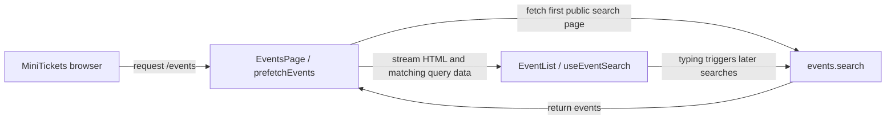

# SSR vs CSR: the catalogue arrives before the visitor writes

History: see [CHANGELOG.md](../CHANGELOG.md) or run `pnpm docs:history`

Area: Frontend · Status: ✅ built in repository; live AWS acceptance is separate

<!-- interview-card: v2 -->

## 1. What is it?

Server-side rendering (SSR) builds a page’s initial HTML on the server. Client-side rendering (CSR) lets browser JavaScript draw and update the interface.

## 2. Why do we need it?

A MiniTickets visitor wants events to appear quickly, then wants responsive searching. Sending the first list already rendered helps the first visit; browser updates handle later typing.

## 3. How does it work?

1. The server sends the page shell while fetching the first list.
2. It sends list HTML and saved query data.
3. The browser attaches interaction and reuses that data, then searches as input changes.

## 4. How do we use it in MiniTickets?

`prefetchEvents` and `useEventSearch` use the same search inputs and cache key, the name identifying those results. This avoids an immediate repeat fetch. Each request keeps its server data separate. A fresh code authorizes scripts for each response, so HTML cannot be shared between visitors; public data caching is separate.

## 5. Interview-ready answer

“MiniTickets combines server and browser rendering. The server fetches the first search page and sends useful HTML with its query data. The browser reuses that state, attaches interaction and handles later searches. Matching query keys prevent duplicate fetching. Our per-request script security makes HTML dynamic and no-store, while correctly keyed public data can still have its own cache.”

## 6. Important follow-up questions

- **Does a Client Component render only in the browser?** No. Next.js can produce its initial HTML on the server.
- **Why does the browser immediately fetch again?** Check whether server and browser inputs/query keys match.
- **What if server prefetch fails?** Inspect internal API reach and logs; the browser can retry.
- **When is static HTML better?** When content tolerates rebuilds and the script-security design supports it.

## 7. Advanced details

Technical reference

### Current rendering and data flow

[SSR](../glossary.md#ssr) and [CSR](../glossary.md#csr) share the catalogue. `apps/web/src/app/events/page.tsx` → `EventsPage`, `EventListWithServerData` validates URL filters and streams a shell/skeleton while the list waits. `apps/web/src/app/layout.tsx` waits for a request; there is no static-site export.

`apps/web/src/features/events/server/prefetch-events.ts` → `prefetchEvents` calls `events.search` with `q: ""`, `limit: 50`, through `http://api:4000`. A per-request QueryClient dehydrates the same infinite-query identity used by `apps/web/src/features/events/hooks/use-event-search.ts` → `useEventSearch`. Hydration attaches browser behavior and reuses data; freshness is **30 seconds**, search debounce **250 ms**.

P10 creates a fresh CSP nonce and marks HTML/RSC **private,no-store**. Sharing another request’s HTML is unsafe. Dynamic rendering still permits correctly keyed public-data caches. `apps/web/src/features/events/server/cached-events.ts` provides an explicit public-data cache, but current search prefetch bypasses that helper and the old list cache to avoid unbounded text/cursor keys. [Cache-aside](cache-aside.md) describes the separate legacy path.

### Reach and investigation

Browser → [ALB](alb.md) uses HTTPS 443, domain DNS and ACM. ALB → web TCP 3000 is admitted by `minitickets-dev-web-sg` from `minitickets-dev-alb-sg`. Web → API uses Service Connect `api:4000`; `minitickets-dev-api-sg` admits TCP **14000** from `minitickets-dev-web-sg`. [ECS service](ecs-service.md) configures this private call. Search is public and needs no password.

Console: ECS → Clusters → `minitickets-dev` → Services → `minitickets-dev-web` → Tasks → task → Networking; service → Configuration and networking → Service Connect. Browser developer tools inspect rendering itself. Missing server lists suggest prefetch logs/internal reach; immediate duplicate fetches suggest mismatched query identity; cross-visitor HTML reuse suggests incorrect cache headers.

### Trade-offs, evidence and growth

SSR costs server work even when data is cached; hydration transfers data and JavaScript. Pure CSR can suit a private tool that tolerates a slower first screen. Static HTML is cheap to deliver but cannot reuse a fresh per-request nonce. A hash-based static CSP or separate public/static routes would be a deliberate redesign.

`pnpm demo:security` covers production-mode HTML/cache acceptance locally; this is not live AWS/CI proof and was not rerun by this rewrite. At 10x, measure time to first byte and cache hit rate; at 100x, evaluate the static-policy redesign deliberately. Read the [current system](../00-big-picture.md), [rendering scenario](../guides/interview-scenarios.md#rendering-models) and [search tour](../guides/infra-explorer.html?tour=search).

### Code anchors

- Anchor: `apps/web/e2e/events.spec.ts` — `response`; follow the numbered comments at this boundary.
- Anchor: `apps/web/src/app/events/page.tsx` — `dynamic`; follow the numbered comments at this boundary.
- Anchor: `apps/web/src/features/events/hooks/use-events.ts` — `useEvents`; follow the numbered comments at this boundary.
- Anchor: `apps/web/src/features/events/server/prefetch-events.ts` — `prefetchEvents`; follow the numbered comments at this boundary.

[Open this piece in the city explorer](../guides/infra-explorer.html?concept=csr-vs-ssr#chapter=24&piece=web-task).

## Where it appears in the story

- [app-story: 1b. Search input, hydration and bounded rows](../app-story.md#1b-search-input-hydration-and-bounded-rows)

