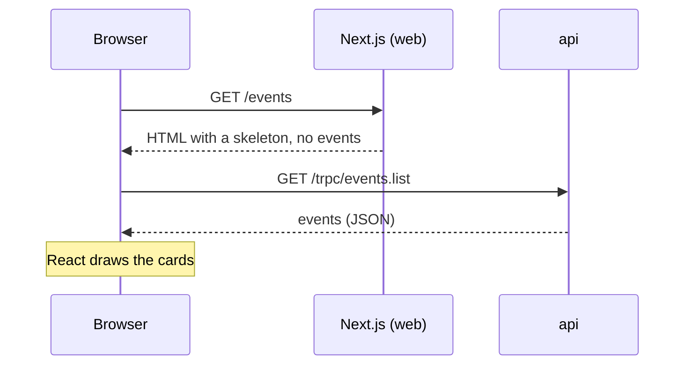

# Client-side vs server-side rendering

History: see [CHANGELOG.md](../CHANGELOG.md) or run `pnpm docs:history`

Area: Frontend · Status: 🟡 partial (CSR built, SSR planned) · Step doc: [21 events list](../../21-events-list.md)

## 1. In one line

With **client-side rendering (CSR)** the browser gets an empty page frame and then fetches the data
itself; with **server-side rendering (SSR)** the server fetches the data first and sends finished
HTML. `/events` is CSR today; SSR is planned so we can compare.

## 2. Real-life comparison

CSR: a restaurant hands you an empty plate and the kitchen sends the food after you sit down. SSR:
the plate arrives with the food already on it.

## 3. Picture it

## 4. Where in our code

- Anchor: `apps/web/src/features/events/hooks/use-events.ts` · `useEvents`: fetches in the browser with `useQuery`.
- Anchor: `apps/web/src/features/events/components/event-card.tsx` · `dateFormat`: `Intl.DateTimeFormat` with no timezone, so dates use the viewer's timezone (the database stores UTC).

Step by step:

1. `app/events/page.tsx` is a Server Component, but it only renders the heading and `<EventList />`.
2. `EventList` is a Client Component (`"use client"`). On the server it renders in its pending
   state, because `useQuery` does not fetch during server rendering. Checked locally:
   `curl localhost:3000/events` contains `aria-label="Loading events"` and none of the event titles.
3. In the browser, React hydrates, `useEvents` calls `events.list`, and the cards appear.
4. Dates: `new Date(startsAt)` from the ISO string, formatted by `Intl.DateTimeFormat`. In the e2e
   run (Chromium) this reads like "Thursday, November 26, 2026 at 12:30 PM".

## 5. See it yourself

DevTools → Network → disable cache, reload `/events`. The first document has the skeleton and no
events; the events arrive in a separate `trpc` request. Or `curl -s localhost:3000/events | grep -c "Indie Rock"` → `0`.

**Break it on purpose:** change your computer's timezone and reload: the same event shows another clock time.

## 6. How it connects

- **Uses ←** [tanstack-query](tanstack-query.md), [server-client-components](server-client-components.md), [trpc-client](trpc-client.md).
- **Gives →** the baseline for the planned SSR step (prefetch on the server and send HTML with the data).

## 7. Our settings and WHY

CSR first, on purpose: it is the simplest version, and we want a measured comparison with SSR later.

## 8. Trade-offs

- **CSR pros:** simple; the page frame appears at once; the api is called straight from the browser.
- **CSR cons:** two round trips before content (HTML, then data); crawlers and slow phones see an empty page for longer; a visible loading state.
- **SSR pros:** content in the first HTML; **cons:** server does more work per request and caching is harder.

## 9. Alternatives and when to choose them

- **SSR:** public, content-heavy pages where first paint and search engines matter.
- **SSG / ISR:** pages that change rarely (build them ahead of time). Not built.
- **CSR:** private, interactive screens such as a dashboard.

## 10. What breaks, and how we'd notice

- A slow api means a long skeleton; the user sees "loading" first. We have no real-user timing yet ([metrics](metrics.md)).
- Server and browser showing different text for the same data (e.g. different timezones) causes a hydration warning. We avoid it because dates render only after the browser fetched the data.

## 13. Interview answers at 3 levels

- **Simple:** CSR draws the page in the browser after fetching data; SSR sends the page already filled in.
- **Senior:** `/events` is a server-rendered frame plus a client component that fetches with TanStack Query, so the first HTML only has a skeleton. Dates are formatted in the browser with `Intl.DateTimeFormat`, so each viewer sees their own timezone.
- **Lead:** Choose per page: SSR for public, SEO-sensitive pages; CSR for private interactive ones. I'd measure both (time to first content, api latency) before deciding. That is why this step records a baseline.

## 14. Follow-up questions interviewers ask

- *Why is SEO worse with CSR?* The first HTML has no content; modern crawlers can run JavaScript but it is slower and less reliable.
- *What is hydration?* React attaching event handlers to server-made HTML.

## 15. Say it in 30 seconds

"Our events page is client-side rendered on purpose: the server sends the frame and a skeleton, the
browser fetches events through TanStack Query. It's the baseline; the next step builds server
rendering so we can compare."

## 16. Status

🟡 partial: CSR built. **Planned:** SSR with server prefetch, and a measured comparison.

## Where it appears in the story

- [App story: 10b. Reading events](../app-story.md#10b-reading-events)
