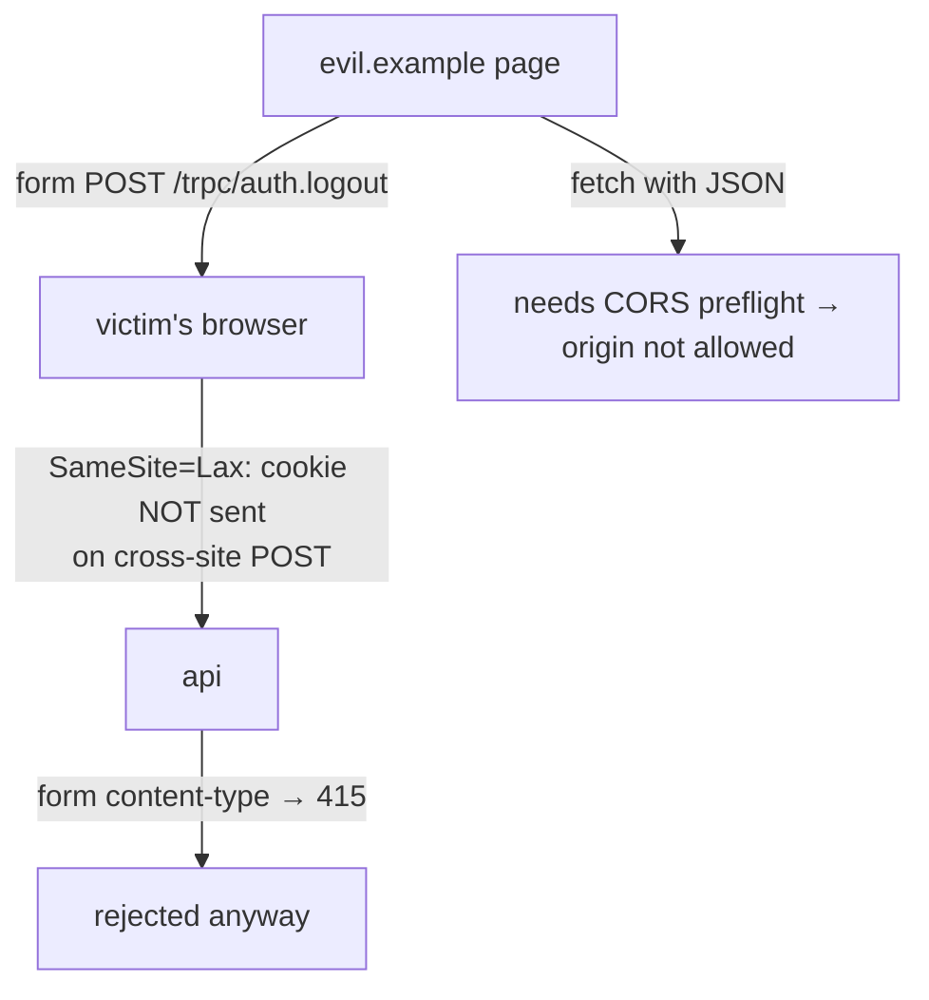

# CSRF (cross-site request forgery)

History: see [CHANGELOG.md](../CHANGELOG.md) or run `pnpm docs:history`

Area: Auth & Security · Status: 🟡 partial (SameSite cookie + JSON-only mutations; no Origin check yet) · Step doc: [07 login](../../07-login-session.md)

## 1. In one line

**CSRF** is another website making the user's browser send a request to our api with the user's
cookie attached; our defences today are `SameSite=Lax` and the fact that mutations only accept JSON.

## 2. Real-life comparison

A forged letter that uses your own letterhead: the bank sees your logo (cookie) and acts on it,
though you never wrote it. Defences: the bank checks the envelope came from your own post office
(SameSite, Origin) and only accepts its own official form (JSON).

## 3. Picture it



## 4. Where in our code

- Anchor: `apps/api/src/procedures/auth.ts` · `cookieOptions.sameSite: "lax"`.

What protects us, step by step:

1. **SameSite=Lax:** the browser does not attach `sid` to cross-site POSTs or `fetch` calls. Only
   top-level GET navigations carry it, and our GETs (`auth.me`, `account.profile`) change nothing.
2. **JSON-only mutations** (observed, not configured by us): a plain HTML form can only send
   `application/x-www-form-urlencoded`, `multipart/form-data` or `text/plain`. Recorded against a
   local api: `text/plain` → tRPC 415 "Unsupported content-type"; form-urlencoded → Fastify 415;
   no content type → tRPC 415.
3. **CORS:** sending `application/json` cross-site needs a preflight, and the api only allows
   `WEB_ORIGIN` ([cors](cors.md)).
4. **Same origin on AWS:** the page and the api are one origin ([same-origin-routing](same-origin-routing.md)).

**Not in our app yet (planned):** an **Origin header check** on state-changing requests, comparing
`Origin` with `WEB_ORIGIN`. The api task definition comment (`infra/src/compute/task.ts`) says
"Step 13 adds a CSRF check that compares each request's Origin header with this value."

## 5. See it yourself

```bash
curl -s -w ' %{http_code}\n' -X POST localhost:4000/trpc/auth.logout -H 'content-type: text/plain' -d '{}'
# {"error":{"message":"Unsupported content-type \"text/plain",…,"httpStatus":415,…}} 415
```

In a browser, make a page on another port with `<form method="POST"
action="http://localhost:4000/trpc/auth.logout">` and submit it while logged in: the request is
rejected and you stay logged in.

**Break it on purpose (thought experiment):** set `sameSite: "none"` and add a mutation that
accepts a form body. A hidden form on any website could now act as the user.

## 6. How it connects

- **Uses ←** [session-cookie](session-cookie.md), [cors](cors.md),
  [same-origin-routing](same-origin-routing.md).
- **Gives →** safe mutations; together with [xss](xss.md) protection, the browser-side security
  story in the [app story](../app-story.md).

## 7. Our settings and WHY

SameSite=Lax rather than Strict: following a link to MiniTickets from email keeps you logged in.
Safe because GETs never change data.

## 8. Trade-offs

- **Pros:** strong protection with no tokens to manage.
- **Cons:** relies on browser SameSite support and on our GETs staying side-effect free; the
  JSON-only rule is a library behaviour, not a policy we own; no Origin check yet.

## 9. Alternatives and when to choose them

- **Origin / `Sec-Fetch-Site` check** (planned): reject cross-site state-changing requests.
- **CSRF tokens** (synchronizer or double-submit): for apps that must accept form posts or older
  browsers.
- **`SameSite=Strict`:** strongest; users arrive logged out from links.

## 10. What breaks, and how we'd notice

A GET that changes state (`/trpc/tickets.delete` as a query) would be reachable by a cross-site
link with the cookie attached. Rule: anything that writes is a mutation.

## 13. Interview answers at 3 levels

- **Simple:** Other websites can't make your browser act on MiniTickets for you.
- **Senior:** The session cookie is SameSite=Lax, so it isn't sent on cross-site POSTs; mutations
  only accept JSON (tRPC and Fastify return 415 for form content types), and JSON cross-origin needs
  a CORS preflight that only `WEB_ORIGIN` passes. On AWS the app is same-origin. An Origin check is
  planned.
- **Lead:** Layer it: SameSite cookies, no state-changing GETs, an explicit Origin or
  `Sec-Fetch-Site` check on writes, and tokens only where forms must be supported. Don't rely on a
  library's content-type behaviour as your only policy.

## 14. Follow-up questions interviewers ask

- *Does CORS stop CSRF?* Partly: it stops reading responses and blocks preflighted requests, but
  simple form posts don't need a preflight.
- *Why does Lax still allow GET?* So links from other sites keep you logged in.

## 15. Say it in 30 seconds

"CSRF is covered by SameSite=Lax on the session cookie, which isn't sent on cross-site POSTs, plus
mutations only accepting JSON, which a plain form can't send and which needs a CORS preflight. On AWS
it's one origin anyway. The missing piece is an explicit Origin check on writes, which is planned."

## 16. Status

🟡 partial. **To make it production-grade:** the planned Origin check on mutations (or
`Sec-Fetch-Site`), and a rule/test that no query changes data.

## Where it appears in the story

- [App story: The app security story](../app-story.md#the-app-security-story)
