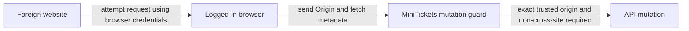

# CSRF (cross-site request forgery)

History: see [CHANGELOG.md](../CHANGELOG.md) or run `pnpm docs:history`

Area: Auth & Security · Status: ✅ built in repository; live AWS acceptance is separate
<!-- interview-card: v2 -->

## 1. What is it?

Cross-site request forgery, or CSRF, tricks a browser into making an unwanted action using an existing login. The attacker relies on credentials the browser sends automatically.

## 2. Why do we need it?

A customer logged into MiniTickets could visit a hostile page that tries to submit a booking or logout request. We must reject that foreign action even if its response cannot be read.

## 3. How does it work?

1. Inspect the origin for every state-changing request.
2. Reject missing or unexpected origin and cross-site metadata.
3. Then authenticate and authorize the requested operation.

## 4. How do we use it in MiniTickets?

Our HTTP guard applies to non-safe methods. CLI callers explicitly provide Origin. SameSite cookies and browser CORS rules add protection, while trusted-page script injection remains a separate threat.

## 5. Interview-ready answer

“MiniTickets protects state-changing requests with an exact trusted Origin check and cross-site fetch-metadata rejection. A missing Origin is rejected too. CORS governs browser response access, so it is not enough to prevent side effects. These checks supplement sessions and authorization; they do not turn a caller-provided header into identity.”

## 6. Important follow-up questions

- **Does CORS alone stop CSRF?** No. Some requests can have effects even when their responses are unreadable.
- **Can a CLI set Origin?** Yes. It is a browser-security signal, not cryptographic authentication.
- **What if a legitimate CLI has no Origin?** It must follow our explicit request contract and include it.
- **Can XSS bypass these checks?** Code running on the trusted origin can make allowed-looking requests; output safety still matters.

## 7. Advanced details

Technical reference

### Source references

- Anchor: `apps/api/src/http/security.ts` — `mutationAllowed`; follow the numbered comments at this boundary.
- Anchor: `apps/api/src/procedures/auth.ts` — `cookieOptions`; follow the numbered comments at this boundary.

`apps/api/src/http/security.ts` → `mutationAllowed` guards all non-safe methods, including missing-Origin refusal. CLI callers explicitly send Origin. `pnpm demo:security` exercises same/cross/missing metadata and cookie isolation; one isolated inverted-origin mutation made both relevant tests fail.

### Configuration and design

CSRF is an authenticated action induced by a foreign site. Exact trusted Origin plus Sec-Fetch-Site checks protect mutations, including rejecting missing Origin; CORS and SameSite are additional independent controls. A request can cause side effects even if its response is unreadable.

### Checks and troubleshooting

Run `pnpm demo:security` and inspect the asserted outcome described above.

Is Origin cryptographic API authentication? No; non-browser clients can set it. Sessions still authorize actions. Do not change a live stack to demonstrate it.

Does CORS alone stop CSRF side effects? **No.**

### Trade-offs and alternatives

Non-browser clients must follow the explicit Origin contract; XSS on the trusted origin bypasses CSRF defenses, so output safety/CSP still matter. Proxy headers need their own trust policy.

10x: centralize trusted origin/environment validation. 100x: service-to-service auth and tenant origin rules with tests.

### Further technical context

CSRF tricks a browser into sending an authenticated action from another site. CORS controls whether browser code can read cross-origin responses; it is not a mutation authorization check. SameSite helps but is not the entire policy. MiniTickets requires the exact trusted Origin on mutations and rejects cross-site Sec-Fetch-Site.

### Related reading

Uses the [current system](../00-big-picture.md); gives a concrete decision to the [scenario](../guides/interview-scenarios.md#csrf-cors) and [explorer tour](../guides/infra-explorer.html?tour=security-layers).

[Open this piece in the city explorer](../guides/infra-explorer.html?concept=csrf#chapter=8&piece=api-task).

## Where it appears in the story

- [app-story: 4b. Mutation admission and browser security](../app-story.md#4b-mutation-admission-and-browser-security)

