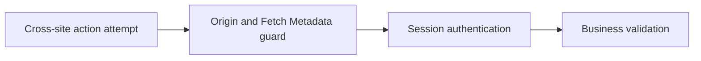

# CSRF (cross-site request forgery)

History: see [CHANGELOG.md](../CHANGELOG.md) or run `pnpm docs:history`

Area: Auth & Security · Status: ✅ built in repository; live AWS acceptance is separate

## 1. In one line

CSRF is an authenticated action induced by a foreign site. Exact trusted Origin plus Sec-Fetch-Site checks protect mutations, including rejecting missing Origin; CORS and SameSite are additional independent controls.

## 2. Real-life comparison

A guard checks both the visitor and the particular action; a readable invitation is not permission to every room.

## 3. Picture it

## 4. Where in our code

- Anchor: `apps/api/src/http/security.ts` — `mutationAllowed`; follow the numbered comments at this boundary.
- Anchor: `apps/api/src/procedures/auth.ts` — `cookieOptions`; follow the numbered comments at this boundary.

`apps/api/src/http/security.ts` → `mutationAllowed` guards all non-safe methods, including missing-Origin refusal. CLI callers explicitly send Origin. `pnpm demo:security` exercises same/cross/missing metadata and cookie isolation; one isolated inverted-origin mutation made both relevant tests fail.

## 5. See it yourself

Run `pnpm demo:security` and inspect the asserted outcome described above.

Failure thought experiment: Is Origin cryptographic API authentication? No; non-browser clients can set it. Sessions still authorize actions. Do not change a live stack to demonstrate it.

## 6. How it connects

Uses the [current system](../00-big-picture.md); gives a concrete decision to the [scenario](../guides/interview-scenarios.md#csrf-cors) and [explorer tour](../guides/infra-explorer.html?tour=security-layers).

## 7. Our settings and WHY

CSRF is an authenticated action induced by a foreign site. Exact trusted Origin plus Sec-Fetch-Site checks protect mutations, including rejecting missing Origin; CORS and SameSite are additional independent controls. A request can cause side effects even if its response is unreadable.

## 8. Trade-offs

Non-browser clients must follow the explicit Origin contract; XSS on the trusted origin bypasses CSRF defenses, so output safety/CSP still matter. Proxy headers need their own trust policy.

## 9. Alternatives and when to choose them

10x: centralize trusted origin/environment validation. 100x: service-to-service auth and tenant origin rules with tests.

## 10. What breaks and how we notice

Is Origin cryptographic API authentication? No; non-browser clients can set it. Sessions still authorize actions.

## 13. Interview answers at 3 levels

- **Simple:** CSRF is an authenticated action induced by a foreign site.
- **Senior:** CSRF tricks a browser into sending an authenticated action from another site. CORS controls whether browser code can read cross-origin responses; it is not a mutation authorization check. SameSite helps but is not the entire policy. MiniTickets requires the exact trusted Origin on mutations and rejects cross-site Sec-Fetch-Site.
- **Lead:** 10x: centralize trusted origin/environment validation. 100x: service-to-service auth and tenant origin rules with tests.

## 14. Follow-up questions with answers

Is Origin cryptographic API authentication? No; non-browser clients can set it. Sessions still authorize actions.

Does CORS alone stop CSRF side effects? **No.**

## 15. Say it in 30 seconds

CSRF tricks a browser into sending an authenticated action from another site. CORS controls whether browser code can read cross-origin responses; it is not a mutation authorization check. SameSite helps but is not the entire policy. MiniTickets requires the exact trusted Origin on mutations and rejects cross-site Sec-Fetch-Site.

## 16. Status and production work

Repository implementation and local evidence are described above. Live AWS/CI execution remains owner acceptance. 10x: centralize trusted origin/environment validation. 100x: service-to-service auth and tenant origin rules with tests.

## Where it appears in the story

- [app-story: 4b. Mutation admission and browser security](../app-story.md#4b-mutation-admission-and-browser-security)
