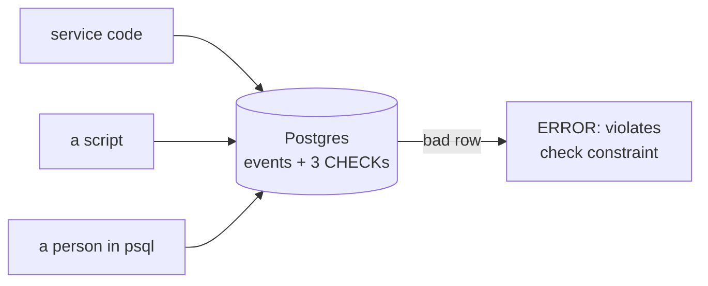

# Database CHECK constraints

History: see [CHANGELOG.md](../CHANGELOG.md) or run `pnpm docs:history`

Area: Data · Status: ✅ built · Step doc: [21 events list](../../21-events-list.md)

## 1. In one line

A **CHECK constraint** is a rule written into the table ("`seats_left` can never be bigger than
`total_seats`") that Postgres enforces on every insert and update, whoever sends it.

## 2. Real-life comparison

A turnstile at a stadium. It does not care whether you came from the main gate, the side door or
with a staff pass: if the ticket is wrong, it does not turn. App-level checks are the guard at the
main gate only.

## 3. Picture it



## 4. Where in our code

- Anchor: `apps/api/src/db/schema/events.ts` · `events`: three `check(...)` calls in the table's second argument.

Step by step:

1. `events_total_seats_positive`: `total_seats > 0`.
2. `events_seats_left_not_negative`: `seats_left >= 0`.
3. `events_seats_left_within_total`: `seats_left <= total_seats`.
4. `drizzle-kit generate` puts them in `apps/api/drizzle/0001_*.sql` as `CONSTRAINT ... CHECK (...)`, so
   they exist in every environment the migration runs in ([migrations](migrations.md)).
5. Nothing in the api code checks these rules yet. The database is the only guard, on purpose, for now.

## 5. See it yourself

```bash
docker exec minitickets-postgres-1 psql -U minitickets -d minitickets -c \
 "insert into events (title,venue,starts_at,total_seats,seats_left) values ('Bad','X',now(),10,11);"
# ERROR:  new row for relation "events" violates check constraint "events_seats_left_within_total"
```

We ran this locally. `(0, 0)` fails with `events_total_seats_positive` and `(10, -1)` fails with
`events_seats_left_not_negative`. `select count(*) from events` stayed at 12.

**Break it on purpose:** remove one `check(...)` from the schema, generate a migration, apply it, and
repeat the insert: the bad row is saved.

## 6. How it connects

- **Uses ←** [drizzle-schema](drizzle-schema.md) and [migrations](migrations.md).
- **Gives →** a safety net for the booking step (not built): when two buyers race for the last seat,
  the constraint stops `seats_left` from going below 0 even if the code has a bug
  ([unique-constraint-race](unique-constraint-race.md) is the same idea for emails).

## 7. Our settings and WHY

Three small named constraints, not one big one. WHY: the error message names the exact rule that failed.

## 8. Trade-offs

- **Pros:** works for every writer; cannot be forgotten; costs almost nothing per write.
- **Cons:** the error is a raw Postgres error, so the app must translate it into a friendly message
  (as `queries/users.ts` does for the unique violation); changing a rule needs a migration.

## 9. Alternatives and when to choose them

- **Validate only in the service:** friendlier messages, but any other writer can bypass it.
- **Triggers:** for rules that look at other rows or tables; a CHECK sees only its own row.
- **Enum types / foreign keys:** for "value must be one of these" and "must point to a real row".

## 10. What breaks, and how we'd notice

- Seeding or importing data that breaks a rule: the whole statement fails with a named constraint.
- A NULL passes a CHECK (the result is "unknown"), which is why the columns are also `NOT NULL`.
- Adding a CHECK to a big existing table scans it; in production this needs care ("expand and contract").

## 13. Interview answers at 3 levels

- **Simple:** The database refuses bad data by itself.
- **Senior:** `events` has three CHECKs on seat counts. Postgres evaluates them per row on insert and
  update, so a buggy service or a manual query cannot create "12 seats left of 10". NULLs pass a
  CHECK, so the columns are `NOT NULL` too.
- **Lead:** Put invariants that must never be false in the database, and keep friendly validation in
  the app. With concurrent bookings, `seats_left >= 0` is the last line of defence; the real fix is an
  atomic `update ... where seats_left > 0`. Adding constraints to a large live table needs a plan.

## 14. Follow-up questions interviewers ask

- *Why not just validate in code?* Code is one door; the database is the building.
- *Do CHECKs cover NULL?* No: a NULL makes the check "unknown", which passes. Use `NOT NULL` as well.

## 15. Say it in 30 seconds

"Our events table has three CHECK constraints: seats are positive, seats left isn't negative and
isn't more than the total. Postgres enforces them for every writer, I showed an insert with 11 of 10
failing in psql, and the app still needs friendly errors on top."

## 16. Status

✅ built. **To make it production-grade:** translate constraint violations into friendly errors when
the booking step writes `seats_left`.

## Where it appears in the story

- [App story: 10b. Reading events](../app-story.md#10b-reading-events)
