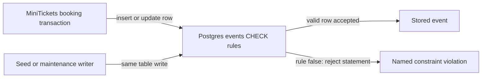

# Database CHECK constraints

History: see [CHANGELOG.md](../CHANGELOG.md) or run `pnpm docs:history`

Area: Data · Status: ✅ built · Step doc: [21 events list](../../21-events-list.md)
<!-- interview-card: v2 -->

## 1. What is it?

A CHECK constraint is a rule stored with a database table. Postgres refuses a row when its values violate that rule, whichever writer sent it.

## 2. Why do we need it?

A buggy MiniTickets script must not save eleven seats left for an event with ten total seats. Application validation is one entrance; the database rule guards every entrance.

## 3. How does it work?



1. Define the invariant beside the schema.
2. Apply it through a migration.
3. Let Postgres enforce it on each inserted or updated row.

## 4. How do we use it in MiniTickets?

Events require positive total seats and remaining seats within bounds. Current booking also checks availability while holding a transaction lock. Shared input schemas provide friendly early validation; constraints remain the final safeguard for every writer.

## 5. Interview-ready answer

“MiniTickets puts seat invariants in Postgres: total seats must be positive, and remaining seats must stay between zero and the total. This protects scripts and concurrent application writers alike. The booking transaction still locks and validates the sale; constraints backstop those decisions instead of replacing a correct concurrency design.”

## 6. Important follow-up questions

- **Why not validate only in the service?** Other writers and future code can bypass it; the stored invariant must still hold.
- **Does CHECK reject NULL automatically?** No. Unknown passes, so required fields also need NOT NULL.
- **Can CHECK enforce any cross-row rule?** No. It is suited to row-local rules; other constraints or transactional designs handle wider invariants.
- **What if existing rows violate a new rule?** Adding the constraint can fail and scan existing data; plan validation and rollout carefully.

## 7. Advanced details

<details>
<summary>Technical reference</summary>

### Current reading notes

Current events has three named checks; users also restricts roles, and bookings restricts quantity/status. The old “booking not built” and “no API validation” statements are obsolete. Historical invalid-insert examples below were recorded locally and not rerun. The transaction locks availability before decrementing; unexpected constraint errors still need diagnosis.

### Implementation reference

- Anchor: `apps/api/src/db/schema/events.ts` · `events`: three `check(...)` calls in the table's second argument.

Step by step:

1. `events_total_seats_positive`: `total_seats > 0`.
2. `events_seats_left_not_negative`: `seats_left >= 0`.
3. `events_seats_left_within_total`: `seats_left <= total_seats`.
4. `drizzle-kit generate` puts them in `apps/api/drizzle/0001_*.sql` as `CONSTRAINT ... CHECK (...)`, so
   they exist in every environment the migration runs in ([migrations](migrations.md)).
5. Current booking code also checks availability under a transaction lock, and shared schemas validate inputs. CHECK constraints remain the final rule for every writer.

### Inspection and historical evidence

```bash
docker exec minitickets-postgres-1 psql -U minitickets -d minitickets -c \
 "insert into events (title,venue,starts_at,total_seats,seats_left) values ('Bad','X',now(),10,11);"
# ERROR:  new row for relation "events" violates check constraint "events_seats_left_within_total"
```

We ran this locally. `(0, 0)` fails with `events_total_seats_positive` and `(10, -1)` fails with
`events_seats_left_not_negative`. `select count(*) from events` stayed at 12.

**Break it on purpose:** remove one `check(...)` from the schema, generate a migration, apply it, and
repeat the insert: the bad row is saved.

### Settings and reasoning

Three small named constraints, not one big one. WHY: the error message names the exact rule that failed.

### Trade-offs

- **Pros:** works for every writer; cannot be forgotten; costs almost nothing per write.
- **Cons:** the error is a raw Postgres error, so the app must translate it into a friendly message
  (as `queries/users.ts` does for the unique violation); changing a rule needs a migration.

### Alternatives and scaling

- **Validate only in the service:** friendlier messages, but any other writer can bypass it.
- **Triggers:** for rules that look at other rows or tables; a CHECK sees only its own row.
- **Enum types / foreign keys:** for "value must be one of these" and "must point to a real row".

### Failure diagnosis

- Seeding or importing data that breaks a rule: the whole statement fails with a named constraint.
- A NULL passes a CHECK (the result is "unknown"), which is why the columns are also `NOT NULL`.
- Adding a CHECK to a big existing table scans it; in production this needs care ("expand and contract").

### Further questions

- *Why not just validate in code?* Code is one door; the database is the building.
- *Do CHECKs cover NULL?* No: a NULL makes the check "unknown", which passes. Use `NOT NULL` as well.

### Status and remaining work

✅ built. Booking is now built: the transaction checks availability before writing; unexpected constraint violations still need clear diagnosis.

### Related reading

- [drizzle-schema](drizzle-schema.md)
- [unique-constraint-race](unique-constraint-race.md)

[Open this piece in the city explorer](../guides/infra-explorer.html?concept=db-check-constraints#chapter=24&piece=code-store).

## Where it appears in the story

- [App story: 10b. Reading events](../app-story.md#10b-reading-events)

</details>
