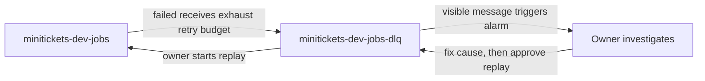

# DLQ: the city repair tray

History: see [CHANGELOG.md](../CHANGELOG.md) or run `pnpm docs:history`

Area: Reliability · Status: ✅ built in repository; live AWS acceptance is separate
<!-- interview-card: v2 -->

## 1. What is it?

A [dead-letter queue](../glossary.md#dead-letter-queue), or DLQ, holds messages that kept failing. It gives us time to investigate and recover unfinished work.

## 2. Why do we need it?

Suppose our email provider keeps rejecting a booking email. Retrying forever would keep spending effort on the same problem. MiniTickets moves it aside so someone can repair the cause and try again.

## 3. How does it work?

1. The worker reports failure and leaves the message undeleted.
2. SQS moves repeatedly received failures into the DLQ.
3. The owner traces logs, repairs the cause and explicitly replays the work.

## 4. How do we use it in MiniTickets?

Email and tickets each have a separate DLQ. The current not-empty alarm watches the email DLQ. `createJobQueues` defines the retry boundary; the worker does not send messages there. Live alarm delivery and replay checks remain pending.

## 5. Interview-ready answer

“A DLQ is MiniTickets' repair queue for work that exhausted its retries. It preserves the failed message for investigation, rather than fixing it automatically. I follow its correlation ID, repair the cause and then have the owner replay it at a controlled rate. Replay can repeat effects, so deduplication still matters.”

## 6. Important follow-up questions

- **Does a DLQ guarantee recovery?** No. Messages expire; someone must notice, diagnose and act in time.
- **Should we replay immediately?** Repair the cause first, then pace replay to consumer and provider capacity.
- **Is this Lambda's asynchronous DLQ?** No. This DLQ belongs to the SQS source queue.
- **Can healthy work land there?** Yes. Short visibility or throttled invocations can consume receives without useful progress.

## 7. Advanced details

Technical reference

### Configuration and security

`minitickets-dev-jobs` names `minitickets-dev-jobs-dlq` in its redrive policy with `maxReceiveCount: 3`; movement occurs when receives exceed that budget, not at a guaranteed wall-clock deadline. The worker delays failed email records by 10, 40 and 120 seconds. The DLQ allow policy uses `byQueue` and permits only the matching source ARN. Workers have no DLQ permissions.

`minitickets-dev-jobs-dlq-not-empty` watches `ApproximateNumberOfMessagesVisible` in `AWS/SQS`: Maximum, 60-second period, one evaluation period, greater than zero. Missing data uses `ignore` so silence does not itself clear the last alarm state. Alarm actions use `minitickets-dev-alerts`; its policy allows `cloudwatch.amazonaws.com` only from the configured alarm/account. Notification subscription and delivery still require separate owner acceptance.

Email source visibility is 60 seconds; tickets use 180 seconds. Both mappings enable `ReportBatchItemFailures`, so successful neighboring records are deleted while failures retry. A whole invocation crash/timeout is different: unfinished batch records can reappear. SQS APIs use HTTPS 443; queues have no security group or password, and owner actions use temporary AWS credentials.

### Implementation and operational limits

- Anchor: `infra/src/jobs/queues.ts` — `createJobQueues`; follow the numbered comments at this boundary.

Sources retain messages for four days; DLQs are configured for 14 days. For standard queues, expiry still uses the original enqueue time: this is not fourteen fresh days after arrival. The DLQ's age metric measures time since movement, so do not confuse that metric with total retention. [AWS documents this distinction](https://docs.aws.amazon.com/AWSSimpleQueueService/latest/SQSDeveloperGuide/sqs-dead-letter-queues.html).

`minitickets-dev-tickets-dlq` is a separate repair tray, restricted to `minitickets-dev-tickets`; tickets do not have the email visible-count alarm. Both DLQs use SQS-managed encryption. A short source visibility timeout can repeat healthy work; mapping/reserved-concurrency mismatch can exhaust receives without useful execution.

Use `pnpm jobs:dlq` locally. [AWS redrive](https://docs.aws.amazon.com/AWSSimpleQueueService/latest/SQSDeveloperGuide/sqs-configure-dead-letter-queue-redrive.html) needs receive/delete/attribute permissions on the DLQ, `sqs:StartMessageMoveTask`, and send permission on the destination; encrypted queues can need extra KMS grants. Redrive should be rate-limited to consumer/provider capacity. Never treat an empty source queue as proof of customer delivery. The [failure scenario](../guides/interview-scenarios.md#dlq-failure) and deploy-day runbook §3.12 cover diagnosis. No live redrive or alarm drill is claimed; prices and deployed account state require separate checks.

### Source references

`infra/src/jobs/queues.ts` → `createJobQueues`.

`infra/src/observability/alarm-specs.ts` → `alarmSpecs`; `apps/worker/src/batch.ts` → `handleBatch`.

### Console and troubleshooting

`us-east-1` → **SQS → Queues → minitickets-dev-jobs-dlq → Dead-letter queue redrive**. Inspect move history; **Start DLQ redrive** changes live work and is an owner step. **CloudWatch → Alarms → All alarms → minitickets-dev-jobs-dlq-not-empty** shows the watched count.

- DLQ grows → worker logs by `correlationId` → repair schema, SES identity or permissions before replay.
- No alert → alarm history and SNS subscription → confirm subscription; prove notification delivery separately.

### Trade-offs and related concepts

- Pick endless retries when the work must wait indefinitely; MiniTickets' Postgres outbox does this before SNS.
- Pick a DLQ when a bounded retry budget needs human repair.

| Neighbor | Direction | What allows it | Console check |
| --- | --- | --- | --- |
| [SQS](sqs.md) | in/back | Redrive policies; owner replay | SQS → source → Dead-letter queue |
| [CloudWatch](cloudwatch-logs.md) | out | Visible-count metric + alarm | CloudWatch → Alarms |
| [Lambda](aws-lambda.md) | cause | Failed records stay undeleted | Lambda → worker → Monitor |

[Open this piece in the city explorer](../guides/infra-explorer.html?concept=dead-letter-queue#chapter=24&piece=email-dlq).

## Where it appears in the story

- [app-story: 9c. Side path: outbox, fan-out and recoverable work](../app-story.md#9c-side-path-outbox-fan-out-and-recoverable-work)

