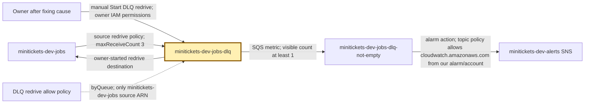
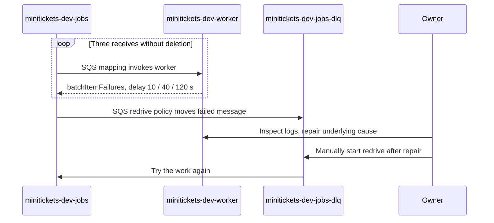

# DLQ: the city repair tray

History: see [CHANGELOG.md](../CHANGELOG.md) or run `pnpm docs:history`

Area: Reliability · Status: ✅ built in repository; live AWS acceptance is separate
<!-- interview-card: v1 -->

## 1. In one line

MiniTickets keeps repeatedly failed email work in a [dead-letter queue](../glossary.md#dead-letter-queue), a repair tray that a person must investigate.

## 2. Where it sits

[Open this piece in the city explorer](../guides/infra-explorer.html?concept=dead-letter-queue#chapter=24&piece=email-dlq).

## 3. How it works

## 4. What happens in MiniTickets

1. SES rejects a booking email, or the handler cannot finish it.
2. The worker leaves that message undeleted. Three receives exhaust its retry budget.
3. SQS moves it from `minitickets-dev-jobs` to `minitickets-dev-jobs-dlq`.
4. The visible-count alarm watches for at least one message.
5. The owner finds the cause, fixes it, then explicitly sends work back. Nothing automatically repairs or redrives it.

## 5. Reach / Allowed / Password

**Reach:** SQS HTTPS on 443; no security group on the tray.

**Allowed:** its redrive allow policy names only its source queue; manual redrive needs owner IAM rights.

**Password:** temporary AWS credentials; workers have no DLQ permission.

## 6. In our code

`infra/src/jobs/queues.ts` → `createJobQueues`.

`infra/src/observability/alarm-specs.ts` → `alarmSpecs`; `apps/worker/src/batch.ts` → `handleBatch`.

## 7. In the AWS console

`us-east-1` → **SQS → Queues → minitickets-dev-jobs-dlq → Dead-letter queue redrive**. Inspect move history; **Start DLQ redrive** changes live work and is an owner step. **CloudWatch → Alarms → All alarms → minitickets-dev-jobs-dlq-not-empty** shows the watched count.

## 8. Good / Bad

**Good:** failed work stays findable; one bad message stops consuming normal retries.

**Bad:** messages still expire; replaying before repair repeats the failure.

## 9. Other choices

- Pick endless retries when the work must wait indefinitely; MiniTickets' Postgres outbox does this before SNS.
- Pick a DLQ when a bounded retry budget needs human repair.

## 10. Connected to

| Neighbor | Direction | What allows it | Console check |
| --- | --- | --- | --- |
| [SQS](sqs.md) | in/back | Redrive policies; owner replay | SQS → source → Dead-letter queue |
| [CloudWatch](cloudwatch-logs.md) | out | Visible-count metric + alarm | CloudWatch → Alarms |
| [Lambda](aws-lambda.md) | cause | Failed records stay undeleted | Lambda → worker → Monitor |

## 11. When it breaks

- DLQ grows → worker logs by `correlationId` → repair schema, SES identity or permissions before replay.
- No alert → alarm history and SNS subscription → confirm subscription; prove notification delivery separately.

## 12. Say it in 30 seconds

“Our DLQ is a repair tray, not proof that work succeeded. After three unsuccessful receives, SQS moves an email there and an alarm watches it. I trace the booking through logs, repair the cause, then the owner redrives it. Deduplication still matters because replay may repeat work.”

## 13. Likely follow-ups

**Who moves failures?** SQS, using queue policies; the worker does not send them there.

**Is this Lambda's asynchronous DLQ?** No. It belongs to the SQS source queue.

## 14. Remember it

The repair tray buys time to fix work; it never fixes work itself.

## 15. More detail

Retention, diagnosis and replay limits

- Anchor: `infra/src/jobs/queues.ts` — `createJobQueues`; follow the numbered comments at this boundary.

Sources retain messages for four days; DLQs are configured for 14 days. For standard queues, expiry still uses the original enqueue time: this is not fourteen fresh days after arrival. The DLQ's age metric measures time since movement, so do not confuse that metric with total retention. [AWS documents this distinction](https://docs.aws.amazon.com/AWSSimpleQueueService/latest/SQSDeveloperGuide/sqs-dead-letter-queues.html).

`minitickets-dev-tickets-dlq` is a separate repair tray, restricted to `minitickets-dev-tickets`. The current visible-count alarm specifically watches the email DLQ; do not assume tickets have the same alarm. Both DLQs use SQS-managed encryption. A short source visibility timeout can repeat healthy work; mapping/reserved-concurrency mismatch can exhaust receives without useful execution. Partial-batch reporting prevents one bad record from retrying good neighbors.

Use `pnpm jobs:dlq` locally. [AWS redrive](https://docs.aws.amazon.com/AWSSimpleQueueService/latest/SQSDeveloperGuide/sqs-configure-dead-letter-queue-redrive.html) needs receive/delete/attribute permissions on the DLQ, `sqs:StartMessageMoveTask`, and send permission on the destination; encrypted queues can need extra KMS grants. Redrive should be rate-limited to consumer/provider capacity. Never treat an empty source queue as proof of customer delivery. The [failure scenario](../guides/interview-scenarios.md#dlq-failure) and deploy-day runbook §3.12 cover diagnosis. No live redrive or alarm drill is claimed; prices and deployed account state require separate checks.

## Where it appears in the story

- [app-story: 9c. Side path: outbox, fan-out and recoverable work](../app-story.md#9c-side-path-outbox-fan-out-and-recoverable-work)
