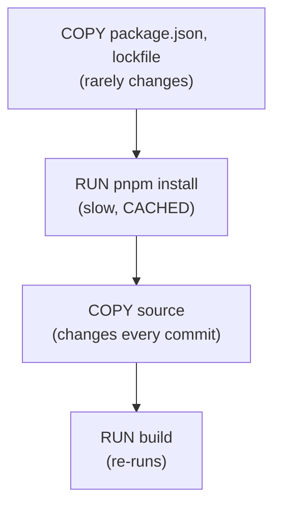

# Docker layer caching

History: see [CHANGELOG.md](../CHANGELOG.md) or run `pnpm docs:history`

Area: DevOps & CI/CD · Status: ✅ built · Step doc: [11 docker](../../11-docker.md), [10 CI](../../10-ci.md)

## 1. In one line

Docker saves the result of each instruction as a **layer** and reuses it when the inputs haven't
changed; we order the Dockerfiles so the slow install is reused on almost every build, and CI keeps
those layers between runs.

## 2. Real-life comparison

Baking a layered cake where yesterday's bottom layers are still in the fridge: if only the icing
changed, you only redo the icing.

## 3. Picture it



## 4. Where in our code

- Anchor: `apps/api/Dockerfile` · step 4 (package files only) and step 5 (`--mount=type=cache` for the pnpm store).
- Anchor: `apps/web/Dockerfile` · steps 4-5, the same pattern.
- Anchor: `.github/workflows/ci.yml` · `docker` job: `cache-from: type=gha,scope=api`, `cache-to: type=gha,mode=max,scope=api` (and `web`).

Step by step:

1. Copy only `package.json` files, `pnpm-lock.yaml`, `pnpm-workspace.yaml`.
2. `pnpm install`: its layer key is those files, so a code-only change reuses it.
3. `RUN --mount=type=cache,id=pnpm-store,…`: a BuildKit cache mount keeps pnpm's download store
   between builds on the same machine, even when the lockfile changes. It is not part of the image.
4. Copy the sources, then build: these re-run on every code change, as they must.
5. In the runtime stage, `node_modules` is copied **before** `dist/`, so a code change doesn't
   invalidate the dependencies layer of the final image either.
6. CI runners start empty, so the `docker` job stores layers in the GitHub Actions cache
   (`type=gha`). `mode=max` also stores layers of intermediate stages; `scope` keeps api and web
   apart.
7. `.dockerignore` keeps `node_modules`, build output, `.env*`, `.git` and docs out of the build
   context, so they never bust the cache or leak in.

## 5. See it yourself

```bash
docker build -f apps/api/Dockerfile -t mt-api .      # first build: slow
echo "// touch" >> apps/api/src/server.ts
docker build -f apps/api/Dockerfile -t mt-api .      # install steps say CACHED
git checkout apps/api/src/server.ts
```

In GitHub Actions, the docker job log shows `CACHED` for unchanged steps.

**Break it on purpose:** move `COPY apps/api apps/api` above `RUN pnpm install`. Every code edit
now reinstalls all dependencies.

## 6. How it connects

- **Uses ←** [docker-multi-stage](docker-multi-stage.md), BuildKit / Buildx.
- **Gives →** fast local builds and a fast [ci-pipeline](ci-pipeline.md) docker job;
  `pnpm images:push` on the laptop.

## 7. Our settings and WHY

Package files first, cache mount for the store, GHA cache with separate scopes. WHY: installs are
the slowest step and change least often.

## 8. Trade-offs

- **Pros:** most builds skip the install; CI builds stay quick.
- **Cons:** cache invalidation surprises (any change to any `package.json` re-installs); GHA cache
  has a size limit and is evicted (as I understand GitHub's policy; not checked).

## 9. Alternatives and when to choose them

- **Registry cache** (`type=registry`, e.g. in ECR): shared between CI and laptops.
- **`pnpm fetch`** (install from the lockfile only, before copying `package.json` files): even
  better cache hits in monorepos.

## 10. What breaks, and how we'd notice

A misordered `COPY`: builds get slow; the build log shows no `CACHED` steps.

## 13. Interview answers at 3 levels

- **Simple:** Docker reuses the parts of a build that didn't change.
- **Senior:** We copy only lockfile and package files before `pnpm install`, so code changes reuse
  the install layer; a BuildKit cache mount keeps the pnpm store; in the runtime stage dependencies
  come before code; CI uses the GHA cache with `mode=max` per image.
- **Lead:** Order instructions by change frequency and share caches across machines. With more
  images I'd move to a registry cache and measure build time per stage.

## 14. Follow-up questions interviewers ask

- *Layer cache vs cache mount?* A layer is part of the image result; a cache mount is a scratch
  folder kept between builds and never in the image.
- *What busts the cache?* Any change to a copied file or an earlier instruction.

## 15. Say it in 30 seconds

"The Dockerfiles copy only package files before pnpm install, so code changes reuse the install
layer; a BuildKit cache mount keeps pnpm's store, and dependencies are copied before code in the
final stage. CI keeps layers in the GitHub Actions cache, separately for api and web."

## 16. Status

✅ built.

## Where it appears in the story

- [App story: 15. Docker](../app-story.md#15-docker)
