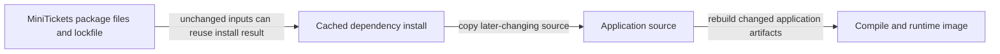

# Docker layer caching

History: see [CHANGELOG.md](../CHANGELOG.md) or run `pnpm docs:history`

Area: DevOps & CI/CD · Status: ✅ built · Step doc: [11 docker](../../11-docker.md), [10 CI](../../10-ci.md)
<!-- interview-card: v2 -->

## 1. What is it?

Docker build caching reuses earlier results when their inputs have not changed. Instruction order decides how much work a small code change must repeat.

## 2. Why do we need it?

A MiniTickets text change should not download every dependency again. Package manifests change less often than source, so we install from those inputs before copying application code.

## 3. How does it work?



1. Copy dependency inputs before application source.
2. Reuse the install result when those inputs match.
3. Rebuild later stages whose code inputs changed.

## 4. How do we use it in MiniTickets?

API, web and worker Dockerfiles use this ordering and a BuildKit download-store cache. CI imports and exports build layers with separate image scopes. `.dockerignore` removes irrelevant and sensitive files from the build context.

## 5. Interview-ready answer

“MiniTickets orders Docker instructions by how often their inputs change. Package files and the lockfile come before installation, then source and compilation. A download-store cache helps when installation must rerun, while CI shares build layers between runs. These are different caches, and a cache miss must still produce a correct build.”

## 6. Important follow-up questions

- **Layer cache versus cache mount?** One reuses an instruction result; the other preserves a build-time working directory.
- **What if the lockfile changes?** Dependency installation must rerun, though downloaded packages may be reused.
- **Does a cache belong in the shipped app?** The build-time package-store cache is not copied into the runtime image.
- **What if builds suddenly slow down?** Inspect changed inputs, instruction order and cache availability rather than assuming cache hits.

## 7. Advanced details

<details>
<summary>Technical reference</summary>

### Source references

- Anchor: `apps/api/Dockerfile` · step 4 (package files only) and step 5 (`--mount=type=cache` for the pnpm store).
- Anchor: `apps/web/Dockerfile` · steps 4-5, the same pattern.
- Anchor: `.github/workflows/ci.yml` · `docker` job: `cache-from: type=gha,scope=api`, `cache-to: type=gha,mode=max,scope=api` (and `web`).
- Anchor: `apps/worker/Dockerfile` · step 2: the same pattern for the worker image (S1c).

Step by step:

1. Copy only `package.json` files, `pnpm-lock.yaml`, `pnpm-workspace.yaml`.
2. `pnpm install`: its layer key is those files, so a code-only change reuses it.
3. `RUN --mount=type=cache,id=pnpm-store,…`: a BuildKit cache mount keeps pnpm's download store
   between builds on the same machine, even when the lockfile changes. It is not part of the image.
4. Copy the sources, then build: these re-run on every code change, as they must.
5. In the runtime stage, `node_modules` is copied **before** `dist/`, so a code change doesn't
   invalidate the dependencies layer of the final image either.
6. CI runners start empty, so the `docker` job stores layers in the GitHub Actions cache
   (`type=gha`). `mode=max` also stores layers of intermediate stages; `scope` keeps api and web
   apart.
7. `.dockerignore` keeps `node_modules`, build output, `.env*`, `.git` and docs out of the build
   context, so they never bust the cache or leak in.

### Configuration and design

Package files first, cache mount for the store, GHA cache with separate scopes. WHY: installs are
the slowest step and change least often.

### Checks and troubleshooting

```bash
docker build -f apps/api/Dockerfile -t mt-api .      # first build: slow
echo "// touch" >> apps/api/src/server.ts
docker build -f apps/api/Dockerfile -t mt-api .      # install steps say CACHED
git checkout apps/api/src/server.ts
```

In GitHub Actions, the docker job log shows `CACHED` for unchanged steps.

**Isolated thought experiment (not performed):** move `COPY apps/api apps/api` above `RUN pnpm install`. Every code edit
now reinstalls all dependencies.

A misordered `COPY`: builds get slow; the build log shows no `CACHED` steps.

- *Layer cache vs cache mount?* A layer is part of the image result; a cache mount is a scratch
  folder kept between builds and never in the image.
- *What busts the cache?* Any change to a copied file or an earlier instruction.

### Trade-offs and alternatives

- **Pros:** most builds skip the install; CI builds stay quick.
- **Cons:** cache invalidation surprises (any change to any `package.json` re-installs); GHA cache
  has a size limit and is evicted (as I understand GitHub's policy; not checked).

- **Registry cache** (`type=registry`, e.g. in ECR): shared between CI and laptops.
- **`pnpm fetch`** (install from the lockfile only, before copying `package.json` files): even
  better cache hits in monorepos.

### Further technical context

We copy only lockfile and package files before `pnpm install`, so code changes reuse
  the install layer; a BuildKit cache mount keeps the pnpm store; in the runtime stage dependencies
  come before code; CI uses the GHA cache with `mode=max` per image.

### Related reading

- **Uses ←** [docker-multi-stage](docker-multi-stage.md), BuildKit / Buildx.
- **Gives →** fast local builds and a fast [ci-pipeline](ci-pipeline.md) docker job;
  `pnpm images:push` on the laptop.

[Open this piece in the city explorer](../guides/infra-explorer.html?concept=docker-layer-caching#chapter=13&piece=github).

## Where it appears in the story

- [App story: 15. Docker](../app-story.md#15-docker)

</details>
