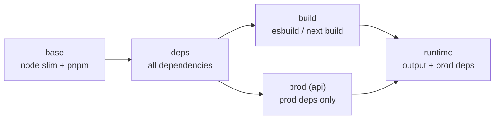

# Docker multi-stage builds (and Next.js standalone)

History: see [CHANGELOG.md](../CHANGELOG.md) or run `pnpm docs:history`

Area: DevOps & CI/CD · Status: ✅ built · Step doc: [11 docker](../../11-docker.md)

## 1. In one line

Each Dockerfile has several **stages**: early ones install everything and build; the final one copies
in only the built output and production dependencies, so the image we run is small.

## 2. Real-life comparison

Cooking in a big kitchen with every tool, then packing only the finished meal into a lunch box. You
don't ship the oven.

## 3. Picture it



## 4. Where in our code

- Anchor: `apps/api/Dockerfile` · stages `base`, `deps`, `build`, `prod`, `runtime`.
- Anchor: `apps/web/Dockerfile` · stages `base`, `deps`, `build`, `runtime`.
- Anchor: `apps/web/next.config.ts` · `output: "standalone"`, `outputFileTracingRoot`.

Step by step (api):

1. `base`: `node:24.13.0-slim` (matches `.nvmrc`), corepack activates pnpm 10.33.2.
2. `deps`: copy only package files, `pnpm install --frozen-lockfile --filter @minitickets/api...`.
3. `build`: copy sources, `node build.mjs` → esbuild bundles `dist/server.js` and `dist/migrate.js`
   (runtime dependencies stay external; `@minitickets/shared` is bundled in).
4. `prod`: `pnpm --filter @minitickets/api --prod deploy --legacy /prod/api` → `node_modules` with
   production dependencies only.
5. `runtime`: a fresh `node:24.13.0-slim`; copies `package.json`, prod `node_modules`, `dist/`,
   `drizzle/`; adds the RDS CA bundle ([tls-in-transit](tls-in-transit.md)); `USER node`; exec-form
   `CMD`.

Web: `next build` with `output: "standalone"` traces the files the server really uses into
`.next/standalone` (a `server.js` plus a minimal `node_modules`); the runtime stage copies that, then
`.next/static` and `public/`, which standalone leaves out on purpose.
`outputFileTracingRoot` is the repo root so tracing finds files from `packages/shared`.

## 5. See it yourself

```bash
docker build -f apps/api/Dockerfile -t mt-api .
docker build -f apps/web/Dockerfile -t mt-web .
docker images | grep mt-                        # compare sizes
docker run --rm --entrypoint ls mt-api node_modules
```

Recorded on the owner's laptop with the compose-built `minitickets-api` image:
`@fastify @minitickets @node-rs @trpc drizzle-orm fastify ioredis pg zod`: production dependencies
only, no esbuild, tsx, drizzle-kit or TypeScript. (`@minitickets/shared` is there because it is a
listed dependency, although esbuild already bundled it.) I am not quoting image sizes:
`docker images` showed different numbers for the local and the ECR-tagged images, and I have not
checked whether they are compressed or unpacked sizes.

**Break it on purpose:** make the api runtime stage `FROM deps` instead of a fresh image. It still
runs, but now contains every dev tool and the whole source.

## 6. How it connects

- **Uses ←** [monorepo](monorepo.md) (filtered installs), [docker-layer-caching](docker-layer-caching.md).
- **Gives →** small images for [ecr](ecr.md) and [fargate](fargate.md) (faster pulls);
  [container-hardening](container-hardening.md); the [ci-pipeline](ci-pipeline.md) docker job.

## 7. Our settings and WHY

| Choice | Why |
| ------ | --- |
| `slim` (Debian), not Alpine | `@node-rs/argon2`'s prebuilt binary needs glibc. |
| Exact Node version | Same Node on laptop, CI and AWS. |
| esbuild bundle for the api | Production runs `node`, no tsx or TypeScript at runtime. |
| Next standalone | Ships only traced files instead of the whole `node_modules`. |

## 8. Trade-offs

- **Pros:** small, reproducible images; dev tools never reach production.
- **Cons:** longer, more complex Dockerfiles; standalone and native modules need care (tracing roots,
  glibc).

## 9. Alternatives and when to choose them

- **Distroless runtime** (`gcr.io/distroless/nodejs`): even smaller, no shell (harder to debug, no
  ECS Exec shell).
- **Buildpacks / Nixpacks:** no Dockerfile to maintain, less control.
- **Single-stage:** fine for prototypes only.

## 10. What breaks, and how we'd notice

- Missing static files in the web image: pages without CSS/JS (the e2e tests against the image
  would catch it).
- A runtime dependency marked as dev: the api crashes at start with "Cannot find module".

## 13. Interview answers at 3 levels

- **Simple:** We build in a big image and ship only the result in a small one.
- **Senior:** The api has five stages: base, deps, build (esbuild bundle), prod (`pnpm deploy --prod`)
  and a fresh slim runtime with only `dist`, prod `node_modules` and migrations. The web uses Next's
  standalone output plus static files. Slim Debian because the native argon2 binary needs glibc.
- **Lead:** Multi-stage builds cut size and attack surface and make builds cacheable. Next I'd pin
  base images by digest and scan them in CI, and consider distroless if we give up shell access.

## 14. Follow-up questions interviewers ask

- *What does `pnpm deploy` do?* Copies a package with only its production dependencies into a
  folder, ready to ship.
- *Why is `.next/static` copied separately?* Standalone leaves it out because it's meant for a CDN.

## 15. Say it in 30 seconds

"Both images are multi-stage. The api installs everything, bundles with esbuild, makes a
production-only node_modules with pnpm deploy, and the final slim image has just that plus the
migrations. The web uses Next's standalone output plus static files. Slim Debian, because the
argon2 native binary needs glibc."

## 16. Status

✅ built.
