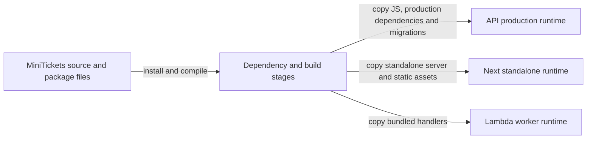

# Docker multi-stage builds (and Next.js standalone)

History: see [CHANGELOG.md](../CHANGELOG.md) or run `pnpm docs:history`

Area: DevOps & CI/CD · Status: ✅ built · Step doc: [11 docker](../../11-docker.md)
<!-- interview-card: v2 -->

## 1. What is it?

A multi-stage Docker build uses separate build environments and copies only the required result into the final image. Build tools can stay outside the image we actually run.

## 2. Why do we need it?

MiniTickets needs TypeScript and package tooling to build, but the deployed API only needs its compiled program and runtime dependencies. Shipping the whole workshop would add size and unnecessary software.

## 3. How does it work?



1. Install build dependencies in an early stage.
2. Compile and prepare the production artifacts.
3. Copy only required artifacts into a fresh runtime stage.

## 4. How do we use it in MiniTickets?

API builds separate production dependencies; web uses Next standalone plus static/public files; worker copies bundled handlers into the Lambda base. API/web runtime patches are intentionally newer than their build toolchain. Native password hashing needs compatible OS and CPU binaries.

## 5. Interview-ready answer

“MiniTickets builds in stages and ships selected production artifacts into fresh runtime images. The API includes compiled code, production dependencies and migrations; web uses standalone output plus its assets. This reduces unnecessary tooling and makes dependencies explicit, but missing traced files or incompatible native modules can still break startup.”

## 6. Important follow-up questions

- **Why copy static files separately?** Next standalone does not include all static/public assets automatically.
- **Does multi-stage guarantee a secure image?** No. Runtime dependencies and base images still need updates and scans.
- **What if a runtime dependency is omitted?** Startup can fail even though compilation passed.
- **Why does the base OS matter?** Native modules need compatible libraries, such as glibc for our password-hashing binary.

## 7. Advanced details

<details>
<summary>Technical reference</summary>

### Source references

- Anchor: `apps/api/Dockerfile` · stages `base`, `deps`, `build`, `prod`, `runtime`.
- Anchor: `apps/web/Dockerfile` · stages `base`, `deps`, `build`, `runtime`.
- Anchor: `apps/web/next.config.ts` · `output: "standalone"`, `outputFileTracingRoot`.
- Anchor: `apps/worker/Dockerfile` · stages `base`, `deps`, `build`, `runtime`: the runtime stage is AWS's Lambda base image plus bundled handler files (S1c).

Step by step (api):

1. `base`: `node:24.13.0-slim` (matches `.nvmrc`), corepack activates pnpm 10.33.2.
2. `deps`: copy only package files, `pnpm install --frozen-lockfile --filter @minitickets/api...`.
3. `build`: copy sources, `node build.mjs` → esbuild bundles `dist/server.js` and `dist/migrate.js`
   (runtime dependencies stay external; `@minitickets/shared` is bundled in).
4. `prod`: `pnpm --filter @minitickets/api --prod deploy --legacy /prod/api` → `node_modules` with
   production dependencies only.
5. `runtime`: a fresh `node:24.22.0-bookworm-slim`; copies `package.json`, prod `node_modules`, `dist/`,
   `drizzle/`; adds the RDS CA bundle ([tls-in-transit](tls-in-transit.md)); `USER node`; exec-form
   `CMD`.

Web: `next build` with `output: "standalone"` traces the files the server really uses into
`.next/standalone` (a `server.js` plus a minimal `node_modules`); the runtime stage copies that, then
`.next/static` and `public/`, which standalone leaves out on purpose.
`outputFileTracingRoot` is the repo root so tracing finds files from `packages/shared`.

### Configuration and design

| Choice | Why |
| ------ | --- |
| `slim` (Debian), not Alpine | `@node-rs/argon2`'s prebuilt binary needs glibc. |
| Exact Node version | Build toolchain remains Node 24.13.0; API/web runtime is patched Node 24.22.0. |
| esbuild bundle for the api | Production runs `node`, no tsx or TypeScript at runtime. |
| Next standalone | Ships only traced files instead of the whole `node_modules`. |

### Checks and troubleshooting

```bash
docker build -f apps/api/Dockerfile -t mt-api .
docker build -f apps/web/Dockerfile -t mt-web .
docker images | grep mt-                        # compare sizes
docker run --rm --entrypoint ls mt-api node_modules
```

Recorded on the owner's laptop with the compose-built `minitickets-api` image:
`@fastify @minitickets @node-rs @trpc drizzle-orm fastify ioredis pg zod`: production dependencies
only, no esbuild, tsx, drizzle-kit or TypeScript. (`@minitickets/shared` is there because it is a
listed dependency, although esbuild already bundled it.) I am not quoting image sizes:
`docker images` showed different numbers for the local and the ECR-tagged images, and I have not
checked whether they are compressed or unpacked sizes.

**Isolated thought experiment (not performed):** make the api runtime stage `FROM deps` instead of a fresh image. It still
runs, but now contains every dev tool and the whole source.

- Missing static files in the web image: pages without CSS/JS (the e2e tests against the image
  would catch it).
- A runtime dependency marked as dev: the api crashes at start with "Cannot find module".

- *What does `pnpm deploy` do?* Copies a package with only its production dependencies into a
  folder, ready to ship.
- *Why is `.next/static` copied separately?* Standalone leaves it out because it's meant for a CDN.

### Trade-offs and alternatives

- **Pros:** small, reproducible images; dev tools never reach production.
- **Cons:** longer, more complex Dockerfiles; standalone and native modules need care (tracing roots,
  glibc).

- **Distroless runtime** (`gcr.io/distroless/nodejs`): even smaller, no shell (harder to debug, no
  ECS Exec shell).
- **Buildpacks / Nixpacks:** no Dockerfile to maintain, less control.
- **Single-stage:** fine for prototypes only.

### Further technical context

The api has five stages: base, deps, build (esbuild bundle), prod (`pnpm deploy --prod`)
  and a fresh slim runtime with only `dist`, prod `node_modules` and migrations. The web uses Next's
  standalone output plus static files. Slim Debian because the native argon2 binary needs glibc.

### Related reading

- **Uses ←** [monorepo](monorepo.md) (filtered installs), [docker-layer-caching](docker-layer-caching.md).
- **Gives →** small images for [ecr](ecr.md) and [fargate](fargate.md) (faster pulls);
  [container-hardening](container-hardening.md); the [ci-pipeline](ci-pipeline.md) docker job.

[Open this piece in the city explorer](../guides/infra-explorer.html?concept=docker-multi-stage#chapter=0&piece=laptop-api).

## Where it appears in the story

- [App story: 15. Docker](../app-story.md#15-docker)

</details>
