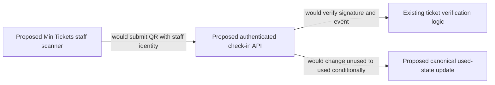

# Door checkin

History: see [CHANGELOG.md](../CHANGELOG.md) or run `pnpm docs:history`

Area: Auth & Security · Status: 📖 explain-only
<!-- interview-card: v2 -->

## 1. What is it?

Door check-in records that an issued ticket has been used for entry. MiniTickets has a proposed design; signing tickets is built, but scanner and admission state changes are not.

## 2. Why do we need it?

Two people could show copies of one valid QR at different doors. A valid signature proves issuance, but both scanners need one shared decision about whether that ticket is still unused.

## 3. How does it work?

1. Authenticate staff and verify the signed ticket.
2. Check the intended event and canonical ticket identity.
3. Conditionally mark unused as used; only one racing attempt would win.

## 4. How do we use it in MiniTickets?

Proposed server layers would reuse ticket verification deliberately, never expose signing to the browser. A scanner, gateway route and conditional admission update are not built. Device quotas would supplement authenticated staff access, not replace it.

## 5. Interview-ready answer

“MiniTickets would authenticate the scanner, verify the QR and conditionally record admission against one canonical ticket. That shared update lets one of two simultaneous scans win. A valid HMAC alone cannot stop reuse. API keys can meter devices but do not authenticate staff, and offline scanners require an explicit conflict policy.”

## 6. Important follow-up questions

- **Can two simultaneous scans succeed?** Only one should win the same conditional unused-to-used transition.
- **Does an API key identify authorized staff?** No. Staff and device authority need real authentication and authorization.
- **What if the scanner is offline?** Global one-time admission cannot be promised without a reconciliation and conflict policy.
- **What should an already-used response show?** A clear refusal plus auditable actor/time, without pretending the second entry succeeded.

## 7. Advanced details

Technical reference

### Source references

Not in our app as an anchored feature. The proposed or observational location is explained below; it must not be mistaken for a deployed resource.

WHERE IN MINITICKETS: proposed check-in procedure/service/queries under apps/api/src, an API Gateway REST route plus authenticated staff authorizer in infra, and a scanner UI feature. Reuse worker token verification as a deliberate shared server-only module, never browser signing. DynamoDB update condition checks unused state/event; audit actor/time and return already-used explicitly. No gateway, usage plan/key, scanner or used-state transition is built.

Existing integration point: `apps/worker/src/tickets/token.ts`.

### Configuration and design

Explain-only: an authenticated scanner would verify the QR and conditionally transition unused to used. API Gateway REST usage-plan keys meter devices but do not authenticate staff; no scanner/gateway exists. HMAC proves issuance; it cannot stop the same valid QR being shown twice.

### Checks and troubleshooting

Use the linked scenario and tour to trace the existing integration point. This proposed extension has no runnable feature demo.

Can two valid scans both succeed? Only if the storage transition is not conditional or checks different identities. Do not change a live stack to demonstrate it.

What prevents two simultaneous scans succeeding? **One conditional state transition.**

### Trade-offs and alternatives

Offline scanners need a reconciliation/conflict policy and cannot promise global one-time use. API keys leak and are not authorization. Rate limits supplement device/staff identity.

10x: per-gate quotas and burst tests. 100x: regional ownership, key revocation and offline conflict procedure.

### Further technical context

Authenticate the staff/device, verify the signed QR claims and conditionally transition a canonical ticket from unused to used. Two scanners race: exactly one conditional update wins. API Gateway REST usage plans/API keys can meter devices, but keys are not user authentication and quotas are best-effort. Reject replay, wrong event and invalid signatures.

### Related reading

Uses the [current system](../00-big-picture.md); gives a concrete decision to the [scenario](../guides/interview-scenarios.md#door-checkin) and [explorer tour](../guides/infra-explorer.html?tour=check-in).

[Open this piece in the city explorer](../guides/infra-explorer.html?concept=door-checkin#chapter=21&piece=checkin-api).

## Where it appears in the story

- [app-story: 4b. Mutation admission and browser security](../app-story.md#4b-mutation-admission-and-browser-security)

