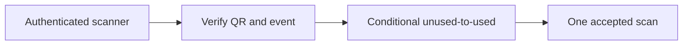

# Door checkin

History: see [CHANGELOG.md](../CHANGELOG.md) or run `pnpm docs:history`

Area: Auth & Security · Status: 📖 explain-only

## 1. In one line

Explain-only: an authenticated scanner would verify the QR and conditionally transition unused to used. API Gateway REST usage-plan keys meter devices but do not authenticate staff; no scanner/gateway exists.

## 2. Real-life comparison

A guard checks both the visitor and the particular action; a readable invitation is not permission to every room.

## 3. Picture it

## 4. Where in our code

Not in our app as an anchored feature. The proposed or observational location is explained below; it must not be mistaken for a deployed resource.

WHERE IN MINITICKETS: proposed check-in procedure/service/queries under apps/api/src, an API Gateway REST route plus authenticated staff authorizer in infra, and a scanner UI feature. Reuse worker token verification as a deliberate shared server-only module, never browser signing. DynamoDB update condition checks unused state/event; audit actor/time and return already-used explicitly. No gateway, usage plan/key, scanner or used-state transition is built.

Existing integration point: `apps/worker/src/tickets/token.ts`.

## 5. See it yourself

Use the linked scenario and tour to trace the existing integration point. This proposed extension has no runnable feature demo.

Failure thought experiment: Can two valid scans both succeed? Only if the storage transition is not conditional or checks different identities. Do not change a live stack to demonstrate it.

## 6. How it connects

Uses the [current system](../00-big-picture.md); gives a concrete decision to the [scenario](../guides/interview-scenarios.md#door-checkin) and [explorer tour](../guides/infra-explorer.html?tour=check-in).

## 7. Our settings and WHY

Explain-only: an authenticated scanner would verify the QR and conditionally transition unused to used. API Gateway REST usage-plan keys meter devices but do not authenticate staff; no scanner/gateway exists. HMAC proves issuance; it cannot stop the same valid QR being shown twice.

## 8. Trade-offs

Offline scanners need a reconciliation/conflict policy and cannot promise global one-time use. API keys leak and are not authorization. Rate limits supplement device/staff identity.

## 9. Alternatives and when to choose them

10x: per-gate quotas and burst tests. 100x: regional ownership, key revocation and offline conflict procedure.

## 10. What breaks and how we notice

Can two valid scans both succeed? Only if the storage transition is not conditional or checks different identities.

## 13. Interview answers at 3 levels

- **Simple:** Explain-only: an authenticated scanner would verify the QR and conditionally transition unused to used.
- **Senior:** Authenticate the staff/device, verify the signed QR claims and conditionally transition a canonical ticket from unused to used. Two scanners race: exactly one conditional update wins. API Gateway REST usage plans/API keys can meter devices, but keys are not user authentication and quotas are best-effort. Reject replay, wrong event and invalid signatures.
- **Lead:** 10x: per-gate quotas and burst tests. 100x: regional ownership, key revocation and offline conflict procedure.

## 14. Follow-up questions with answers

Can two valid scans both succeed? Only if the storage transition is not conditional or checks different identities.

What prevents two simultaneous scans succeeding? **One conditional state transition.**

## 15. Say it in 30 seconds

Authenticate the staff/device, verify the signed QR claims and conditionally transition a canonical ticket from unused to used. Two scanners race: exactly one conditional update wins. API Gateway REST usage plans/API keys can meter devices, but keys are not user authentication and quotas are best-effort. Reject replay, wrong event and invalid signatures.

## 16. Status and production work

Explain-only: no feature deployment exists. 10x: per-gate quotas and burst tests. 100x: regional ownership, key revocation and offline conflict procedure.

## Where it appears in the story

- [app-story: 4b. Mutation admission and browser security](../app-story.md#4b-mutation-admission-and-browser-security)
