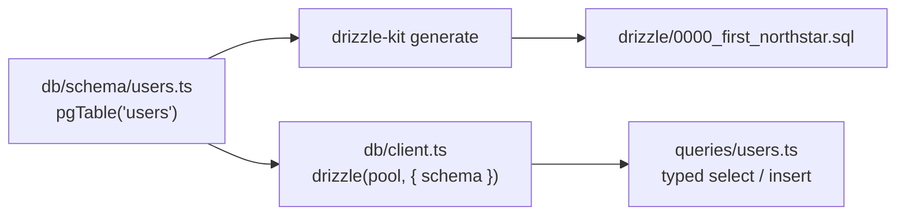

# Postgres schema with Drizzle ORM (UUID keys)

History: see [CHANGELOG.md](../CHANGELOG.md) or run `pnpm docs:history`

Area: Data · Status: ✅ built · Step doc: [05 database](../../05-database.md)

## 1. In one line

The `users` table is described once in TypeScript with **Drizzle**; that description gives typed
queries in the api and is the source the SQL migrations are generated from.

## 2. Real-life comparison

An architect's drawing of a room: builders work from it (migrations), and the furniture shop uses
the same drawing to know what fits (typed queries).

## 3. Picture it



## 4. Where in our code

- Anchor: `apps/api/src/db/schema/users.ts` · `users`: the table definition.
- Anchor: `apps/api/src/db/client.ts` · `db`: the Drizzle instance on top of the pool.
- Anchor: `apps/api/src/db/schema/events.ts` · `events`: the second table (with three `check` constraints, see [db-check-constraints](db-check-constraints.md)).

The table:

| Column | Drizzle | SQL (from the migration) | Why |
| ------ | ------- | ------------------------ | --- |
| `id` | `uuid().primaryKey().defaultRandom()` | `uuid PRIMARY KEY DEFAULT gen_random_uuid()` | Random ids can't be guessed or counted. |
| `email` | `text().notNull().unique()` | `text NOT NULL`, `CONSTRAINT users_email_unique UNIQUE` | One account per email. |
| `password_hash` | `text().notNull()` | `text NOT NULL` | Only the argon2 hash, never the password. |
| `created_at` | `timestamp({ withTimezone: true }).defaultNow()` | `timestamp with time zone DEFAULT now()` | Unambiguous instant. |

Step by step:

1. TypeScript names are camelCase (`passwordHash`), SQL names snake_case (`password_hash`); the
   column functions map them.
2. `drizzle(pool, { schema })` gives `db` with types from the schema.
3. Queries use it: `db.select().from(users).where(eq(users.email, email))`
   ([sql-injection](sql-injection.md)).
4. Changing the schema means generating a new migration ([migrations](migrations.md)).

## 5. See it yourself

```bash
docker exec -it minitickets-postgres-1 psql -U minitickets -d minitickets -c '\d users'
```

You see the four columns, the primary key and `users_email_unique`.

**Break it on purpose:** add `name: text("name").notNull()` to the schema without a migration. The
api compiles, but inserts fail at runtime (`column "name" does not exist`). Run
`pnpm --filter @minitickets/api db:generate` to create the migration.

## 6. How it connects

- **Uses ←** [rds-postgres](rds-postgres.md) on AWS, Postgres 17.6 in Docker locally;
  [connection-pooling](connection-pooling.md).
- **Gives →** [migrations](migrations.md), typed [layered-api](layered-api.md) queries,
  [unique-constraint-race](unique-constraint-race.md).

## 7. Our settings and WHY

UUID keys made by Postgres (`gen_random_uuid()`), `timestamptz`, email unique. WHY: no guessable
ids in URLs later; time zones handled by the database; uniqueness enforced where races can't beat
it.

## 8. Trade-offs

- **Pros:** one typed source; SQL-like API (easy to read the SQL it makes); small runtime.
- **Cons:** random UUIDs make B-tree inserts less local than sequential ids (fine at our size);
  Drizzle is younger than Prisma or TypeORM.

## 9. Alternatives and when to choose them

- **Prisma:** schema file + generated client; great tooling, heavier runtime.
- **Kysely / plain SQL with `pg`:** maximum control; types by hand or codegen.
- **UUIDv7 / ULID:** time-ordered ids, better index locality, still not guessable in practice.

## 10. What breaks, and how we'd notice

- Schema and database out of sync: runtime SQL errors (500s, logged with the cause). CI's e2e job
  runs migrations first, so a missing migration fails CI.

## 13. Interview answers at 3 levels

- **Simple:** We describe our database table in TypeScript, and the tools build the real table from
  it.
- **Senior:** Drizzle `pgTable` defines `users` with a random UUID key, unique email, hash and
  `timestamptz`. `drizzle-kit generate` turns changes into committed SQL; `db` gives typed queries
  that compile to parameterised SQL.
- **Lead:** Schema-as-code keeps types and database aligned, but migrations are still the contract
  with production data. I'd consider time-ordered ids (UUIDv7) once tables grow, for index locality.

## 14. Follow-up questions interviewers ask

- *Why UUID over serial?* Not guessable, can be made anywhere; cost is index locality and size.
- *ORM or query builder?* Drizzle is closer to a typed query builder.

## 15. Say it in 30 seconds

"The users table is defined in TypeScript with Drizzle: random UUID key, unique email, the argon2
hash and a timestamptz. drizzle-kit generates the SQL migrations from it, and the same schema gives
us typed, parameterised queries."

## 16. Status

✅ built.

## Where it appears in the story

- [App story: 9. The query](../app-story.md#9-the-query)
