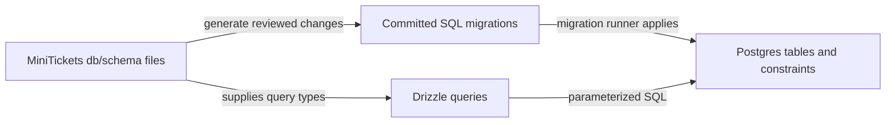

# Postgres schema with Drizzle ORM (UUID keys)

History: see [CHANGELOG.md](../CHANGELOG.md) or run `pnpm docs:history`

Area: Data · Status: ✅ built · Step doc: [05 database](../../05-database.md)
<!-- interview-card: v2 -->

## 1. What is it?

A database schema describes tables, columns and rules. Drizzle lets MiniTickets express that structure in TypeScript and use it when building typed SQL queries.

## 2. Why do we need it?

If a signup query expects a field that the database lacks, compilation alone cannot save it. A shared schema description helps generate reviewed database changes and makes query shapes easier to check.

## 3. How does it work?



1. Describe columns and database constraints.
2. Generate and review a migration for a structural change.
3. Apply it before code depends on the new structure.

## 4. How do we use it in MiniTickets?

Users, events, bookings and outbox have schema files. UUID keys identify records; constraints protect allowed values and relationships. Query adapters use Drizzle over the shared connection pool. Input validation remains a separate boundary.

## 5. Interview-ready answer

“MiniTickets uses Drizzle as a typed SQL-oriented schema and query tool. Schema files describe columns and constraints, and generated SQL migrations update the actual database. That reduces type drift, but the schema file itself does not change a running database. Reviewed migrations and compatibility during deployment still carry the operational risk.”

## 6. Important follow-up questions

- **Does changing TypeScript alter production tables?** No. The migration must be generated, reviewed and applied.
- **Does a random UUID authorize access?** No. Ownership and permissions are checked independently of identifier unpredictability.
- **Why keep constraints in the database too?** Every writer must obey them, including scripts and concurrent requests.
- **What is the cost of random UUID keys?** They are larger and less insertion-local than sequential keys; assess it against actual scale.

## 7. Advanced details

<details>
<summary>Technical reference</summary>

### Current reading notes

Current users also has role with a default and CHECK constraint; the original four-column table below is the initial schema, not the complete current table. Schema composition in db/client.ts includes users/events/bookings/outbox. Random identifiers resist enumeration but are not access control. Postgres timestamptz stores an instant rather than the original display timezone.

### Implementation reference

- Anchor: `apps/api/src/db/schema/users.ts` · `users`: the table definition.
- Anchor: `apps/api/src/db/client.ts` · `db`: the Drizzle instance on top of the pool.
- Anchor: `apps/api/src/db/schema/events.ts` · `events`: the second table (with three `check` constraints, see [db-check-constraints](db-check-constraints.md)).

The table:

| Column | Drizzle | SQL (from the migration) | Why |
| ------ | ------- | ------------------------ | --- |
| `id` | `uuid().primaryKey().defaultRandom()` | `uuid PRIMARY KEY DEFAULT gen_random_uuid()` | Random IDs resist enumeration; they are not an authorization check. |
| `email` | `text().notNull().unique()` | `text NOT NULL`, `CONSTRAINT users_email_unique UNIQUE` | One account per email. |
| `password_hash` | `text().notNull()` | `text NOT NULL` | Only the argon2 hash, never the password. |
| `created_at` | `timestamp({ withTimezone: true }).defaultNow()` | `timestamp with time zone DEFAULT now()` | Unambiguous instant. |

Step by step:

1. TypeScript names are camelCase (`passwordHash`), SQL names snake_case (`password_hash`); the
   column functions map them.
2. `drizzle(pool, { schema })` gives `db` with types from the schema.
3. Queries use it: `db.select().from(users).where(eq(users.email, email))`
   ([sql-injection](sql-injection.md)).
4. Changing the schema means generating a new migration ([migrations](migrations.md)).

### Inspection and historical evidence

```bash
docker exec -it minitickets-postgres-1 psql -U minitickets -d minitickets -c '\d users'
```

You see the four columns, the primary key and `users_email_unique`.

**Break it on purpose:** add `name: text("name").notNull()` to the schema without a migration. The
api compiles, but inserts fail at runtime (`column "name" does not exist`). Run
`pnpm --filter @minitickets/api db:generate` to create the migration.

### Settings and reasoning

UUID keys made by Postgres (`gen_random_uuid()`), `timestamptz`, email unique. WHY: IDs resistant to enumeration, while ownership checks remain required; time zones handled by the database; uniqueness enforced where races can't beat
it.

### Trade-offs

- **Pros:** one typed source; SQL-like API (easy to read the SQL it makes); small runtime.
- **Cons:** random UUIDs make B-tree inserts less local than sequential ids (fine at our size);
  Drizzle is younger than Prisma or TypeORM.

### Alternatives and scaling

- **Prisma:** schema file + generated client; great tooling, heavier runtime.
- **Kysely / plain SQL with `pg`:** maximum control; types by hand or codegen.
- **UUIDv7 / ULID:** time-ordered ids, better index locality, improved index locality, but never a substitute for authorization.

### Failure diagnosis

- Schema and database out of sync: runtime SQL errors (500s, logged with the cause). CI's e2e job
  runs migrations first, so a missing migration fails CI.

### Further questions

- *Why UUID over serial?* Not guessable, can be made anywhere; cost is index locality and size.
- *ORM or query builder?* Drizzle is closer to a typed query builder.

### Related reading

- [rds-postgres](rds-postgres.md)
- [connection-pooling](connection-pooling.md)
- [layered-api](layered-api.md)
- [unique-constraint-race](unique-constraint-race.md)

[Open this piece in the city explorer](../guides/infra-explorer.html?concept=drizzle-schema#chapter=24&piece=code-store).

## Where it appears in the story

- [App story: 9. The query](../app-story.md#9-the-query)

</details>
