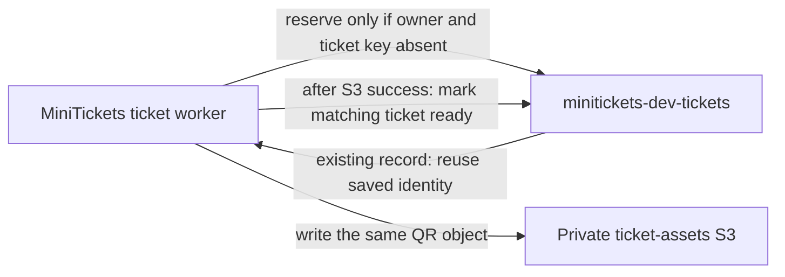

# DynamoDB: the city record drawers

History: see [CHANGELOG.md](../CHANGELOG.md) or run `pnpm docs:history`

Area: AWS Data · Status: ✅ built in repository; live AWS acceptance is separate
<!-- interview-card: v2 -->

## 1. What is it?

[DynamoDB](../glossary.md#dynamodb) stores records found by their keys. MiniTickets uses it to remember completed emails and maintain each owner's issued ticket records.

## 2. Why do we need it?

A booking message can arrive twice or processing can crash halfway through. Saved identities let a retry recognize prior work and resume the same ticket instead of creating a different one.

## 3. How does it work?

1. The worker conditionally reserves a ticket record.
2. A retry reads and reuses the existing record.
3. It writes the QR image in S3 file storage, then marks that ticket ready.

## 4. How do we use it in MiniTickets?

Email uses a separate completed-job table. Tickets use owner plus booking-seat identity; a [conditional write](../glossary.md#series-2-vocabulary) succeeds only when its check passes. The API reads tickets using the verified session owner. Postgres still owns bookings and seats.

## 5. Interview-ready answer

“We choose DynamoDB keys from MiniTickets' access patterns. Email checks a completed booking job; tickets use owner and booking-seat identity. A conditional reservation selects one ticket, and retries resume that record before marking it ready. This supports recoverable background work; it does not replace our Postgres booking transaction.”

## 6. Important follow-up questions

- **Does this guarantee one email?** No. Sending before recording completion and simultaneous workers leave duplicate windows.
- **What if a ticket stays creating?** Inspect worker and S3 failures; retry resumes the stored identity.
- **Does expiry delete records immediately?** No. TTL cleanup is asynchronous and cannot enforce exact access expiry.
- **Why not query any field?** Efficient reads depend on keys and planned indexes; arbitrary scanning is a different cost.

## 7. Advanced details

Technical reference

### Configuration and security

The email worker role has `dynamodb:GetItem/PutItem` on `minitickets-dev-processed-jobs`; the ticket role has `GetItem/PutItem/UpdateItem` on `minitickets-dev-tickets`; the API task role has `Query` on the tickets table. These are HTTPS API calls with temporary role credentials, not SQL connections or database security-group rules.

The stable email key is `booking.confirmed:<bookingId>`. Tickets reserve `(userId, ticketId)` with `ticketId` equal to `bookingId:seat`; a losing reservation strongly reads the winner. After the deterministic S3 write, `markReady` requires the stored `qrToken` to match. The session supplies the owner; a caller cannot select another user’s records.

### Implementation and operational limits

- Anchor: `infra/src/jobs/processed-jobs-table.ts` — `createProcessedJobsTable`; follow the numbered comments at this boundary.

Both tables use `PAY_PER_REQUEST`; storage still costs money when idle. The processed-jobs partition key is `jobKey`. `isDone` uses a strongly consistent GetItem; `markDone` conditionally puts `doneAt` and numeric Unix-second `expiresAt`. [TTL deletion is asynchronous](https://docs.aws.amazon.com/amazondynamodb/latest/developerguide/TTL.html), usually within a few days. Thirty days exceeds our source/DLQ retention. This table has point-in-time recovery and deletion protection disabled in dev; losing it can repeat emails. Recording after send and simultaneous workers leave duplicate email windows.

Tickets have no TTL. Their base partition/sort keys are `userId`/`ticketId`; `by-event-date` uses `eventDate`/`eventDateKey` and projects all fields. A global secondary index (GSI) supplies another lookup order and is eventually consistent; no reminder consumer is built. Very popular dates can concentrate traffic. The API strongly queries the owner's base partition and already follows DynamoDB's 1 MB page cursor; it has no Scan permission. Its final joined response is not bounded yet, so product pagination remains useful. Stored data is validated too. A ready transition checks `qrToken`; mismatched identities fail rather than mint replacements. At greater scale, examine hot keys, time-window/sharding needs and reconciliation. `pnpm demo:tickets` covers local duplicate/resume behavior; it does not prove live AWS permissions. [DynamoDB scenario](../guides/interview-scenarios.md#dynamodb). Old costs are illustrative snapshots.

### Source references

`infra/src/jobs/processed-jobs-table.ts` → `createProcessedJobsTable`; `infra/src/tickets/storage.ts` → `createTicketStorage`.

`apps/worker/src/tickets/store.ts` → `DynamoTickets.reserve` / `markReady`; `apps/api/src/queries/tickets.ts` → `listByUser`.

### Console and troubleshooting

`us-east-1` → **DynamoDB → Tables → minitickets-dev-tickets → Explore table items** shows owner/ticket records. **Indexes** shows `by-event-date`. Select `minitickets-dev-processed-jobs` → **Additional settings → Time to Live (TTL)**: `expiresAt`.

- Table not found → region/name/env → point to the provisioned table; locally create it.
- Tickets stay creating → ticket logs/S3 writes → fix failure; retry resumes the stored ticket.

### Trade-offs and related concepts

- Pick Postgres for MiniTickets seats and bookings that must change together.
- Pick DynamoDB for direct key lookups and independently retried ticket state.

| Neighbor | Direction | What allows it | Console check |
| --- | --- | --- | --- |
| [Lambda](aws-lambda.md) | in | Table actions on function role | Lambda → Permissions → role |
| [S3](presigned-urls.md) | after | Ticket ready only after PutObject | S3 → bucket → tickets/ |
| [IAM](execution-vs-task-role.md) | guard | Exact table ARN grants | IAM → Roles → Permissions |

[Open this piece in the city explorer](../guides/infra-explorer.html?concept=dynamodb#chapter=24&piece=jobs-table).

## Where it appears in the story

- [app-story: 9c. Side path: outbox, fan-out and recoverable work](../app-story.md#9c-side-path-outbox-fan-out-and-recoverable-work)

