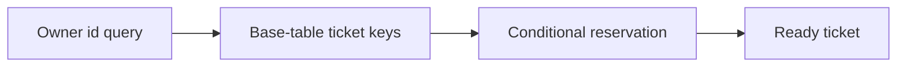

# Amazon DynamoDB (key-value database)

History: see [CHANGELOG.md](../CHANGELOG.md) or run `pnpm docs:history`

Area: AWS Data · Status: ✅ built in repository; live AWS acceptance is separate

## 1. In one line

DynamoDB holds processed-job dedup and canonical owner tickets. Jobs use jobKey with 30-day TTL; tickets use userId/ticketId and by-event-date GSI with no TTL. Conditional reservation and ready transitions converge after retries.

## 2. Real-life comparison

A durable work tray keeps the task after the customer leaves; a completed stamp identifies a repeat.

## 3. Picture it

## 4. Where in our code

- Anchor: `infra/src/jobs/processed-jobs-table.ts` — `createProcessedJobsTable`; follow the numbered comments at this boundary.

`infra/src/tickets/storage.ts` defines the ticket table/index; `apps/worker/src/tickets/store.ts` reserves/marks ready; `apps/api/src/queries/tickets.ts` only reads the authenticated owner. `pnpm demo:tickets` tests duplicate/resume behavior. The API role is not granted arbitrary Scan.

## 5. See it yourself

Run `pnpm demo:tickets` and inspect the asserted outcome described above.

Failure thought experiment: Can a caller choose another ownerId? No; take it from the verified session. Do not change a live stack to demonstrate it.

## 6. How it connects

Uses the [current system](../00-big-picture.md); gives a concrete decision to the [scenario](../guides/interview-scenarios.md#dynamodb) and [explorer tour](../guides/infra-explorer.html?tour=booking).

## 7. Our settings and WHY

DynamoDB holds processed-job dedup and canonical owner tickets. Jobs use jobKey with 30-day TTL; tickets use userId/ticketId and by-event-date GSI with no TTL. Conditional reservation and ready transitions converge after retries. A table key should serve actual reads rather than mimic a relational schema blindly.

## 8. Trade-offs

A GSI adds write/storage cost and lag. TTL deletion is asynchronous; never use it as exact authorization expiry. On-demand billing still has hot-partition limits.

## 9. Alternatives and when to choose them

10x: paginate owner queries. 100x: shard hot date indexes/bounded time windows and model reconciliation reads.

## 10. What breaks and how we notice

Can a caller choose another ownerId? No; take it from the verified session.

## 11. Reach / Allowed / Password

Prove the network path separately from the scoped IAM action and the runtime credential. [Every IAM badge](../guides/infra-build-along.md#every-iam-badge-who--what--attached) shows trust, permissions and attachment. No AWS endpoint needs an inbound SG simply because a non-VPC Lambda calls it.

## 12. Cost

Existing resource/usage costs are detailed in the corresponding infra guide chapter. No new resources were deployed by this documentation change. Historical phase costs are illustrative snapshots, not a current quote; inspect billing and current regional pricing before a capacity decision.

## 13. Interview answers at 3 levels

- **Simple:** DynamoDB holds processed-job dedup and canonical owner tickets.
- **Senior:** Design from queries: an owner lists their tickets and the worker conditionally reserves a canonical ticket. Base keys userId/ticketId support owner-scoped reads; a date index supports event-date access. Conditional writes prevent duplicate reservations. A GSI is eventually consistent and a popular date can become hot.
- **Lead:** 10x: paginate owner queries. 100x: shard hot date indexes/bounded time windows and model reconciliation reads.

## 14. Follow-up questions with answers

Can a caller choose another ownerId? No; take it from the verified session.

What is canonical ticket identity? **bookingId and seat.**

## 15. Say it in 30 seconds

Design from queries: an owner lists their tickets and the worker conditionally reserves a canonical ticket. Base keys userId/ticketId support owner-scoped reads; a date index supports event-date access. Conditional writes prevent duplicate reservations. A GSI is eventually consistent and a popular date can become hot.

## 16. Status and production work

Repository implementation and local evidence are described above. Live AWS/CI execution remains owner acceptance. 10x: paginate owner queries. 100x: shard hot date indexes/bounded time windows and model reconciliation reads.

## Where it appears in the story

- [app-story: 9c. Side path: outbox, fan-out and recoverable work](../app-story.md#9c-side-path-outbox-fan-out-and-recoverable-work)
