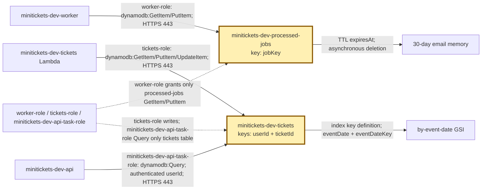
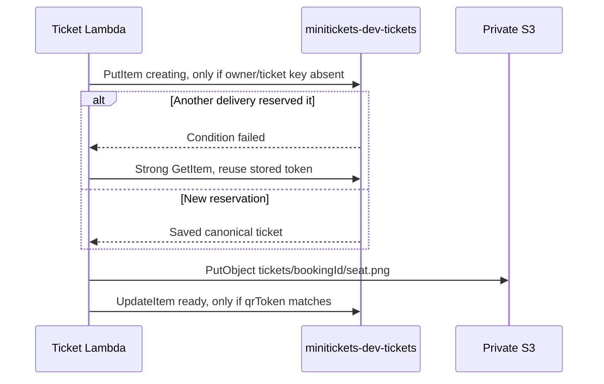

# DynamoDB: the city record drawers

History: see [CHANGELOG.md](../CHANGELOG.md) or run `pnpm docs:history`

Area: AWS Data · Status: ✅ built in repository; live AWS acceptance is separate
<!-- interview-card: v1 -->

## 1. In one line

MiniTickets looks in [DynamoDB](../glossary.md#dynamodb) record drawers to remember finished emails and to keep each owner's issued ticket identity.

## 2. Where it sits

[Open this piece in the city explorer](../guides/infra-explorer.html?concept=dynamodb#chapter=24&piece=jobs-table).

## 3. How it works

## 4. What happens in MiniTickets

1. Email checks `booking.confirmed:<bookingId>` in `minitickets-dev-processed-jobs` before sending.
2. It records completion afterward, with deletion scheduled 30 days later.
3. Tickets reserve `(userId, ticketId)`; `ticketId` is `bookingId:seat`.
4. A [conditional write](../glossary.md#series-2-vocabulary) saves only if its check passes. A losing retry reads the winner's ticket.
5. After S3 accepts its QR image, the ticket becomes `ready`. The API queries only the signed-in owner's drawer.

## 5. Reach / Allowed / Password

**Reach:** HTTPS 443 to DynamoDB; no database security group.

**Allowed:** email Get/Put, ticket Get/Put/Update, API Query; each on its named table.

**Password:** temporary IAM role credentials, no database password.

## 6. In our code

`infra/src/jobs/processed-jobs-table.ts` → `createProcessedJobsTable`; `infra/src/tickets/storage.ts` → `createTicketStorage`.

`apps/worker/src/tickets/store.ts` → `DynamoTickets.reserve` / `markReady`; `apps/api/src/queries/tickets.ts` → `listByUser`.

## 7. In the AWS console

`us-east-1` → **DynamoDB → Tables → minitickets-dev-tickets → Explore table items** shows owner/ticket records. **Indexes** shows `by-event-date`. Select `minitickets-dev-processed-jobs` → **Additional settings → Time to Live (TTL)**: `expiresAt`.

## 8. Good / Bad

**Good:** no SQL connection pool; checked writes make ticket retries converge.

**Bad:** key design must match reads; secondary indexes add cost and may lag.

## 9. Other choices

- Pick Postgres for MiniTickets seats and bookings that must change together.
- Pick DynamoDB for direct key lookups and independently retried ticket state.

## 10. Connected to

| Neighbor | Direction | What allows it | Console check |
| --- | --- | --- | --- |
| [Lambda](aws-lambda.md) | in | Table actions on function role | Lambda → Permissions → role |
| [S3](presigned-urls.md) | after | Ticket ready only after PutObject | S3 → bucket → tickets/ |
| [IAM](execution-vs-task-role.md) | guard | Exact table ARN grants | IAM → Roles → Permissions |

## 11. When it breaks

- Table not found → region/name/env → point to the provisioned table; locally create it.
- Tickets stay creating → ticket logs/S3 writes → fix failure; retry resumes the stored ticket.

## 12. Say it in 30 seconds

“We design DynamoDB keys from MiniTickets reads. Email looks up a completed booking job. Tickets use owner plus booking-seat identity. A conditional reservation chooses one canonical ticket; retries reuse it, write the same QR and mark ready. Postgres still owns bookings and seats. DynamoDB does not replace that transaction.”

## 13. Likely follow-ups

**Does TTL expire access exactly?** No; deletion happens later.

**Can users choose another owner?** No; the API uses the verified session.

## 14. Remember it

Choose the drawer label from the question you need to answer.

## 15. More detail

Reads, expiry, index and recovery limits

- Anchor: `infra/src/jobs/processed-jobs-table.ts` — `createProcessedJobsTable`; follow the numbered comments at this boundary.

Both tables use `PAY_PER_REQUEST`; storage still costs money when idle. The processed-jobs partition key is `jobKey`. `isDone` uses a strongly consistent GetItem; `markDone` conditionally puts `doneAt` and numeric Unix-second `expiresAt`. [TTL deletion is asynchronous](https://docs.aws.amazon.com/amazondynamodb/latest/developerguide/TTL.html), usually within a few days. Thirty days exceeds our source/DLQ retention. This table has point-in-time recovery and deletion protection disabled in dev; losing it can repeat emails. Recording after send and simultaneous workers leave duplicate email windows.

Tickets have no TTL. Their base partition/sort keys are `userId`/`ticketId`; `by-event-date` uses `eventDate`/`eventDateKey` and projects all fields. A global secondary index (GSI) supplies another lookup order and is eventually consistent; no reminder consumer is built. Very popular dates can concentrate traffic. The API strongly queries the owner's base partition and already follows DynamoDB's 1 MB page cursor; it has no Scan permission. Its final joined response is not bounded yet, so product pagination remains useful. Stored data is validated too. A ready transition checks `qrToken`; mismatched identities fail rather than mint replacements. At greater scale, examine hot keys, time-window/sharding needs and reconciliation. `pnpm demo:tickets` covers local duplicate/resume behavior; it does not prove live AWS permissions. [DynamoDB scenario](../guides/interview-scenarios.md#dynamodb). Old costs are illustrative snapshots.

## Where it appears in the story

- [app-story: 9c. Side path: outbox, fan-out and recoverable work](../app-story.md#9c-side-path-outbox-fan-out-and-recoverable-work)
