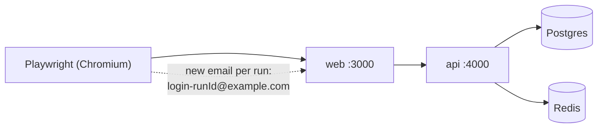

# End-to-end tests with Playwright (and test data isolation)

History: see [CHANGELOG.md](../CHANGELOG.md) or run `pnpm docs:history`

Area: Testing · Status: ✅ built · Step doc: [04 signup form](../../04-signup-form.md), [10 CI](../../10-ci.md)

## 1. In one line

**End-to-end (e2e) tests** drive a real browser through the real app (web, api, Postgres, Redis)
like a user; each run creates its own fresh accounts so tests never depend on old data.

## 2. Real-life comparison

A mystery shopper who walks in, buys something and asks for a refund, checking the whole shop works,
not just the till.

## 3. Picture it



## 4. Where in our code

- Anchor: `apps/web/playwright.config.ts` · `baseURL` (`E2E_BASE_URL` or localhost:3000), `webServer` (CI only).
- Anchor: `apps/web/e2e/login.spec.ts` · `runId`, `beforeAll`: fresh account through the signup page.

Step by step:

1. Four spec files: `signup`, `login`, `logout`, `dashboard` (`apps/web/e2e/*.spec.ts`).
2. Each file makes `runId = Date.now()-random` and an email like `login-<runId>@example.com`, and
   signs up through the UI in `beforeAll`: no database access, no shared fixtures.
3. Tests use accessible locators (`getByLabel`, `getByRole`), which also checks labels exist.
4. Locally, Playwright uses the servers you already run (`pnpm dev`) and never starts its own. In CI
   (`CI=true`), `webServer` starts the api (`/health`) and a **production** build of the web.
5. `E2E_BASE_URL` points the same tests at another copy, e.g. the CloudFront URL after a deploy.
6. They check behaviour that units can't: HttpOnly cookie (`document.cookie`), redirects, 409 under
   the field, disabled button while pending (`page.route` delays requests), fake-cookie 401.

## 5. See it yourself

```bash
pnpm dev                      # in one terminal
pnpm test:e2e                 # in another
E2E_BASE_URL=https://<id>.cloudfront.net pnpm test:e2e   # against AWS
```

**Break it on purpose:** use a fixed email `test@example.com` in `login.spec.ts`: the first run
passes, the second fails at signup with "Email already registered".

## 6. How it connects

- **Uses ←** the whole app; [ci-pipeline](ci-pipeline.md) service containers and migrations.
- **Gives →** the top of the [testing-pyramid](testing-pyramid.md); proof for
  [session-cookie](session-cookie.md), [route-guard-proxy](route-guard-proxy.md),
  [open-redirect](open-redirect.md), [ui-error-handling](ui-error-handling.md).

## 7. Our settings and WHY

| Setting | Why |
| ------- | --- |
| Unique data per run | Repeatable without resetting the database. |
| Signup through the UI | No test-only backdoors into the database. |
| Chromium only | Fast CI; cross-browser not needed yet. |
| Production web build in CI | Test what users get, not the dev server. |

## 8. Trade-offs

- **Pros:** highest confidence; catches integration bugs across all layers.
- **Cons:** slower (minutes in CI with builds); test users pile up in the database; can be flaky
  with timing.

## 9. Alternatives and when to choose them

- **Cypress:** similar, different runner model.
- **API-level setup** (create users with a direct API call): faster `beforeAll`.
- **Database reset per run:** clean data, needs DB access from tests.

## 10. What breaks, and how we'd notice

Flakiness from timing; the CI uploads the HTML report on failure. Locally, tests fail if `pnpm dev`
isn't running (by design).

## 13. Interview answers at 3 levels

- **Simple:** A robot uses the real app in a real browser and checks it works.
- **Senior:** Playwright specs for signup, login, logout and dashboard, each creating a unique
  account through the UI in `beforeAll`. Locally they hit the running dev servers; in CI Playwright
  starts the api and a production web build against service-container Postgres and Redis. The same
  tests run against the CloudFront URL with `E2E_BASE_URL`.
- **Lead:** Keep e2e tests few and journey-focused, isolated by data, and runnable against any
  environment, so they double as post-deploy smoke tests.

## 14. Follow-up questions interviewers ask

- *How do you keep e2e tests independent?* Unique data per run; no order dependence.
- *Why accessible locators?* Stable, user-facing, and they fail if labels disappear.

## 15. Say it in 30 seconds

"Playwright e2e tests for signup, login, logout and the dashboard. Every run creates fresh accounts
through the UI, so there's no shared test data. Locally they use the running dev servers; in CI
Playwright starts the api and a production web build with real Postgres and Redis, and the same tests
can run against the deployed CloudFront URL."

## 16. Status

✅ built.

## Where it appears in the story

- [App story: 14. The testing pyramid](../app-story.md#14-the-testing-pyramid)
- [App story: 16. CI](../app-story.md#16-ci)
