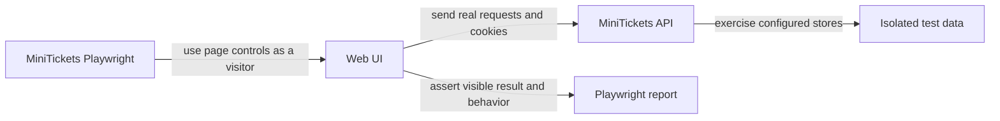

# End-to-end tests with Playwright (and test data isolation)

History: see [CHANGELOG.md](../CHANGELOG.md) or run `pnpm docs:history`

Area: Testing · Status: ✅ built in repository; live acceptance is separate

<!-- interview-card: v2 -->

## 1. What is it?

An end-to-end test drives the browser through a real user journey. It checks whether the interface and the services behind it work together.

## 2. Why do we need it?

A login procedure can pass its tests while the form sends the wrong input or loses the session cookie. A browser journey can catch that broken connection.

## 3. How does it work?

1. Create isolated users and data for the journey.
2. Drive the browser through the intended flow.
3. Inspect reports on failure and state exactly which flows passed.

## 4. How do we use it in MiniTickets?

Playwright checks UI and network behavior. Phase demos use isolated data and ports; security checks use a production-mode web build and include accessibility scans. A targeted local run does not establish the whole suite or deployed AWS behavior.

## 5. Interview-ready answer

“MiniTickets uses browser tests to check the connections a user actually depends on: controls, requests, cookies and visible results. We isolate test accounts and phase data so runs are repeatable. Browser checks complement fast rule tests and real-store concurrency tests. A green targeted run is scoped evidence, not proof of every journey or live cloud permissions.”

## 6. Important follow-up questions

- **Why isolate test accounts?** Shared mutable accounts make tests influence each other and become flaky.
- **Should every edge case use a browser?** No. Small rule tests usually explain those failures faster.
- **What if only one phase passed?** Report that phase and its count, rather than claiming the whole suite passed.
- **Can an emulator prove email delivery?** No. Real service permissions and delivery need live acceptance.

## 7. Advanced details

Technical reference

### Configuration and recorded evidence

`apps/web/playwright.config.ts` takes `E2E_BASE_URL` or localhost:3000; its `webServer` starts servers only in CI. `apps/web/e2e/login.spec.ts` uses `runId` / `beforeAll` to create a fresh account through signup. Owner servers must not be replaced; isolated phase demos choose their own ports/data.

Historical evidence: **404 Vitest tests**, **24 production-mode local e2e** in `pnpm demo:security`, plus isolated `demo:search`, `demo:sale`, `demo:outbox`. Security includes CSP, vitals and three axe scans; an isolated inverted-origin mutation demonstrated relevant tests fail. D1 covered **144 offline tour navigations without screenshots**. None is a fresh run or full-suite/AWS deployment claim from this rewrite.

### Limits and growth

Browser tests cover real UI/network boundaries but do not establish IAM, ALB proxy behavior, SES delivery or CloudFront policy. Real-store demos provide row-lock/transaction evidence; mocks cannot substitute for it. Favor stable fixtures, owned flake repair and measured phase outcomes. Future options include contract tests, production canaries, risk-based gates and representative assistive-technology review beyond automated accessibility checks.

### Code anchors

- Anchor: `apps/web/playwright.config.ts` · `baseURL` (`E2E_BASE_URL` or localhost:3000), `webServer` (CI only).
- Anchor: `apps/web/e2e/login.spec.ts` · `runId`, `beforeAll`: fresh account through the signup page.

### Related reading

[current system](../00-big-picture.md) · [scenario](../guides/interview-scenarios.md#accessibility) · [explorer tour](../guides/infra-explorer.html?tour=security-layers)

[Open this concept in the city explorer](../guides/infra-explorer.html?concept=e2e-tests#chapter=13&piece=github).

## Where it appears in the story

- [App story: 14. The testing pyramid](../app-story.md#14-the-testing-pyramid)
- [App story: 16. CI](../app-story.md#16-ci)

