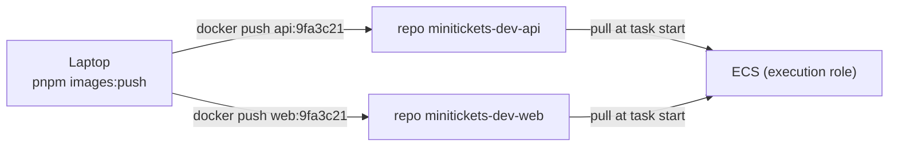

# ECR: the image registry

Area: AWS Compute · Status: ✅ built · Step doc: [16 ECR](../../16-infra-ecr.md)

## 1. In one line

**ECR** (Elastic Container Registry) is AWS's private store for Docker images; ECS pulls our api and
web images from it when a task starts.

## 2. Real-life comparison

A private warehouse with one shelf per product. Each box on the shelf has a label (the tag) that can
never be moved to another box, and old boxes are thrown out automatically.

## 3. Picture it



## 4. Where in our code

- Anchor: `infra/src/registry.ts` · `createRepo`, `lifecyclePolicy`: two repositories, each with a lifecycle policy.

Step by step:

1. `lifecyclePolicy`: rule 1 expires **untagged** images after 1 day; rule 2 keeps only the newest
   10 **tagged** images.
2. `createRepo("api")` and `createRepo("web")`: `imageTagMutability: "IMMUTABLE"`
   ([immutable-image-tags](immutable-image-tags.md)), `scanOnPush: true`
   ([image-scanning](image-scanning.md)), `forceDelete: true` (dev: the stack can be destroyed with
   images inside).
3. `createRegistry` returns `apiRepoUrl` and `webRepoUrl` as stack outputs; `scripts/push-images.sh`
   reads them, and `index.ts` builds `${apiRepoUrl}:${apiImageTag}` for the task definition.
4. The registry is **always on**: storage costs cents.

## 5. See it yourself

```bash
aws ecr describe-images --profile ticketlite --repository-name minitickets-dev-api \
  --query "sort_by(imageDetails,&imagePushedAt)[-3:].[imageTags[0],imagePushedAt,imageSizeInBytes]" --output table
aws ecr get-lifecycle-policy --profile ticketlite --repository-name minitickets-dev-api --query lifecyclePolicyText
```

**Break it on purpose:** set `apiImageTag` to a tag that was never pushed and turn compute on. The
task stops with `CannotPullContainerError … not found`, and the circuit breaker gives up.

## 6. How it connects

- **Uses ←** nothing.
- **Gives →** images for every [task definition](task-definition.md); pulled by the
  [execution role](execution-vs-task-role.md) through the internet gateway.

## 7. Our settings and WHY

| Setting | Value | Why |
| ------- | ----- | --- |
| Repos | one per service | api and web are built and deployed separately. |
| Tags | immutable | A tag (git SHA) always means one build. |
| Lifecycle | untagged 1 day, keep 10 tagged | Storage is billed per GB. |
| `forceDelete` | true | Dev teardown; production keeps it false. |

## 8. Trade-offs

- **Pros:** private, in the same region as ECS (no transfer fee), IAM-controlled, scanning built in.
- **Cons:** keeping only 10 tags limits how far back you can roll back without rebuilding.

## 9. Alternatives and when to choose them

- **Docker Hub / GitHub Container Registry:** public images, or teams already on GitHub.
- **ECR pull-through cache:** mirror public images (like `node:24`) inside AWS.
- **Cross-region replication:** multi-region deployments.

## 10. What breaks, and how we'd notice

- Tag not pushed: `CannotPullContainerError`.
- No network path from the task to ECR (private subnet, no NAT or endpoint): image pull fails.
- Pushing an existing tag: `tag … already exists` (immutable).

## 11. Reach / Allowed / Password

- **Reach:** the task's public IP + internet gateway to ECR's public endpoint.
- **Allowed:** the execution role's `AmazonECSTaskExecutionRolePolicy` (ECR pull).
- **Password:** none; requests are signed with STS credentials. On the laptop,
  `aws ecr get-login-password` gives Docker a 12-hour token.

## 12. Cost

About $0.10 per GB per month; our images are a few hundred MB each and at most 10 per repo, so a few
cents a month. Pulls from ECS in the same region are free ([docs/16](../../16-infra-ecr.md)).

## 13. Interview answers at 3 levels

- **Simple:** ECR stores our Docker images privately in AWS.
- **Senior:** Two immutable repos with scan-on-push and a lifecycle policy. The push script tags
  images with the git SHA and reads the repo URLs from Pulumi outputs; the execution role pulls them
  at task start.
- **Lead:** Immutable SHA tags plus a lifecycle policy give traceability at low cost. In production
  I'd push from CI with an OIDC role, pin by digest, act on scan findings, and keep more history or
  promote images between accounts.

## 14. Follow-up questions interviewers ask

- *Tag vs digest?* A tag is a name; the digest is the hash of the content.
- *Why does the laptop need `get-login-password`?* Docker does not speak IAM; it needs a token.

## 15. Say it in 30 seconds

"Two private ECR repos, api and web, with immutable tags, scan on push, and a lifecycle policy that
keeps 10 tagged images. The push script tags with the git SHA; ECS pulls with the execution role."

## 16. Status

✅ built.
