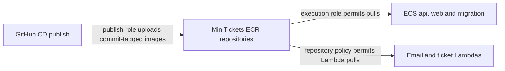

# ECR: the city’s sealed image shelves

History: see [CHANGELOG.md](../CHANGELOG.md) or run `pnpm docs:history`
Area: AWS Compute · Status: ✅ built in repository; live acceptance is separate
<!-- interview-card: v2 -->

## 1. What is it?

[ECR](../glossary.md#ecr) stores container images: ready-to-run packages containing an app and what it needs.

## 2. Why do we need it?

A release needs the same software in every task. MiniTickets publishes an image once, then deploys those exact bytes instead of rebuilding separately on each machine.

## 3. How does it work?

1. Publish checks whether an image already exists for the commit.
2. Missing images are built and uploaded; existing ones are reused.
3. Deployment selects images for running containers in ECS and triggered functions in Lambda.

## 4. How do we use it in MiniTickets?

Separate API, web and worker repositories keep releases traceable. Both Lambdas share the worker image. Immutable tags stop a commit tag being changed to different bytes; deployed-image retention keeps a limited rollback history.

## 5. Interview-ready answer

“ECR is MiniTickets' image registry. We publish API, web and worker images under immutable commit tags and reuse them during deployment. That makes releases traceable and rollback repeatable while the images remain retained. Upload permission, ECS pull permission and Lambda's repository policy are separate access checks.”

## 6. Important follow-up questions

- **Why publish once?** Rebuilding can change dependencies or base images even for the same source commit.
- **Does immutability mean secure?** No. An unchanged image can still contain vulnerabilities; scanning and updates remain necessary.
- **What if an image is missing?** New tasks cannot pull it. Inspect task errors and repository retention before choosing a release.
- **Can every old release be restored?** Only if its image remains available and its code is compatible with today's database.

## 7. Advanced details

Technical reference

### Configuration and security

ECS pull grants include `ecr:BatchGetImage` and `ecr:GetDownloadUrlForLayer`. The worker repository policy separately permits `lambda.amazonaws.com` to use those pull actions for the worker/tickets functions. Current `createRegistry` creates three repositories (API, web and worker).

`createRegistry` and the shared service list create `minitickets-dev-api`, `minitickets-dev-web` and `minitickets-dev-worker`. Publish checks seven-character SHA tags; approved deploy adds `deployed-<sha>` to the same bytes. ECS needs HTTPS 443 via public IP/internet gateway. Docker uses a temporary ECR login token, not a saved registry password. Publish needs `BatchGetImage` to check existing manifests before rebuilding.

### Implementation and operational limits

- Anchor: `infra/src/registry.ts` · `createRepo`, `lifecyclePolicy`: three repositories, each with a lifecycle policy.

Each repository sets `imageTagMutability: "IMMUTABLE"`, basic `scanOnPush: true` and dev-only `forceDelete: true`. Production should not make accidental repository deletion easy. `imageServices` is the shared API/web/worker list used by creation and permission code, reducing forgotten-repository errors.

Lifecycle rule 1 keeps the newest 10 images matching `deployed-*`; rule 2 keeps the newest 30 other tagged images; rule 3 expires untagged images after one day. Higher-priority matching protects deployed images from the general tagged rule. “Newest” uses image push time: adding a deployed tag does not make old bytes newly pushed. This is a bounded rollback shelf, not a permanent archive. Lifecycle policy replacement uses `deleteBeforeReplace` to avoid deleting the new policy after creating it over the same repository.

Publish’s policy permits `GetAuthorizationToken` on `*` because that login action has no repository resource scope. Layer upload, `PutImage`, layer checks and manifest reads are limited to the three repository ARNs. It cannot delete images. The worker repository separately allows Lambda pulls for our worker/tickets functions; a GitHub push badge does not grant Lambda pulling rights.

CI builds and scans images without publishing them; CD builds the release ARM64 images after CI. The security gate currently fails on fixable CRITICAL findings, with `ignore-unfixed` and the dated `.trivyignore` policy. ECR scan-on-push and CI Trivy are separate checks. They do not prove a live deployment was accepted.

[Official ECR console repositories](https://docs.aws.amazon.com/AmazonECR/latest/userguide/Repositories.html).

### Source references

`infra/src/registry.ts` → `createRegistry`, `createRepo`.

`infra/src/image-repos.ts` → `imageServices`, `repoName`.

`.github/workflows/cd.yml` → `publish`.

### Console and troubleshooting

`us-east-1` → ECR → Private registry → Repositories → `minitickets-dev-api` → Images / Lifecycle policy / Permissions. Expect SHA tags, digests and scan results. Repeat for web/worker. Stored images not checked live.

Image pull fails → task stopped reason and ECR Images → restore missing release or repair pull permission.

Publish denied → role policy → include manifest reads as well as upload actions.

### Trade-offs and related concepts

- Another registry: pick it when portability outweighs AWS integration.
- Digest pinning: pick it when releases need the full content fingerprint.

| Neighbor | Direction | What allows it | Console check |
| --- | --- | --- | --- |
| [OIDC](cd-oidc.md) | In ← | gh-publish ECR policy | IAM → Roles → minitickets-dev-gh-publish |
| [Task recipe](task-definition.md) | Out → | image URI + execution role | ECS → Task definitions → revision |
| [Lambda](aws-lambda.md) | Out → | Worker repository resource policy | ECR → worker → Permissions |

[Open this piece in the city explorer](../guides/infra-explorer.html?concept=ecr#chapter=7&piece=ecr).

## Where it appears in the story

- [Infra story: 12. ECR](../infra-story.md#12-ecr)
- [Big picture: 4. Components](../00-big-picture.md#4-components)

