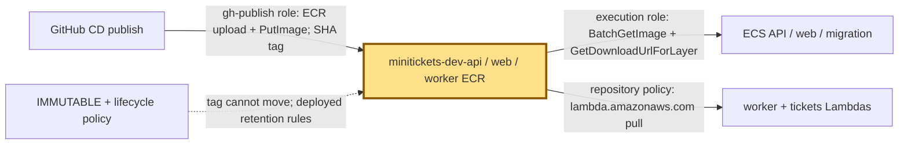
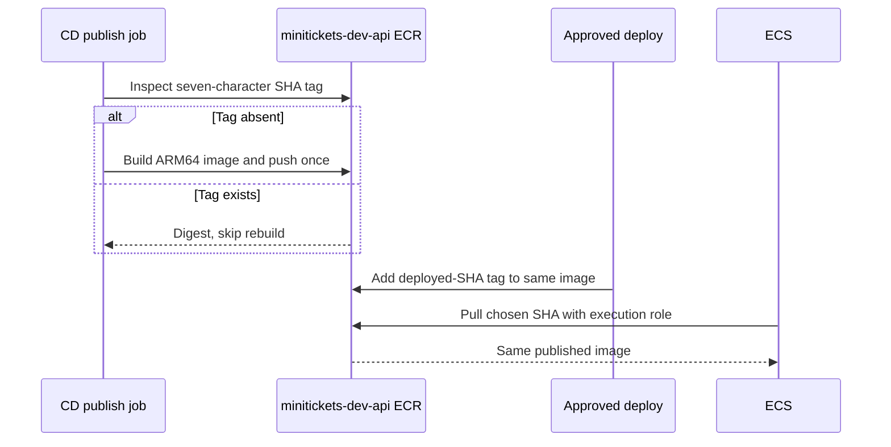

# ECR: the city’s sealed image shelves

History: see [CHANGELOG.md](../CHANGELOG.md) or run `pnpm docs:history`
Area: AWS Compute · Status: ✅ built in repository; live acceptance is separate
<!-- interview-card: v1 -->

## 1. In one line

MiniTickets publishes a [container image](../glossary.md#ecr), a ready-to-run app package, once under a commit tag in ECR.

## 2. Where it sits

[Open this piece in the city explorer](../guides/infra-explorer.html?concept=ecr#chapter=7&piece=ecr).

## 3. How it works

## 4. What happens in MiniTickets

1. `createRegistry` creates three private repositories: `minitickets-dev-api`, `minitickets-dev-web`, `minitickets-dev-worker`.
2. Publish checks each seven-character SHA tag. Existing images are reused; missing ones are built for ARM64.
3. Immutable tags cannot be moved to different bytes. Approved deploy adds `deployed-<sha>` retention tags.
4. ECS pulls API/web images; both Lambdas pull the worker image through a separate repository policy.

## 5. Reach / Allowed / Password

**Reach:** HTTPS 443 to ECR; ECS uses public IP plus internet gateway.

**Allowed:** publish role uploads; execution role or Lambda repository policy permits pulling.

**Password:** Docker receives a temporary ECR login token; no saved registry password.

## 6. In our code

`infra/src/registry.ts` → `createRegistry`, `createRepo`.

`infra/src/image-repos.ts` → `imageServices`, `repoName`.

`.github/workflows/cd.yml` → `publish`.

## 7. In the AWS console

`us-east-1` → ECR → Private registry → Repositories → `minitickets-dev-api` → Images / Lifecycle policy / Permissions. Expect SHA tags, digests and scan results. Repeat for web/worker. Stored images not checked live.

## 8. Good / Bad

**Good:** Trace a running image to its commit. Reuse exact bytes on rollback.

**Bad:** Retention still limits rollback history. A stored image can contain vulnerabilities.

## 9. Other choices

- Another registry: pick it when portability outweighs AWS integration.
- Digest pinning: pick it when releases need the full content fingerprint.

## 10. Connected to

| Neighbor | Direction | What allows it | Console check |
| --- | --- | --- | --- |
| [OIDC](cd-oidc.md) | In ← | gh-publish ECR policy | IAM → Roles → minitickets-dev-gh-publish |
| [Task recipe](task-definition.md) | Out → | image URI + execution role | ECS → Task definitions → revision |
| [Lambda](aws-lambda.md) | Out → | Worker repository resource policy | ECR → worker → Permissions |

## 11. When it breaks

Image pull fails → task stopped reason and ECR Images → restore missing release or repair pull permission.

Publish denied → role policy → include manifest reads as well as upload actions.

## 12. Say it in 30 seconds

“ECR is our sealed image shelf. Three private repositories hold immutable SHA-tagged API, web and worker images. Publish builds missing tags once; deploy reuses those bytes. Deployed tags protect a limited rollback history. Publishing permission, ECS pulling permission and Lambda’s repository policy are different gates.”

## 13. Likely follow-ups

- Why does publish need `BatchGetImage`? It checks manifests before deciding to rebuild.
- Is scanning a guarantee? No; it finds known issues under the configured policy.

## 14. Remember it

A tag names the sealed box; its digest fingerprints the contents.

## 15. More detail

Settings, limits and deeper interview notes

- Anchor: `infra/src/registry.ts` · `createRepo`, `lifecyclePolicy`: two repositories, each with a lifecycle policy.

Each repository sets `imageTagMutability: "IMMUTABLE"`, basic `scanOnPush: true` and dev-only `forceDelete: true`. Production should not make accidental repository deletion easy. `imageServices` is the shared API/web/worker list used by creation and permission code, reducing forgotten-repository errors.

Lifecycle rule 1 keeps the newest 10 images matching `deployed-*`; rule 2 keeps the newest 30 other tagged images; rule 3 expires untagged images after one day. Higher-priority matching protects deployed images from the general tagged rule. “Newest” uses image push time: adding a deployed tag does not make old bytes newly pushed. This is a bounded rollback shelf, not a permanent archive. Lifecycle policy replacement uses `deleteBeforeReplace` to avoid deleting the new policy after creating it over the same repository.

Publish’s policy permits `GetAuthorizationToken` on `*` because that login action has no repository resource scope. Layer upload, `PutImage`, layer checks and manifest reads are limited to the three repository ARNs. It cannot delete images. The worker repository separately allows Lambda pulls for our worker/tickets functions; a GitHub push badge does not grant Lambda pulling rights.

CI builds and scans images without publishing them; CD builds the release ARM64 images after CI. The security gate currently fails on fixable CRITICAL findings, with `ignore-unfixed` and the dated `.trivyignore` policy. ECR scan-on-push and CI Trivy are separate checks. They do not prove a live deployment was accepted.

[Official ECR console repositories](https://docs.aws.amazon.com/AmazonECR/latest/userguide/Repositories.html).

## Where it appears in the story

- [Infra story: 12. ECR](../infra-story.md#12-ecr)
- [Big picture: 4. Components](../00-big-picture.md#4-components)
