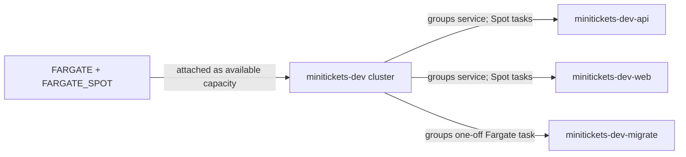

# ECS cluster: the city work register

History: see [CHANGELOG.md](../CHANGELOG.md) or run `pnpm docs:history`
Area: AWS Compute · Status: ✅ built · Step doc: [17 ECS api](../../17-infra-ecs-api.md) (section 3.1)
<!-- interview-card: v2 -->

## 1. What is it?

An [ECS cluster](../glossary.md#ecs-cluster) groups containers managed by AWS. MiniTickets' cluster is the place to find its application services and running tasks.

## 2. Why do we need it?

We need somewhere to organize API, web and migration work without managing host machines. A shared register makes it clear which applications belong to MiniTickets dev.

## 3. How does it work?

1. Create the named cluster.
2. Attach the supported ways to obtain compute capacity.
3. Services or one-off task requests choose how to run their containers.

## 4. How do we use it in MiniTickets?

`createCluster` in `infra/src/compute/cluster.ts` creates the register. API and web services use discounted, interruptible Spot capacity. Migrations use regular Fargate. Infrastructure dependencies ensure capacity is attached before services use it.

## 5. Interview-ready answer

“MiniTickets' ECS cluster groups API, web and migration work. Fargate lets AWS manage the host machines; services maintain application tasks and migrations run once. The cluster organizes work and available capacity. Task networking and roles handle access, and our single Spot copies are a dev cost choice rather than high availability.”

## 6. Important follow-up questions

- **Cluster versus service?** The cluster groups work; a service maintains the desired number of application tasks.
- **Does it protect network traffic?** No. Task networking, security groups and application authentication do that.
- **What if the capacity provider is not associated?** Service creation can fail; check the attachment and dependency order.
- **Why choose EC2 capacity instead?** It can suit steady workloads when managing hosts is an acceptable trade-off.

## 7. Advanced details

Technical reference

### Configuration and operations

`createCluster` creates `minitickets-dev` when `computeEnabled=true`. `FARGATE` and `FARGATE_SPOT` are attached through `ClusterCapacityProviders`. API/web each request one Spot task. Migration uses `run-task --launch-type FARGATE`.

In `us-east-1`: ECS → Clusters → `minitickets-dev` → Services / Tasks shows work; Infrastructure shows providers. These are configured names, not live counts. A “provider not associated” error belongs in service Events; preserve the completed provider-attachment dependency. Deployment IAM creates infrastructure, and task roles govern application AWS operations. Each task has its own networking; the cluster holds no app password.

Separate clusters can support separate environment ownership; EKS is an alternative when Kubernetes is required. Neither a named cluster nor one running Spot task supplies an availability guarantee.

- Anchor: `infra/src/compute/cluster.ts` · `createCluster`: the cluster and its capacity providers.

`containerInsights` is `disabled`; basic service CPU and memory metrics remain available. Extra task-level Container Insights would add observability cost. An empty Fargate cluster has no task compute charge; running tasks and related resources do.

`ClusterCapacityProviders` depends on the cluster. Consumers receive `capacityProviders.clusterName`, not `cluster.name`, so Pulumi follows the full dependency chain. Removing that dependency could fail only on a fresh create, making the bug intermittent.

A capacity-provider strategy uses a base and weights to divide work. Our services choose only Spot; an on-demand base plus Spot is a production option, not our current configuration. A cluster is not a security boundary. AWS refuses to delete one while dependent services remain. EKS is another choice when the Kubernetes ecosystem is required.

[Official ECS console guide](https://docs.aws.amazon.com/AmazonECS/latest/developerguide/getting-started-fargate.html).

### Related reading

- [Service](ecs-service.md)
- [Fargate](fargate.md)
- [Task recipe](task-definition.md)

[Open this piece in the city explorer](../guides/infra-explorer.html?concept=ecs-cluster#chapter=8&piece=api-task).

## Where it appears in the story

- [Infra story: 4. ECS: cluster, service, task definition, task, Spot](../infra-story.md#4-ecs-cluster-service-task-definition-task-spot)
- [Big picture: 4. Components](../00-big-picture.md#4-components)

