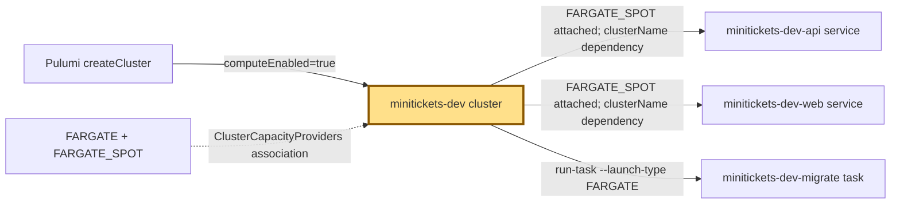
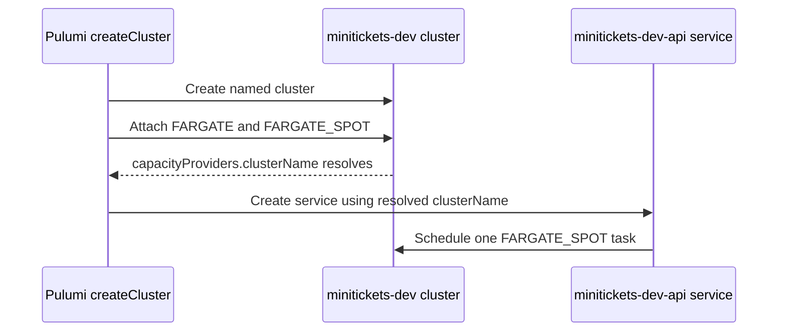

# ECS cluster: the city work register

History: see [CHANGELOG.md](../CHANGELOG.md) or run `pnpm docs:history`
Area: AWS Compute · Status: ✅ built · Step doc: [17 ECS api](../../17-infra-ecs-api.md) (section 3.1)
<!-- interview-card: v1 -->

## 1. In one line

When MiniTickets starts a worker, [ECS](../glossary.md#ecs-cluster), AWS’s container manager, files it under `minitickets-dev`.

## 2. Where it sits

[Open this piece in the city explorer](../guides/infra-explorer.html?concept=ecs-cluster#chapter=8&piece=api-task).

## 3. How it works

## 4. What happens in MiniTickets

1. `createCluster` creates `minitickets-dev` when compute is enabled.
2. It attaches `FARGATE` and `FARGATE_SPOT`: the two places AWS may find machines.
3. API and web services each request one Spot task. The one-off migration uses regular Fargate.
4. Returning the provider’s cluster name makes services wait for that attachment.

## 5. Reach / Allowed / Password

**Reach:** not needed here; each task gets its own network.

**Allowed:** deployment permissions create the cluster; task badges govern running code.

**Password:** not needed; a cluster stores no app password.

## 6. In our code

`infra/src/compute/cluster.ts` → `createCluster`.

## 7. In the AWS console

`us-east-1` → ECS → Clusters → `minitickets-dev` → Services / Tasks; inspect capacity providers under Infrastructure. These are configured names; live counts were not checked.

## 8. Good / Bad

**Good:** One place to find both services. No host machines to maintain.

**Bad:** The register itself adds no network protection. One Spot copy still permits outages.

## 9. Other choices

- EC2 capacity: pick it when steady workloads justify managing your own machines.
- Separate clusters: pick them when environments need separate ownership.

## 10. Connected to

| Neighbor | Direction | What allows it | Console check |
| --- | --- | --- | --- |
| [Service](ecs-service.md) | Out → | Attached Spot provider | ECS → cluster → Services |
| [Fargate](fargate.md) | In ← | Capacity-provider attachment | ECS → cluster → Infrastructure |
| [Task recipe](task-definition.md) | Out → | Service taskDefinition / run-task | ECS → cluster → Tasks |

## 11. When it breaks

“Provider not associated” → service Events → make the service depend on the completed provider attachment.

## 12. Say it in 30 seconds

“Our ECS cluster is the city’s work register. `minitickets-dev` groups API, web and migration tasks. It permits regular Fargate and Spot. Services use Spot; migrations use regular Fargate. The cluster does not protect traffic: task networking and roles do that.”

## 13. Likely follow-ups

- Does a cluster own servers? With Fargate, AWS hides the hosts.
- Why return the provider’s name? To prevent a creation-order race.

## 14. Remember it

The register names the workers; it does not guard their doors.

## 15. More detail

Settings, limits and deeper interview notes

- Anchor: `infra/src/compute/cluster.ts` · `createCluster`: the cluster and its capacity providers.

`containerInsights` is `disabled`; basic service CPU and memory metrics remain available. Extra task-level Container Insights would add observability cost. An empty Fargate cluster has no task compute charge; running tasks and related resources do.

`ClusterCapacityProviders` depends on the cluster. Consumers receive `capacityProviders.clusterName`, not `cluster.name`, so Pulumi follows the full dependency chain. Removing that dependency could fail only on a fresh create, making the bug intermittent.

A capacity-provider strategy uses a base and weights to divide work. Our services choose only Spot; an on-demand base plus Spot is a production option, not our current configuration. A cluster is not a security boundary. AWS refuses to delete one while dependent services remain. EKS is another choice when the Kubernetes ecosystem is required.

[Official ECS console guide](https://docs.aws.amazon.com/AmazonECS/latest/developerguide/getting-started-fargate.html).

## Where it appears in the story

- [Infra story: 4. ECS: cluster, service, task definition, task, Spot](../infra-story.md#4-ecs-cluster-service-task-definition-task-spot)
- [Big picture: 4. Components](../00-big-picture.md#4-components)
