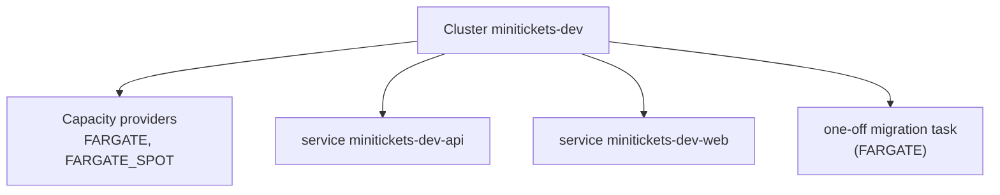

# ECS cluster and capacity providers

Area: AWS Compute · Status: ✅ built · Step doc: [17 ECS api](../../17-infra-ecs-api.md) (section 3.1)

## 1. In one line

An **ECS cluster** is a named group that services and tasks belong to; its **capacity providers**
say what kind of machines those tasks may run on (`FARGATE`, `FARGATE_SPOT`).

## 2. Real-life comparison

A kitchen. It holds no food by itself; it is where the cooks (services) work. The capacity providers
are the two kinds of ovens it may use: the normal oven, or a cheap borrowed one that the owner can
take back.

## 3. Picture it



## 4. Where in our code

- Anchor: `infra/src/compute/cluster.ts` · `createCluster`: the cluster and its capacity providers.

Step by step:

1. `aws.ecs.Cluster` named `minitickets-dev`, with `containerInsights: "disabled"` (see [metrics](metrics.md)).
2. `aws.ecs.ClusterCapacityProviders` attaches `FARGATE` and `FARGATE_SPOT`.
3. Returns `clusterName` **from the capacity providers resource**, so anything that uses the name
   (the services) waits until the providers are attached. Otherwise a service could fail with
   "capacity provider FARGATE_SPOT is not associated with the cluster".
4. Created only when `computeEnabled` is on (`infra/index.ts`, step 12).

## 5. See it yourself

```bash
aws ecs describe-clusters --profile ticketlite --clusters minitickets-dev \
  --query "clusters[0].[status,capacityProviders,runningTasksCount,settings]"
```

**Break it on purpose (thought experiment):** return `cluster.name` instead of
`capacityProviders.clusterName`. On a fresh `pulumi up`, the service may be created first and fail
with the "not associated" error. A race like this shows up only sometimes.

## 6. How it connects

- **Uses ←** nothing.
- **Gives →** a home for [ECS services](ecs-service.md) and the migration task; the capacity for
  [Fargate](fargate.md) and [Fargate Spot](fargate-spot.md).

## 7. Our settings and WHY

| Setting | Value | Why |
| ------- | ----- | --- |
| Name | `minitickets-dev` | Used by scripts and deploy-day commands. |
| Container Insights | disabled | Billed as custom metrics; basic metrics are enough for dev. |
| Capacity providers | FARGATE, FARGATE_SPOT | Services use Spot; migrations use normal Fargate. |

## 8. Trade-offs

- **Pros:** free, nothing to patch.
- **Cons:** a cluster gives no isolation by itself; IAM and security groups do that.

## 9. Alternatives and when to choose them

- **EC2 capacity provider (Auto Scaling group):** large steady workloads or special hardware (GPUs).
- **One cluster per environment or team:** clearer ownership and quotas.
- **EKS:** a Kubernetes ecosystem is a requirement.

## 10. What breaks, and how we'd notice

- Services created before the capacity providers: "not associated with the cluster".
- Cluster deleted while services exist: AWS refuses; Pulumi deletes services first.

## 11. Reach / Allowed / Password

Not a connection. Tasks in it get their own network settings and roles.

## 12. Cost

An empty cluster is free; you pay for running tasks.

## 13. Interview answers at 3 levels

- **Simple:** A cluster groups our containers in ECS.
- **Senior:** Ours is a Fargate-only cluster with the FARGATE and FARGATE_SPOT capacity providers
  attached. Services pick Spot; the migration runner uses on-demand. We pass the cluster name from
  the capacity providers resource to force the right creation order.
- **Lead:** The cluster is mostly a namespace. The real decisions are capacity strategy (on-demand
  base plus Spot), observability cost (Container Insights) and how clusters map to environments and
  teams.

## 14. Follow-up questions interviewers ask

- *Does a cluster have machines?* With Fargate, none we see or pay for.
- *What is a capacity provider strategy?* Weights and a base that split a service's tasks between
  providers.

## 15. Say it in 30 seconds

"One ECS cluster, `minitickets-dev`, with FARGATE and FARGATE_SPOT attached and Container Insights
off. It's free while empty; services use Spot and the migration task uses on-demand Fargate."

## 16. Status

✅ built.
