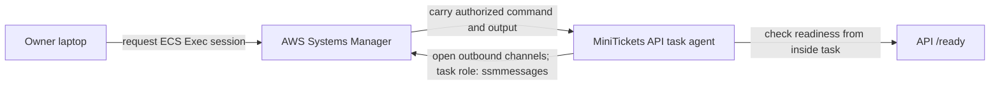

# ECS Exec: a shell inside a running task

History: see [CHANGELOG.md](../CHANGELOG.md) or run `pnpm docs:history`

Area: AWS Compute · Status: ✅ built · Step doc: [17 ECS api](../../17-infra-ecs-api.md) (section 3.12)

<!-- interview-card: v2 -->

## 1. What is it?

ECS Exec lets an authorized operator run a command inside a running container. The connection uses AWS’s management service rather than opening an inbound shell port.

## 2. Why do we need it?

The API cannot connect to its private database. A check from the laptop may succeed or fail for different reasons; sometimes we need to inspect the network from where the API actually runs.

## 3. How does it work?

1. Enable command access for the API service and its task agent.
2. The operator and agent establish an authorized management session.
3. Run a focused diagnostic from inside the container.

## 4. How do we use it in MiniTickets?

MiniTickets enables this for API tasks to investigate readiness and private-store reach. Web tasks do not enable it. A shell can access the container’s environment, so this is powerful operator access that should be restricted and audited.

## 5. Interview-ready answer

“MiniTickets uses ECS Exec to inspect a running API task without opening an inbound SSH port. The task agent and operator connect through AWS’s management service. It helps distinguish a private-network problem from a laptop problem. The access is powerful because the shell can reach injected secrets; production hardening would restrict operators and record sessions.”

## 6. Important follow-up questions

- **Why is permission on the task role?** The management agent runs in the task; its runtime identity opens the channels.
- **Why can the shell fail to start?** Check operator permissions, task-agent state, plugin installation and outbound reach.
- **Does it make the database public?** No. Commands run from inside the API’s existing network boundary.
- **Are sessions already audited here?** Session logging is proposed hardening, not a current guarantee.

## 7. Advanced details

Technical reference

### Configuration and access

API service sets `enableExecuteCommand: true`; task definition sets `linuxParameters.initProcessEnabled: true` to forward signals/reap children. `infra/src/compute/iam.ts` grants task-role `ssmmessages:CreateControlChannel`, `CreateDataChannel`, `OpenControlChannel`, `OpenDataChannel` on `*` because those actions do not support resource-level scoping. Web has no task role/Exec setting. Operator needs scoped `ecs:ExecuteCommand`; both ends use IAM credentials, no shell password. Agent traffic is outbound to Systems Manager through task egress.

Laptop requires AWS CLI and Session Manager plugin. Inspect tasks with `aws ecs list-tasks --profile ticketlite --cluster minitickets-dev --service-name minitickets-dev-api`; inspect `managedAgents` with `aws ecs describe-tasks`. Operator command: `aws ecs execute-command --profile ticketlite --cluster minitickets-dev --task <task-arn> --container api --interactive --command sh`. Inside, a readiness fetch can target `http://localhost:4000/ready`. These are reference commands, not executed here.

### Failure investigation and hardening

Missing plugin gives `SessionManagerPlugin is not found`; a nonrunning agent suggests a task predating enablement or missing task permissions; hanging suggests no route to SSM. A web task is intentionally unavailable for Exec. RDS is private and its group admits API; Exec does not add a direct laptop route.

Sessions are not recorded unless configured. Restrict access to a break-glass role and consider CloudWatch/S3 session logs, KMS and alerts. Alternatives include bastion/SSM forwarding for a SQL client or no production shell, using logs/metrics only. Original notes claim no known extra Exec charge; current pricing was not checked and underlying logging/network costs remain possible. No session or live acceptance was performed here.

### Code anchors

- Anchor: `infra/src/compute/iam.ts` · `taskExec`: the four `ssmmessages` actions on the task role.
- Anchor: `infra/src/compute/service.ts` · `enableExecuteCommand: true`: turned on for the api service.
- Anchor: `infra/src/compute/task.ts` · `linuxParameters.initProcessEnabled`: an init process that reaps the shells.

### Related reading

[task role](execution-vs-task-role.md) · [service](ecs-service.md) · [RDS](rds-postgres.md) · [Valkey](elasticache-valkey.md)

[Open this concept in the city explorer](../guides/infra-explorer.html?concept=ecs-exec#chapter=8&piece=api-task).

## Where it appears in the story

- [Infra story: 4. ECS: cluster, service, task definition, task, Spot](../infra-story.md#4-ecs-cluster-service-task-definition-task-spot)
- [Big picture: 4. Components](../00-big-picture.md#4-components)

