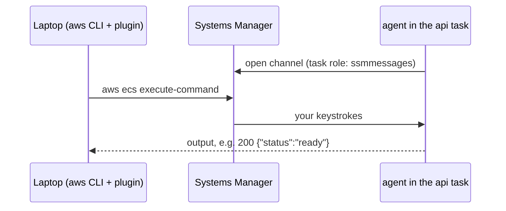

# ECS Exec: a shell inside a running task

Area: AWS Compute · Status: ✅ built · Step doc: [17 ECS api](../../17-infra-ecs-api.md) (section 3.12)

## 1. In one line

**ECS Exec** opens a shell (or runs one command) inside a running container from our laptop,
through AWS Systems Manager, without opening any inbound port.

## 2. Real-life comparison

Calling someone who is already inside a locked building. You cannot walk in, but they phone a shared
switchboard and you phone the same switchboard; it connects the two calls.

## 3. Picture it



## 4. Where in our code

- Anchor: `infra/src/compute/iam.ts` · `taskExec`: the four `ssmmessages` actions on the task role.
- Anchor: `infra/src/compute/service.ts` · `enableExecuteCommand: true`: turned on for the api service.
- Anchor: `infra/src/compute/task.ts` · `linuxParameters.initProcessEnabled`: an init process that reaps the shells.

Step by step:

1. The service has `enableExecuteCommand: true`, so Fargate adds the SSM agent to each api task.
2. The agent opens channels to Systems Manager with the **task role**'s
   `ssmmessages:CreateControlChannel`, `CreateDataChannel`, `OpenControlChannel`, `OpenDataChannel`.
3. `initProcessEnabled: true` runs a tiny init as PID 1 that forwards signals and cleans up the
   child processes each shell creates.
4. On the laptop: the AWS CLI plus the Session Manager plugin.
5. Web has none of this: no task role, no `enableExecuteCommand`.

## 5. See it yourself

```bash
TASK=$(aws ecs list-tasks --profile ticketlite --cluster minitickets-dev --service-name minitickets-dev-api --query 'taskArns[0]' --output text)
aws ecs describe-tasks --profile ticketlite --cluster minitickets-dev --tasks "$TASK" \
  --query "tasks[0].containers[0].managedAgents"          # ExecuteCommandAgent RUNNING
aws ecs execute-command --profile ticketlite --cluster minitickets-dev --task "$TASK" \
  --container api --interactive --command "sh"
# inside: node -e "fetch('http://localhost:4000/ready').then(async r => console.log(r.status, await r.text()))"
```

**Break it on purpose:** try the same against a web task. It fails, because web has ECS Exec off.

## 6. How it connects

- **Uses ←** the [task role](execution-vs-task-role.md), the [service](ecs-service.md), the task's
  path out to AWS endpoints (public IP).
- **Gives →** the only way to look inside the VPC from the laptop: `/ready` checks, reaching
  [RDS](rds-postgres.md) and [Valkey](elasticache-valkey.md) from where the api sits.

## 7. Our settings and WHY

| Choice | Why |
| ------ | --- |
| api only | That is where we need to debug data connections; web has nothing to check. |
| `Resource: "*"` | These `ssmmessages` actions do not support resource-level permissions. |
| `initProcessEnabled` | AWS recommends it for ECS Exec. |

## 8. Trade-offs

- **Pros:** no SSH, no bastion host, no open port, IAM-controlled.
- **Cons:** anyone with `ecs:ExecuteCommand` on the cluster gets a shell with the container's
  environment, including the injected secrets. Sessions are not logged anywhere unless configured.

## 9. Alternatives and when to choose them

- **Bastion host / SSM port forwarding to RDS:** when people need a SQL client against the database.
- **ECS Exec with session logging** to CloudWatch or S3 (and KMS encryption): production audit.
- **No shell at all in production:** strict environments; debug through logs and metrics only.

## 10. What breaks, and how we'd notice

| Symptom | Cause |
| ------- | ----- |
| `SessionManagerPlugin is not found` | Plugin missing on the laptop |
| `execute command failed … agent not running` | Task started before exec was enabled, or task role lacks `ssmmessages` |
| Hangs | No network path from the task to SSM |

## 11. Reach / Allowed / Password

- **Reach:** the agent calls **out** to Systems Manager; nothing calls in.
- **Allowed:** the task role (agent side) and the laptop user's `ecs:ExecuteCommand` (caller side).
- **Password:** none; IAM signs both sides.

## 12. Cost

No extra AWS charge that we know of for ECS Exec itself; the session is a few messages.

## 13. Interview answers at 3 levels

- **Simple:** ECS Exec gives us a shell inside a running container.
- **Senior:** The api service has `enableExecuteCommand`, the task role has the four `ssmmessages`
  actions, and the task definition enables an init process. The agent and our CLI both talk to SSM,
  so no inbound port is opened. We use it to call `/ready` from inside the VPC.
- **Lead:** It replaces bastion hosts, but it is a powerful door. In production I'd restrict
  `ecs:ExecuteCommand` to a break-glass role, log sessions, and alert on use.

## 14. Follow-up questions interviewers ask

- *Why is the permission on the task role, not the execution role?* The agent runs inside the task.
- *Why can't you reach RDS from the laptop directly?* It is private; only the api group may connect.

## 15. Say it in 30 seconds

"ECS Exec opens a shell inside the running api task through Systems Manager. It needs
`enableExecuteCommand` on the service, `ssmmessages` on the task role, an init process, and the
plugin on the laptop. No port is opened; we use it to check `/ready` from inside the VPC."

## 16. Status

✅ built. **To make it production-grade:** session logging and a restricted break-glass role.
