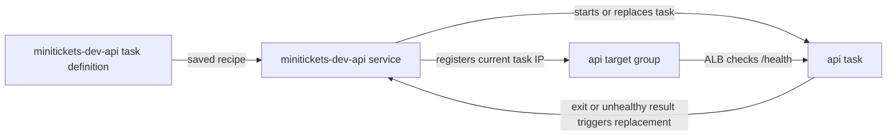

# ECS service: the shift manager

History: see [CHANGELOG.md](../CHANGELOG.md) or run `pnpm docs:history`
Area: AWS Compute · Status: ✅ built · Step docs: [17 ECS api](../../17-infra-ecs-api.md), [18 ALB + web](../../18-infra-alb-web.md)
<!-- interview-card: v2 -->

## 1. What is it?

An [ECS service](../glossary.md#ecs-service) keeps a chosen number of application containers running. It replaces failed tasks and rolls out new versions.

## 2. Why do we need it?

If the MiniTickets API crashes, somebody must start its replacement and update routing. The service does that automatically instead of relying on an operator to notice and restart it.

## 3. How does it work?

1. Compare running tasks with the desired number.
2. Start replacements from the selected task definition.
3. Register new task addresses and retire old ones during deployment.

## 4. How do we use it in MiniTickets?

Separate api and web services each want one Spot task. ECS maintains their target-group membership. New task definitions trigger rolling deployments; a failed startup can trigger rollback. Service Connect provides private application calls.

## 5. Interview-ready answer

“The ECS service is MiniTickets' shift manager: it keeps the desired API or web task running, replaces failures and updates load-balancer targets. It also rolls new task definitions and can roll back failed deployments. One interruptible task per application is a dev cost trade-off, so replacement can still leave an outage.”

## 6. Important follow-up questions

- **Service versus task?** The service manages continuity; a task is one running copy.
- **Why might a service never stabilize?** Inspect service events and stopped-task reasons for image, secret, health or network failures.
- **Does successful startup prove booking works?** No. Current liveness checks deliberately avoid shared stores.
- **When use a standalone task?** For finite work such as a database migration, which should finish rather than stay running.

## 7. Advanced details

Technical reference

### Configuration, permissions and operations

`infra/src/compute/service.ts` → `createApiService` and `infra/src/compute/web-service.ts` → `createWebService` create the two services in `minitickets-dev`. Each uses `desiredCount: 1`, `FARGATE_SPOT` weight 1, public subnets and `assignPublicIp: true` for outgoing AWS access. Selected task-definition ARNs supply the recipes; cluster/provider dependencies supply capacity.

ALB mappings select container `api` 4000 or `web` 3000. API ingress allows ALB 4000 and web's Service Connect proxy traffic on 14000; the reverse private proxy receives on web 13000. ECS's service-linked role manages network interfaces and target registration, not the app task role. ECS injects app secrets at startup.

In `us-east-1`: ECS → Clusters → `minitickets-dev` → Services → named service → Deployments / Events / Tasks. Task Networking shows subnet/interface/security groups. Live health was not checked. Repair the image, secret access or network path identified by stopped-task reasons before retrying an unstable rollout.

- Anchor: `infra/src/compute/service.ts` · `createApiService`: the api service.
- Anchor: `infra/src/compute/web-service.ts` · `createWebService`: the web service.

Both services enable `deploymentCircuitBreaker: { enable: true, rollback: true }`. API enables ECS Exec; web does not. Neither explicitly sets rolling minimum/maximum percentages, so ECS defaults apply. Spot interruption or a crash can still leave no worker while a replacement starts; rolling overlap does not remove that risk.

The API’s ALB mapping and 60-second grace period exist only with entry enabled. Web exists only with entry enabled. The target group must already belong to a listener before service creation; the listener layer returns usable ARNs after attaching the rules. A different VPC or unattached target group causes creation failure.

Service Connect offers `api:4000` and `web:3000`; receiving proxies use 14000 and 13000. Web waits for the API service to exist so its first task learns the API name. API may require a one-time redeployment when web is first added. Service auto scaling and an on-demand base remain future choices. Blue/green deployment buys a switchable new fleet at the cost of overlapping capacity.

The ECS service itself adds no separate compute charge. Task CPU, memory, public IPv4 and surrounding resources do. Historical hourly estimates are not current quotes.

[Official ECS task networking](https://docs.aws.amazon.com/AmazonECS/latest/developerguide/fargate-task-networking.html).

### Related reading

- [Cluster](ecs-cluster.md)
- [Task recipe](task-definition.md)
- [Target groups](target-groups.md)

[Open this piece in the city explorer](../guides/infra-explorer.html?concept=ecs-service#chapter=8&piece=api-task).

## Where it appears in the story

- [Infra story: 4. ECS: cluster, service, task definition, task, Spot](../infra-story.md#4-ecs-cluster-service-task-definition-task-spot)
- [Big picture: 4. Components](../00-big-picture.md#4-components)

