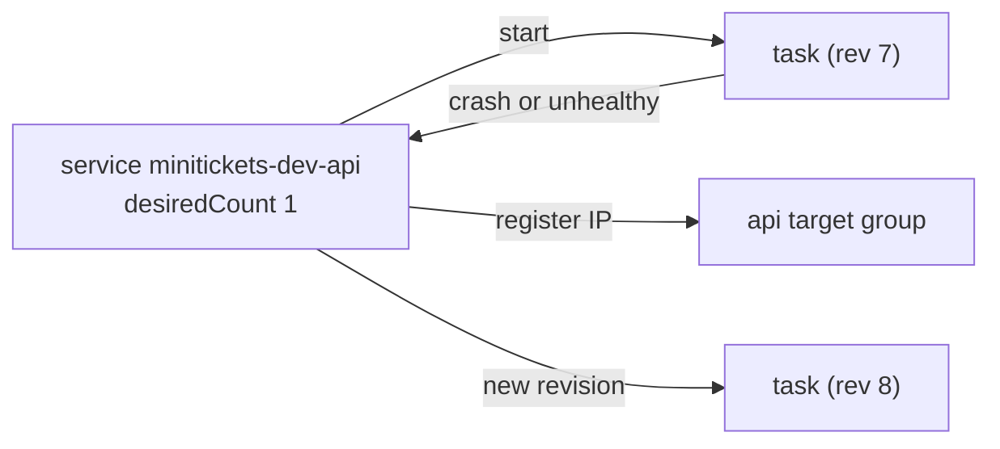

# ECS service: desired count, replacement

History: see [CHANGELOG.md](../CHANGELOG.md) or run `pnpm docs:history`

Area: AWS Compute · Status: ✅ built · Step docs: [17 ECS api](../../17-infra-ecs-api.md), [18 ALB + web](../../18-infra-alb-web.md)

## 1. In one line

An **ECS service** keeps the wanted number of tasks running from one task definition, replaces any
task that dies or fails its health checks, registers tasks with the ALB, and rolls out new revisions.

## 2. Real-life comparison

A shift manager. The rule is "always one cook at the api counter". If the cook goes home sick, the
manager calls in another one. When the recipe changes, the manager brings in a cook with the new
recipe before sending the old one home.

## 3. Picture it



## 4. Where in our code

- Anchor: `infra/src/compute/service.ts` · `createApiService`: the api service.
- Anchor: `infra/src/compute/web-service.ts` · `createWebService`: the web service.

The api service, step by step:

1. `cluster: clusterName`, `taskDefinition: taskDefinitionArn`.
2. `desiredCount: 1` ([scaling](scaling.md)).
3. `capacityProviderStrategies: [{ capacityProvider: "FARGATE_SPOT", weight: 1 }]` ([fargate-spot](fargate-spot.md)).
4. `networkConfiguration`: public subnets, the api security group, `assignPublicIp: true` (no NAT).
5. `deploymentCircuitBreaker: { enable: true, rollback: true }` ([circuit-breaker](circuit-breaker.md)).
6. `enableExecuteCommand: true` ([ecs-exec](ecs-exec.md)).
7. Only with entry on: `loadBalancers` (container `api`, port 4000, api target group) and
   `healthCheckGracePeriodSeconds: 60`.
8. No deployment settings are given, so ECS's rolling-update defaults apply
   ([zero-downtime-deploys](zero-downtime-deploys.md)).

The web service is the same pattern with container `web`, port 3000, the web group and no ECS Exec.

## 5. See it yourself

```bash
aws ecs describe-services --profile ticketlite --cluster minitickets-dev \
  --services minitickets-dev-api minitickets-dev-web \
  --query 'services[].{name:serviceName,desired:desiredCount,running:runningCount,events:events[:3].message}'
```

**Break it on purpose (safe, compute on):** stop the running api task by hand
(`aws ecs stop-task --cluster minitickets-dev --task <arn>`). Within a minute the service starts a
new one; the events show "has started 1 tasks".

## 6. How it connects

- **Uses ←** [cluster](ecs-cluster.md), [task definition](task-definition.md),
  [subnets](subnets.md), [security groups](security-groups.md), [target groups](target-groups.md).
- **Gives →** running tasks for the [ALB](alb.md); rolling deploys; self-healing.

## 7. Our settings and WHY

| Setting | api | web | Why |
| ------- | --- | --- | --- |
| `desiredCount` | 1 | 1 | Dev; production 2+ across AZs. |
| Capacity | FARGATE_SPOT | FARGATE_SPOT | About 70% cheaper; dev can live with interruptions. |
| Public IP | yes | yes | No NAT gateway. |
| Circuit breaker + rollback | yes | yes | A broken image does not loop forever. |
| ECS Exec | yes | no | Debug shell for the api only. |
| Grace period | 60 s (entry on) | 60 s | Node needs a few seconds before `/health` answers. |

## 8. Trade-offs

- **Pros:** self-healing, rolling deploys, ALB registration, all managed.
- **Cons:** with one task, every replacement or Spot interruption is a short outage.

## 9. Alternatives and when to choose them

- **Service auto scaling** (target tracking on CPU or requests): real traffic.
- **CODE_DEPLOY (blue/green) deployment controller:** instant switch and fast rollback.
- **Standalone tasks (`run-task`):** one-off jobs like our migration.

## 10. What breaks, and how we'd notice

- `services-stable` times out: a task keeps failing; check the stopped reason and service events.
- "unable to place a task": capacity, subnet or configuration problems.
- Service and target group in different VPCs, or the target group not attached to a load balancer:
  ECS refuses to create the service (why `listener.ts` returns the ARNs only after the rules exist).

## 11. Reach / Allowed / Password

- **Reach:** the service's `networkConfiguration` decides subnets, security group and public IP.
- **Allowed:** ECS uses its service-linked role (`AWSServiceRoleForECS`) to create network
  interfaces and register targets; tasks use their own roles.

## 12. Cost

The service is free; each task costs per second (Spot ARM ¼ vCPU + 512 MB ≈ $0.003 an hour, plus
$0.005 an hour for its public IPv4 address).

## 13. Interview answers at 3 levels

- **Simple:** A service keeps our containers running and replaces failed ones.
- **Senior:** Two services, api and web, one Spot task each in public subnets with their own
  security groups, registered in `ip` target groups with a 60 s grace period, deployment circuit
  breaker with rollback, and ECS Exec on the api.
- **Lead:** For production: two or more tasks spread across AZs, an on-demand base with Spot on top,
  auto scaling, and alarms on running count and deployment failures.

## 14. Follow-up questions interviewers ask

- *Service vs task?* The task is one running copy; the service keeps N copies alive.
- *What does the grace period protect?* ECS from killing a task whose ALB checks have not passed yet.

## 15. Say it in 30 seconds

"Two ECS services keep one Spot task each running for api and web, register them in the ALB's target
groups, replace failed tasks, and roll out new revisions with a circuit breaker that rolls back if
the new version never gets healthy."

## 16. Status

✅ built. **To make it production-grade:** 2+ tasks across AZs, on-demand base, auto scaling.
