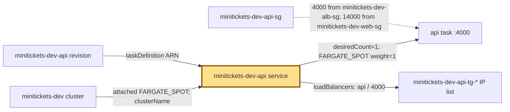
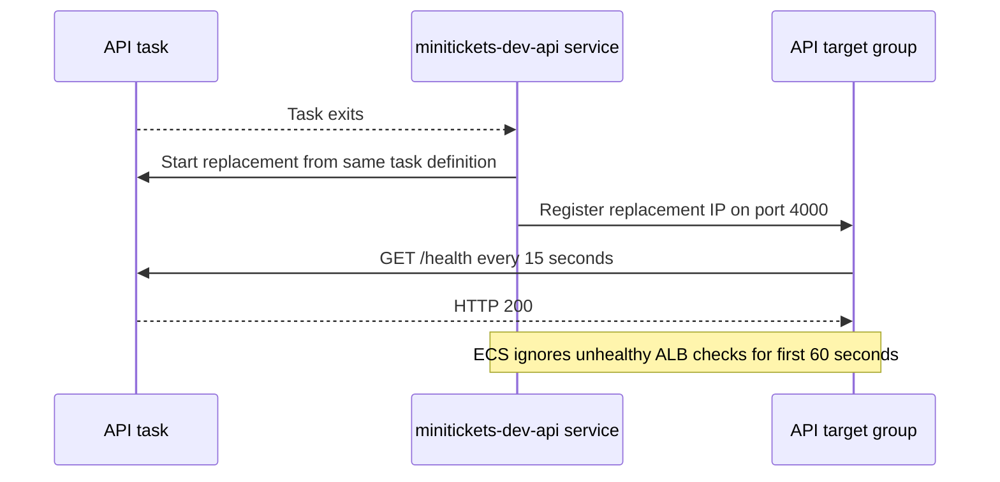

# ECS service: the shift manager

History: see [CHANGELOG.md](../CHANGELOG.md) or run `pnpm docs:history`
Area: AWS Compute · Status: ✅ built · Step docs: [17 ECS api](../../17-infra-ecs-api.md), [18 ALB + web](../../18-infra-alb-web.md)
<!-- interview-card: v1 -->

## 1. In one line

When an API worker dies, the MiniTickets [service](../glossary.md#ecs-service) starts a replacement from its saved recipe.

## 2. Where it sits

[Open this piece in the city explorer](../guides/infra-explorer.html?concept=ecs-service#chapter=8&piece=api-task).

## 3. How it works

## 4. What happens in MiniTickets

1. `minitickets-dev-api` and `minitickets-dev-web` each want one task.
2. Both run on Spot, in public subnets with a public IP for outgoing AWS calls.
3. ECS adds each task IP to its API :4000 or web :3000 target group.
4. Failed tasks are replaced. New recipes trigger a rolling change; a startup failure can trigger automatic rollback.

## 5. Reach / Allowed / Password

**Reach:** public subnets and task security groups.

**Allowed:** ECS’s service-linked role manages task interfaces and target registration.

**Password:** not needed by the manager; ECS injects each app’s secrets at startup.

## 6. In our code

`infra/src/compute/service.ts` → `createApiService`.

`infra/src/compute/web-service.ts` → `createWebService`.

## 7. In the AWS console

`us-east-1` → ECS → Clusters → `minitickets-dev` → Services → `minitickets-dev-api` → Deployments / Events / Tasks. Open a task’s Networking details to see its subnet, interface and guards. Live health was not checked.

## 8. Good / Bad

**Good:** Replaces failed workers. Registers changing task IPs automatically.

**Bad:** One Spot copy can go away. A healthy process does not prove booking works.

## 9. Other choices

- Two or more tasks: pick them when one lost worker must not stop the app.
- Standalone task: pick it when work runs once, like migrations.

## 10. Connected to

| Neighbor | Direction | What allows it | Console check |
| --- | --- | --- | --- |
| [Cluster](ecs-cluster.md) | In ← | Attached provider | ECS → cluster → Infrastructure |
| [Task recipe](task-definition.md) | In ← | taskDefinition ARN | ECS → service → Deployments |
| [Target groups](target-groups.md) | Out → | containerName + containerPort mapping | EC2 → Target groups → Targets |

## 11. When it breaks

Never becomes stable → service Events and stopped-task reason → repair the image, secret access or network path before retrying.

## 12. Say it in 30 seconds

“The service is our shift manager. It keeps one API or web task alive, replaces failures and registers task IPs with the load balancer. It rolls new task definitions and can roll back a failed startup. One Spot task is a dev cost choice, so I do not claim high availability.”

## 13. Likely follow-ups

- Service versus task? The manager versus one running worker.
- What does 60 seconds protect? Startup from early failed load-balancer checks.

## 14. Remember it

A task does one shift; the service fills the next shift.

## 15. More detail

Settings, limits and deeper interview notes

- Anchor: `infra/src/compute/service.ts` · `createApiService`: the api service.
- Anchor: `infra/src/compute/web-service.ts` · `createWebService`: the web service.

Both services enable `deploymentCircuitBreaker: { enable: true, rollback: true }`. API enables ECS Exec; web does not. Neither explicitly sets rolling minimum/maximum percentages, so ECS defaults apply. Spot interruption or a crash can still leave no worker while a replacement starts; rolling overlap does not remove that risk.

The API’s ALB mapping and 60-second grace period exist only with entry enabled. Web exists only with entry enabled. The target group must already belong to a listener before service creation; the listener layer returns usable ARNs after attaching the rules. A different VPC or unattached target group causes creation failure.

Service Connect offers `api:4000` and `web:3000`; receiving proxies use 14000 and 13000. Web waits for the API service to exist so its first task learns the API name. API may require a one-time redeployment when web is first added. Service auto scaling and an on-demand base remain future choices. Blue/green deployment buys a switchable new fleet at the cost of overlapping capacity.

The ECS service itself adds no separate compute charge. Task CPU, memory, public IPv4 and surrounding resources do. Historical hourly estimates are not current quotes.

[Official ECS task networking](https://docs.aws.amazon.com/AmazonECS/latest/developerguide/fargate-task-networking.html).

## Where it appears in the story

- [Infra story: 4. ECS: cluster, service, task definition, task, Spot](../infra-story.md#4-ecs-cluster-service-task-definition-task-spot)
- [Big picture: 4. Components](../00-big-picture.md#4-components)
