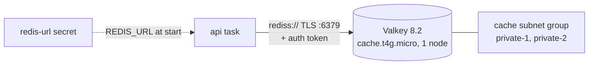

# ElastiCache Valkey: TLS + auth token

History: see [CHANGELOG.md](../CHANGELOG.md) or run `pnpm docs:history`

Area: AWS Data · Status: ✅ built · Step doc: [14 data](../../14-infra-data.md) (sections 3.7, 3.8)

## 1. In one line

**ElastiCache** runs a managed **Valkey** 8.2 node (an open-source fork of Redis) in our private
subnets; the api keeps login sessions there, over TLS with an auth token.

## 2. Real-life comparison

A coat check next to the vault: fast, small, short-lived. You get a ticket (session id), and the
coat check only opens for staff who know its password.

## 3. Picture it



## 4. Where in our code

- Anchor: `infra/src/data/cache.ts` · `createCache`: auth token, subnet group and the replication group.

Step by step:

1. `authToken`: `random.RandomPassword`, 32 letters and digits (safe inside a URL), stored as a
   Pulumi secret.
2. `subnetGroup`: private subnets only, 2 AZs.
3. `aws.elasticache.ReplicationGroup`: `engine: "valkey"`, `engineVersion: "8.2"`,
   `nodeType: "cache.t4g.micro"`, `numCacheClusters: 1`, no automatic failover, no Multi-AZ, port 6379.
   A replication group (not a plain cache cluster) is the kind that supports TLS + auth token.
4. `securityGroupIds: [redisSgId]`.
5. `transitEncryptionEnabled: true`, `atRestEncryptionEnabled: true`, `authToken`.
6. `snapshotRetentionLimit: 0` (no backups: sessions can be recreated by logging in).
7. `secrets.ts` stores `rediss://:<token>@<primary endpoint>:6379` as the redis-url secret
   ([secrets-manager](secrets-manager.md)).

The api code is unchanged from local Redis 7.4: Valkey speaks the same protocol, and we only use
GET, SET with expiry and DEL.

## 5. See it yourself

```bash
aws elasticache describe-replication-groups --profile ticketlite --replication-group-id minitickets-dev-valkey \
  --query "ReplicationGroups[0].[TransitEncryptionEnabled,AtRestEncryptionEnabled,AuthTokenEnabled,Status]"
```

Expect `true, true, true, available`. To prove the session store works: log in on `appUrl`, then
`/ready` via ECS Exec returns 200.

**Break it on purpose (thought experiment):** put `redis://` (no `s`) in the secret. The server only
accepts TLS, so the connection fails and `/ready` returns 503.

## 6. How it connects

- **Uses ←** [private subnets](subnets.md), the redis [security group](security-groups.md).
- **Gives →** the session store behind login (Phase 3 `sessions-vs-jwt` card); its endpoint and token
  to [Secrets Manager](secrets-manager.md).

## 7. Our settings and WHY

| Setting | Value | Why |
| ------- | ----- | --- |
| Engine | Valkey 8.2 | Redis-compatible and about 20% cheaper than Redis on ElastiCache. |
| Size | 1 × `cache.t4g.micro` | Plenty for sessions in dev. |
| TLS + token | on | Session ids never cross the network in plain text; only callers with the token can run commands. |
| Snapshots | 0 | Sessions are not the source of truth. |

## 8. Trade-offs

- **Pros:** fast, managed, encrypted, private.
- **Cons:** one node: if it fails, every user is logged out until it comes back. TLS and at-rest
  encryption cannot be turned on later without rebuilding.

## 9. Alternatives and when to choose them

- **2+ nodes in 2 AZs with automatic failover:** production.
- **ElastiCache Serverless:** spiky load, no sizing.
- **DynamoDB with TTL** for sessions: no always-on node, pay per request.
- **Stateless JWTs:** no session store at all, but no instant logout.

## 10. What breaks, and how we'd notice

| Symptom | Cause |
| ------- | ----- |
| Hang / timeout | Security group or `redis://` instead of `rediss://` |
| `WRONGPASS` / `NOAUTH` | Wrong token in the secret |
| Everyone logged out | The node restarted or the data layer was switched off |

## 11. Reach / Allowed / Password

**Reach:** redis group allows 6379 only from the api group; private subnets. **Allowed:** no IAM on
the connection. **Password:** the auth token inside the `rediss://` URL, over TLS.

## 12. Cost

About $0.013 an hour, roughly $9.30 a month if left on ([docs/14](../../14-infra-data.md), section 3.11).

## 13. Interview answers at 3 levels

- **Simple:** A managed Redis-compatible cache that stores our login sessions.
- **Senior:** A single-node Valkey 8.2 replication group on `cache.t4g.micro` in the private subnets,
  TLS in transit, encryption at rest and an auth token. The full `rediss://` URL lives in Secrets
  Manager and is injected as `REDIS_URL`. The api code is the same as for local Redis.
- **Lead:** Sessions make the api stateless, which moves availability to the cache. For production
  I'd run a replica in a second AZ with automatic failover, alarm on memory and evictions, and decide
  whether losing sessions on failover is acceptable.

## 14. Follow-up questions interviewers ask

- *Why Valkey and not Redis?* Same protocol, open-source licence, cheaper on ElastiCache.
- *Why no backups?* Sessions are disposable; users can log in again.

## 15. Say it in 30 seconds

"Sessions live in a single Valkey 8.2 node on ElastiCache, private, TLS-only, with an auth token and
at-rest encryption. The api gets a `rediss://` URL from Secrets Manager. It's one node in dev, so a
failure logs everyone out; production needs a replica with failover."

## 16. Status

✅ built for dev. **To make it production-grade:** replica + automatic failover across AZs.

## Where it appears in the story

- [Infra story: 8. ElastiCache Valkey](../infra-story.md#8-elasticache-valkey)
- [Big picture: 4. Components](../00-big-picture.md#4-components)
