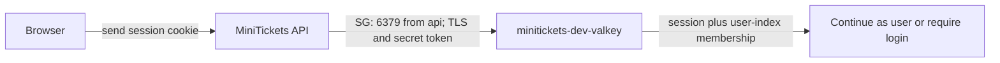

# Valkey: the city’s fast coat check

History: see [CHANGELOG.md](../CHANGELOG.md) or run `pnpm docs:history`
Area: AWS Data · Status: ✅ built · Step doc: [14 data](../../14-infra-data.md) (sections 3.7, 3.8)
<!-- interview-card: v2 -->

## 1. What is it?

[Valkey](../glossary.md#v) is a fast shared memory store that understands Redis commands. MiniTickets keeps [session](../glossary.md#valkey) records there to remember logged-in users.

## 2. Why do we need it?

A visitor can reach different API copies on successive requests. Shared session storage lets each copy recognize the same login instead of remembering it only inside one process.

## 3. How does it work?

1. The API hashes the cookie token and looks up its session.
2. It checks that the token still belongs to the user's session index.
3. Missing either record means the login is not accepted.

## 4. How do we use it in MiniTickets?

Valkey also holds legacy event-list caches, shared rate limits and advisory seat availability. Current `events.search` bypasses that list cache. Atomic Lua scripts coordinate related updates; Postgres still decides seat ownership.

## 5. Interview-ready answer

“Valkey gives MiniTickets fast shared state across API copies. We use it for sessions, legacy list caches and admission hints. Session reads require both a record and index membership, so missing state fails closed. Redis can reduce database work, but our Postgres transaction remains the final authority for selling seats.”

## 6. Important follow-up questions

- **What if sessions disappear?** Users need to log in again; missing login state cannot be trusted.
- **Is all Redis state disposable?** Public caches rebuild, but losing sessions affects users and needs an explicit availability policy.
- **Can stale seat hints oversell?** They cannot override the database's locked seat check.
- **Why not keep state in each API?** Separate processes would disagree; shared commands coordinate them.

## 7. Advanced details

Technical reference

### Configuration and security

The cache guard is `minitickets-dev-redis-sg`; only `minitickets-dev-api-sg` reaches TCP 6379. Its URL secret is `minitickets/dev/redis-url`. Reconciliation reads confirmed `seatsLeft` from Postgres; Redis never becomes the booking authority.

ECS injects `REDIS_URL` at startup using execution-role `GetSecretValue`. Redis commands themselves use the auth token, not an IAM permission check. Sessions last seven days. One node has no automatic failover; login storage availability needs deliberate treatment even though public cache values can rebuild.

### Implementation and operational limits

- Anchor: `infra/src/data/cache.ts` · `createCache`: auth token, subnet group and the replication group.

`createCache` creates a replication group with `engine: "valkey"`, `engineVersion: "8.2"`, `nodeType: "cache.t4g.micro"`, `numCacheClusters: 1`, `automaticFailoverEnabled: false`, `multiAzEnabled: false`, `port: 6379`. Its subnet group uses the two private subnets. A subnet group across zones is not a second node.

Both transit and at-rest encryption are enabled. `random.RandomPassword` creates 32 letters/digits so the token safely fits inside the URL. Secrets Manager stores `rediss://:<token>@<primary endpoint>:6379`; neither the token nor full URL should be printed. A replication-group resource supports primary/replica operation; this setup chooses one primary. Current [AWS TLS documentation](https://docs.aws.amazon.com/AmazonElastiCache/latest/dg/in-transit-encryption.html) covers supported encryption changes; do not assume every change requires replacement.

`snapshotRetentionLimit: 0` and `applyImmediately: true` are dev choices. Sessions are replaceable by login; public list caches can rebuild. A cache outage does not imply every key was lost, but inaccessible login authority cannot be assumed valid. Add a replica/failover, memory/eviction alarms and an explicit session-loss policy before a stronger availability claim.

The app now uses sorted sets, hashes, Lua scripts and scans as well as GET/SET/DEL. Session creation and index updates share a Lua operation, cap 20 devices and replace the previous token. Reads require both the saved session and index membership. Rate buckets and inventory use separate scripts; Redis admission is advisory and is repaired against Postgres.

Legacy list soft freshness is 30–33 s and hard expiry 300 s. Cache failures have bounded behavior; authorization and seat truth must not rely on stale public lists. ElastiCache Serverless and JWTs are other designs, with different cost and revocation choices. Historical $9.30/month and percentage savings were estimates, not checked prices.

### Source references

`infra/src/data/cache.ts` → `createCache`.

`apps/api/src/queries/sessions.ts` → `create`, `get`, `revokeAll`.

`apps/api/src/queries/inventory.ts` → `reserve`, `reconcile`.

### Console and troubleshooting

`us-east-1` → ElastiCache → Valkey caches → `minitickets-dev-valkey` → Configuration / Connectivity and security. Check one primary, TLS, authentication and subnet group. Console labels can vary with cache view; live state was not checked.

Timeout → guard/routes/TLS URL → restore private 6379 path.

`WRONGPASS` → injected secret age → correct credentials and replace affected task.

Login disappears → eviction/restart/index expiry → inspect memory and session logs.

### Trade-offs and related concepts

- Replica plus failover: pick it when one node failure must not stop login.
- DynamoDB sessions: pick them when per-request storage fits better than a running node.

| Neighbor | Direction | What allows it | Console check |
| --- | --- | --- | --- |
| [Sessions](sessions-vs-jwt.md) | In/out ↔ | TLS + auth token | ElastiCache → cache → Configuration |
| [Cache-aside](cache-aside.md) | In/out ↔ | API Redis client and bounded keys | ElastiCache → Monitoring |
| [Secrets](secrets-manager.md) | In ← | Execution-role GetSecretValue | Secrets Manager → redis-url → Permissions |

[Open this piece in the city explorer](../guides/infra-explorer.html?concept=elasticache-valkey#chapter=5&piece=valkey).

## Where it appears in the story

- [Infra story: 8. ElastiCache Valkey](../infra-story.md#8-elasticache-valkey)
- [Big picture: 4. Components](../00-big-picture.md#4-components)

