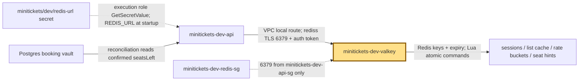
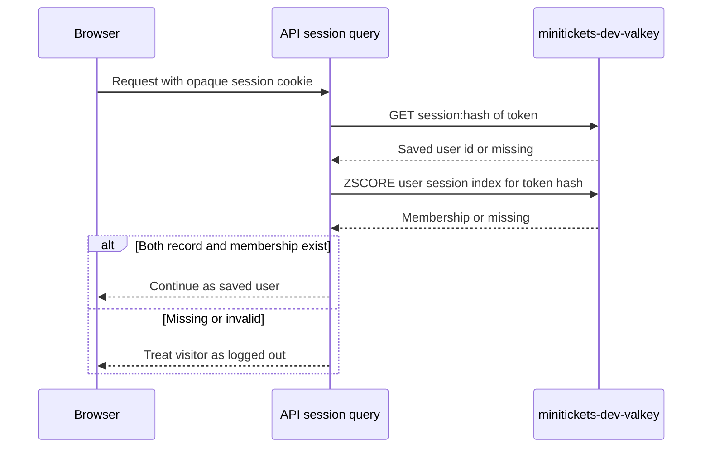

# Valkey: the city’s fast coat check

History: see [CHANGELOG.md](../CHANGELOG.md) or run `pnpm docs:history`
Area: AWS Data · Status: ✅ built · Step doc: [14 data](../../14-infra-data.md) (sections 3.7, 3.8)
<!-- interview-card: v1 -->

## 1. In one line

When a visitor returns, MiniTickets checks their [session](../glossary.md#valkey), its saved login record, in private [Valkey](../glossary.md#v), our Redis-compatible memory store.

## 2. Where it sits

[Open this piece in the city explorer](../guides/infra-explorer.html?concept=elasticache-valkey#chapter=5&piece=valkey).

## 3. How it works

## 4. What happens in MiniTickets

1. `createCache` creates one Valkey 8.2 node, `cache.t4g.micro`, private on :6379.
2. ECS injects `REDIS_URL`, containing the TLS address and a 32-character token.
3. Sessions last seven days; a per-user index supports rotation, device limits and revocation.
4. Legacy event lists, shared rate buckets and advisory inventory also use Redis commands.
5. Postgres still decides seat ownership. Current `events.search` bypasses the legacy list cache.

## 5. Reach / Allowed / Password

**Reach:** private route; redis guard allows 6379 from minitickets-dev-api-sg only.

**Allowed:** no IAM check on Redis commands; execution role reads the URL secret first.

**Password:** auth token inside `rediss://`, with TLS.

## 6. In our code

`infra/src/data/cache.ts` → `createCache`.

`apps/api/src/queries/sessions.ts` → `create`, `get`, `revokeAll`.

`apps/api/src/queries/inventory.ts` → `reserve`, `reconcile`.

## 7. In the AWS console

`us-east-1` → ElastiCache → Valkey caches → `minitickets-dev-valkey` → Configuration / Connectivity and security. Check one primary, TLS, authentication and subnet group. Console labels can vary with cache view; live state was not checked.

## 8. Good / Bad

**Good:** Fast shared login checks. Atomic scripts coordinate work across API copies.

**Bad:** One node has no failover. Losing session records forces fresh login.

## 9. Other choices

- Replica plus failover: pick it when one node failure must not stop login.
- DynamoDB sessions: pick them when per-request storage fits better than a running node.

## 10. Connected to

| Neighbor | Direction | What allows it | Console check |
| --- | --- | --- | --- |
| [Sessions](sessions-vs-jwt.md) | In/out ↔ | TLS + auth token | ElastiCache → cache → Configuration |
| [Cache-aside](cache-aside.md) | In/out ↔ | API Redis client and bounded keys | ElastiCache → Monitoring |
| [Secrets](secrets-manager.md) | In ← | Execution-role GetSecretValue | Secrets Manager → redis-url → Permissions |

## 11. When it breaks

Timeout → guard/routes/TLS URL → restore private 6379 path.

`WRONGPASS` → injected secret age → correct credentials and replace affected task.

Login disappears → eviction/restart/index expiry → inspect memory and session logs.

## 12. Say it in 30 seconds

“Valkey is our fast shared coat check. It holds login records, legacy list caches and advisory admission state. The API reaches one private TLS-only node with a secret token. Lua makes related changes atomic. It is disposable support state: Postgres remains seat truth, and missing session membership fails closed.”

## 13. Likely follow-ups

- Why Valkey? It speaks the Redis protocol our client uses.
- Does losing a cache risk overselling? No; the locked Postgres transaction decides.

## 14. Remember it

The coat-check ticket proves a login; it never owns a theatre seat.

## 15. More detail

Settings, limits and deeper interview notes

- Anchor: `infra/src/data/cache.ts` · `createCache`: auth token, subnet group and the replication group.

`createCache` creates a replication group with `engine: "valkey"`, `engineVersion: "8.2"`, `nodeType: "cache.t4g.micro"`, `numCacheClusters: 1`, `automaticFailoverEnabled: false`, `multiAzEnabled: false`, `port: 6379`. Its subnet group uses the two private subnets. A subnet group across zones is not a second node.

Both transit and at-rest encryption are enabled. `random.RandomPassword` creates 32 letters/digits so the token safely fits inside the URL. Secrets Manager stores `rediss://:<token>@<primary endpoint>:6379`; neither the token nor full URL should be printed. A replication-group resource supports primary/replica operation; this setup chooses one primary. Current [AWS TLS documentation](https://docs.aws.amazon.com/AmazonElastiCache/latest/dg/in-transit-encryption.html) covers supported encryption changes; do not assume every change requires replacement.

`snapshotRetentionLimit: 0` and `applyImmediately: true` are dev choices. Sessions are replaceable by login; public list caches can rebuild. A cache outage does not imply every key was lost, but inaccessible login authority cannot be assumed valid. Add a replica/failover, memory/eviction alarms and an explicit session-loss policy before a stronger availability claim.

The app now uses sorted sets, hashes, Lua scripts and scans as well as GET/SET/DEL. Session creation and index updates share a Lua operation, cap 20 devices and replace the previous token. Reads require both the saved session and index membership. Rate buckets and inventory use separate scripts; Redis admission is advisory and is repaired against Postgres.

Legacy list soft freshness is 30–33 s and hard expiry 300 s. Cache failures have bounded behavior; authorization and seat truth must not rely on stale public lists. ElastiCache Serverless and JWTs are other designs, with different cost and revocation choices. Historical $9.30/month and percentage savings were estimates, not checked prices.

## Where it appears in the story

- [Infra story: 8. ElastiCache Valkey](../infra-story.md#8-elasticache-valkey)
- [Big picture: 4. Components](../00-big-picture.md#4-components)
