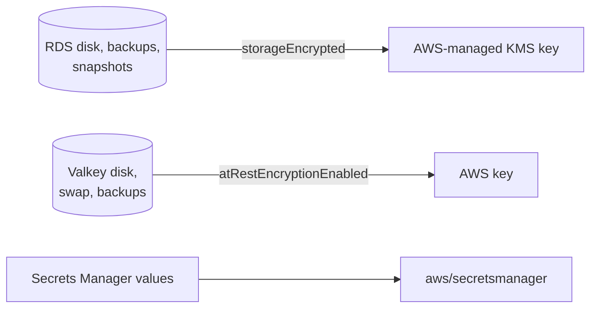

# Encryption at rest

History: see [CHANGELOG.md](../CHANGELOG.md) or run `pnpm docs:history`

Area: Auth & Security · Status: ✅ built · Step doc: [14 data](../../14-infra-data.md) (section 3.8)

## 1. In one line

**Encryption at rest** means data is stored encrypted on disk and in backups, so a stolen disk or
snapshot is unreadable without the key.

## 2. Real-life comparison

Keeping documents in a locked filing cabinet, not just in a locked room. If someone carries the
cabinet out, they still cannot read the papers.

## 3. Picture it



## 4. Where in our code

- Anchor: `infra/src/data/postgres.ts` · `storageEncrypted: true`: disk, backups and snapshots encrypted.
- Anchor: `infra/src/data/cache.ts` · `atRestEncryptionEnabled: true`: data Valkey writes to disk is encrypted.

Step by step:

1. Both settings are given at creation. They **cannot be turned on later** without rebuilding the
   database or cache (comments at both settings).
2. No key is named, so AWS's default keys are used ([kms](kms.md)).
3. Secrets Manager always encrypts secret values.
4. Encryption and decryption are transparent: the api's code does nothing different.

## 5. See it yourself

```bash
aws rds describe-db-instances --profile ticketlite --db-instance-identifier minitickets-dev-db --query "DBInstances[0].StorageEncrypted"
aws elasticache describe-replication-groups --profile ticketlite --replication-group-id minitickets-dev-valkey --query "ReplicationGroups[0].AtRestEncryptionEnabled"
```

Both should print `true`.

## 6. How it connects

- **Uses ←** [KMS](kms.md).
- **Gives →** protection for [RDS](rds-postgres.md) data and [backups](backups-dr.md), and for the
  [Valkey](elasticache-valkey.md) node's disk.

## 7. Our settings and WHY

On for both, because it is free, required by most compliance standards, and impossible to add later
without a rebuild.

## 8. Trade-offs

- **Pros:** stolen media is useless; required for audits.
- **Cons:** it does not protect against anyone who can query the running database (the api, a stolen
  password). It protects the disk, not the data's users.

## 9. Alternatives and when to choose them

- **Customer-managed keys:** control and audit of the key itself.
- **Application-level (field) encryption:** very sensitive fields (for example tax ids) that even DB
  admins must not read.

## 10. What breaks, and how we'd notice

- Forgetting it at creation: a migration to a new encrypted instance (snapshot → copy encrypted →
  restore) later.

## 11. Reach / Allowed / Password

Not a connection. With customer-managed keys, KMS permissions would become an **Allowed** question.

## 12. Cost

Free with AWS-managed keys; no measurable performance cost for us.

## 13. Interview answers at 3 levels

- **Simple:** Our database and cache are encrypted on disk.
- **Senior:** `storageEncrypted` on RDS (covering backups and snapshots) and `atRestEncryptionEnabled`
  on Valkey, both with default AWS keys, both set at creation because they cannot be enabled later in
  place.
- **Lead:** At-rest encryption is table stakes; the real protection of data is access control,
  TLS, and least privilege. I'd add customer-managed keys only when key control or cross-account
  sharing is required.

## 14. Follow-up questions interviewers ask

- *Does at-rest encryption stop SQL injection leaks?* No; the database decrypts for any valid query.
- *Can you encrypt an existing unencrypted RDS?* Only via an encrypted copy of a snapshot and a restore.

## 15. Say it in 30 seconds

"RDS storage, backups and snapshots, and the Valkey node's disk are encrypted with AWS-managed keys,
set at creation because it can't be added later. It protects stolen media, not data that a valid
query can read."

## 16. Status

✅ built.
