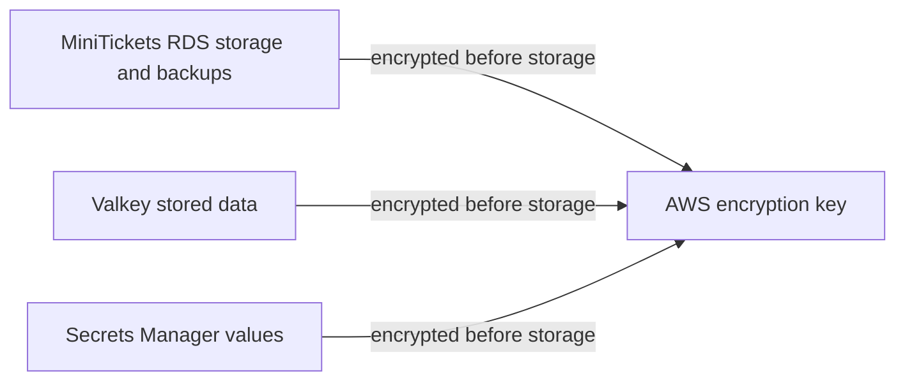

# Encryption at rest

History: see [CHANGELOG.md](../CHANGELOG.md) or run `pnpm docs:history`

Area: Auth & Security · Status: ✅ built · Step doc: [14 data](../../14-infra-data.md) (section 3.8)
<!-- interview-card: v2 -->

## 1. What is it?

Encryption at rest stores data in a form that needs a key to read. It protects stored media and backups, rather than deciding which application users may query them.

## 2. Why do we need it?

A copied MiniTickets database disk or backup should not reveal customer records by itself. Encryption adds protection even if someone gains access to stored media.

## 3. How does it work?

1. Enable the storage service encryption setting.
2. The service encrypts writes and decrypts authorized reads.
3. Protect access to both the running service and its keys.

## 4. How do we use it in MiniTickets?

RDS storage and Valkey data written to disk are encrypted. Secrets Manager encrypts its values. Our query code does not perform this storage encryption; database access and TLS remain separate protections.

## 5. Interview-ready answer

“MiniTickets encrypts database storage, backups and cache storage using AWS service support. This protects stored copies, but it does not stop a valid database query returning sensitive data. I treat encryption, permissions and transport security as separate controls, and plan any migration from unencrypted storage before changing infrastructure.”

## 6. Important follow-up questions

- **Does it prevent SQL injection leaks?** No. The running database decrypts data for queries it accepts.
- **Can an unencrypted RDS instance just flip a switch?** The documented path uses an encrypted snapshot copy and restore.
- **When use field encryption?** When particular values need protection beyond ordinary database access.
- **What if a key becomes unavailable?** Data access or recovery may fail; key lifecycle belongs in the recovery plan.

## 7. Advanced details

Technical reference

### Source anchors

- Anchor: `infra/src/data/postgres.ts` · `storageEncrypted: true`: disk, backups and snapshots encrypted.
- Anchor: `infra/src/data/cache.ts` · `atRestEncryptionEnabled: true`: data Valkey writes to disk is encrypted.

### Storage settings and scope

`infra/src/data/postgres.ts` → `createPostgres` enables storageEncrypted, covering RDS disk, logs, backups and snapshots. `infra/src/data/cache.ts` → `createCache` enables atRestEncryptionEnabled for Valkey data written to storage. Secrets Manager always encrypts secret values. We configure default service keys rather than customer-managed ones; application query code does not manually decrypt storage.

Encryption protects stored media, not data returned through valid queries or stolen credentials. TLS protects a different boundary. Customer-managed keys add key-policy/lifecycle control; field encryption is a separate design for values even database administrators should not read. No such field-encryption design is built.

### Migration and read-only inspection

For existing unencrypted RDS, use the documented encrypted snapshot-copy and restore path, not an in-place flag flip. Our node-based Valkey replication group also enables at-rest encryption only at creation; the documented migration uses backup, restore into an encrypted group and endpoint cutover. These are owner operations, not steps performed by this rewrite. [RDS encryption](https://docs.aws.amazon.com/AmazonRDS/latest/UserGuide/Overview.Encryption.html) and [ElastiCache at-rest encryption](https://docs.aws.amazon.com/AmazonElastiCache/latest/dg/at-rest-encryption.html) document these boundaries.

Metadata checks: `aws rds describe-db-instances --profile ticketlite --db-instance-identifier minitickets-dev-db --query "DBInstances[0].StorageEncrypted"` and `aws elasticache describe-replication-groups --profile ticketlite --replication-group-id minitickets-dev-valkey --query "ReplicationGroups[0].AtRestEncryptionEnabled"`. The code sets both true; live values were not read here.

No customer-managed key fee is configured; service costs remain. The old card's free/no-performance-cost claims were not measurements. AWS notes encryption can affect cache operations, so benchmark the real workload when making performance claims.

### Preserved references

- [kms](kms.md)
- [RDS](rds-postgres.md)
- [backups](backups-dr.md)
- [Valkey](elasticache-valkey.md)

[Open this piece in the city explorer](../guides/infra-explorer.html?concept=encryption-at-rest#chapter=5&piece=rds).

## Where it appears in the story

- [Infra story: 7. RDS Postgres](../infra-story.md#7-rds-postgres)

