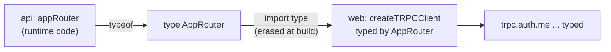

# End-to-end types: web imports only `type AppRouter`

History: see [CHANGELOG.md](../CHANGELOG.md) or run `pnpm docs:history`

Area: API · Status: ✅ built · Step doc: [01 setup](../../01-setup.md)

## 1. In one line

The web app imports the **type** of the api's router (`import type { AppRouter }`), so every call's
input and output is checked by TypeScript, and no server code ever reaches the browser.

## 2. Real-life comparison

A plug and a socket made from the same drawing. If the factory changes the socket, the plug no
longer fits on the drawing board, before anything is shipped.

## 3. Picture it



## 4. Where in our code

- Anchor: `apps/api/src/trpc/router.ts` · `export type AppRouter = typeof appRouter`.
- Anchor: `apps/web/src/lib/trpc/client.ts` · `import type { AppRouter } from "@minitickets/api/router"`.

Step by step:

1. The api exports `appRouter` (runtime) and `type AppRouter` (types only).
2. `apps/api/package.json` exposes only the types: `"exports": { "./router": { "types": "./src/trpc/router.ts" } }`.
3. The web lists `@minitickets/api` as a **devDependency** (needed only for type-checking).
4. `import type` is erased when compiling, so the browser bundle contains no api code.
5. `createTRPCClient<AppRouter>` and `createTRPCContext<AppRouter>` turn the type into typed calls:
   `trpc.account.profile.queryOptions()` knows the result is `{ id, email, createdAt }`.
6. The shapes come from the `.output()` schemas in `packages/shared`
   ([validation-at-boundaries](validation-at-boundaries.md)).

`apps/api/src/trpc/context.ts` has `import type {} from "@fastify/cookie"` for the same reason: the
web type-checks `context.ts` through `AppRouter` and needs the cookie types.

## 5. See it yourself

```bash
pnpm typecheck     # passes
```

**Break it on purpose:** in `packages/shared/src/schemas/account.ts`, rename `createdAt` to
`joinedAt`. `pnpm typecheck` now fails in `apps/web/.../profile-card.tsx`
(`profile.data.createdAt` does not exist). Nothing ran; the compiler caught it.

## 6. How it connects

- **Uses ←** [rpc-vs-rest](rpc-vs-rest.md) (the router), [monorepo](monorepo.md) (workspace
  packages).
- **Gives →** typed hooks in [feature-folders](feature-folders.md); refactors with confidence;
  [static-checks](static-checks.md) in CI enforce it.

## 7. Our settings and WHY

Types only, through a `types`-only export and `import type`. WHY: the browser must never bundle
server code (it would leak internals and break the build); the rule is also in `CLAUDE.md`.

## 8. Trade-offs

- **Pros:** compile-time contract; autocomplete; zero runtime cost.
- **Cons:** both apps must be in one repo (or share a package); types say nothing about **deploy
  timing**: an old browser tab can still send an old shape.

## 9. Alternatives and when to choose them

- **OpenAPI + generated client:** for separate repos or other languages.
- **GraphQL codegen:** same idea from a GraphQL schema.
- **Shared Zod schemas only** (no tRPC): types for inputs and outputs, hand-written fetch calls.

## 10. What breaks, and how we'd notice

- A runtime import from the api in the web (`import { appRouter }`): server code in the bundle; the
  build may fail on Node-only modules. Code review and the `CLAUDE.md` rule guard it.
- Type drift between deployed versions: not caught by types; needs backward-compatible changes.

## 13. Interview answers at 3 levels

- **Simple:** If the api changes, the web app's code stops compiling until it's fixed.
- **Senior:** The api exports `type AppRouter = typeof appRouter`; the web imports it with
  `import type` through a types-only package export, so the client is fully typed and no server code
  ships. A renamed field breaks `pnpm typecheck` in CI.
- **Lead:** Compile-time contracts remove a class of integration bugs but not deploy-time skew.
  Pair them with additive changes and, if the client base grows beyond our own web app, a generated
  OpenAPI spec.

## 14. Follow-up questions interviewers ask

- *What is `import type`?* An import that exists only for the type checker and is removed from the
  output.
- *Does this replace runtime validation?* No: the server still validates every input with Zod.

## 15. Say it in 30 seconds

"The api exports only the type of its router. The web imports it with import type, so every call is
typed and no server code reaches the browser. Rename a field in the api and the web stops compiling
in CI. Runtime validation still happens on the server."

## 16. Status

✅ built.
