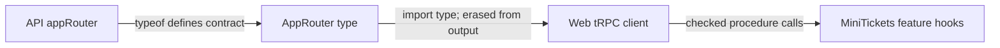

# End-to-end types: web imports only `type AppRouter`

History: see [CHANGELOG.md](../CHANGELOG.md) or run `pnpm docs:history`

Area: API · Status: ✅ built · Step doc: [01 setup](../../01-setup.md)
<!-- interview-card: v2 -->

## 1. What is it?

End-to-end types let client code use the API’s input and output contract during compilation. A type-only import carries that description without shipping the API implementation.

## 2. Why do we need it?

If MiniTickets renames a profile field, the web app should fail its checks before release. Copying the same interface into two projects would let those definitions drift.

## 3. How does it work?



1. Infer the router type from the server definition.
2. Import it through the package’s type-only export.
3. Check web calls and field access against that shared contract.

## 4. How do we use it in MiniTickets?

Both browser and web-server tRPC clients use `AppRouter`. Shared schemas define external shapes. The API package is a development dependency for web typechecking; web still communicates over HTTP and does not execute server business code.

## 5. Interview-ready answer

“MiniTickets shares the API router’s type with its web clients, so input or output changes surface as compiler errors. Type-only imports are removed from emitted code and keep API implementation out of browser bundles. This improves integration checks, but runtime validation and backward-compatible deployment still matter because types do not govern old running clients.”

## 6. Important follow-up questions

- **Does import type make a network request?** No. It affects compilation only; the tRPC client performs the actual HTTP call.
- **Does this validate arbitrary JSON?** No. The server must still validate external inputs and outputs.
- **What if someone imports appRouter at runtime?** It crosses our layer boundary and can pull server dependencies into web code.
- **What about clients in another language?** A generated client from OpenAPI or another language-neutral schema may fit better.

## 7. Advanced details

<details>
<summary>Technical reference</summary>

### Current reading notes

Current package export exposes router types, and `import type` is erased. AppRouter traversal also requires the type-only Fastify cookie augmentation in context.ts. No runtime API import is allowed in web. Field-rename examples below are learning thought experiments, not edits or checks executed for this rewrite.

### Implementation reference

- Anchor: `apps/api/src/trpc/router.ts` · `export type AppRouter = typeof appRouter`.
- Anchor: `apps/web/src/lib/trpc/client.ts` · `import type { AppRouter } from "@minitickets/api/router"`.
- Anchor: `apps/web/src/lib/trpc/server.ts` · `import type { AppRouter }` again, for the web server's own client (`getServerTrpc`): typed calls over HTTP, still no api code in the web.

Step by step:

1. The api exports `appRouter` (runtime) and `type AppRouter` (types only).
2. `apps/api/package.json` exposes only the types: `"exports": { "./router": { "types": "./src/trpc/router.ts" } }`.
3. The web lists `@minitickets/api` as a **devDependency** (needed only for type-checking).
4. `import type` is erased when compiling, so the browser bundle contains no api code.
5. `createTRPCClient<AppRouter>` and `createTRPCContext<AppRouter>` turn the type into typed calls:
   `trpc.account.profile.queryOptions()` knows the result is `{ id, email, createdAt }`.
6. The shapes come from the `.output()` schemas in `packages/shared`
   ([validation-at-boundaries](validation-at-boundaries.md)).

`apps/api/src/trpc/context.ts` has `import type {} from "@fastify/cookie"` for the same reason: the
web type-checks `context.ts` through `AppRouter` and needs the cookie types.

### Inspection and historical evidence

```bash
pnpm typecheck     # passes
```

**Break it on purpose:** in `packages/shared/src/schemas/account.ts`, rename `createdAt` to
`joinedAt`. `pnpm typecheck` now fails in `apps/web/.../profile-card.tsx`
(`profile.data.createdAt` does not exist). Nothing ran; the compiler caught it.

### Settings and reasoning

Types only, through a `types`-only export and `import type`. WHY: the browser must never bundle
server code (it would leak internals and break the build); the rule is also in `CLAUDE.md`.

### Trade-offs

- **Pros:** compile-time contract; autocomplete; zero runtime cost.
- **Cons:** both apps must be in one repo (or share a package); types say nothing about **deploy
  timing**: an old browser tab can still send an old shape.

### Alternatives and scaling

- **OpenAPI + generated client:** for separate repos or other languages.
- **GraphQL codegen:** same idea from a GraphQL schema.
- **Shared Zod schemas only** (no tRPC): types for inputs and outputs, hand-written fetch calls.

### Failure diagnosis

- A runtime import from the api in the web (`import { appRouter }`): server code in the bundle; the
  build may fail on Node-only modules. Code review and the `CLAUDE.md` rule guard it.
- Type drift between deployed versions: not caught by types; needs backward-compatible changes.

### Further questions

- *What is `import type`?* An import that exists only for the type checker and is removed from the
  output.
- *Does this replace runtime validation?* No: the server still validates every input with Zod.

### Related reading

- [rpc-vs-rest](rpc-vs-rest.md)
- [monorepo](monorepo.md)
- [feature-folders](feature-folders.md)
- [static-checks](static-checks.md)

[Open this piece in the city explorer](../guides/infra-explorer.html?concept=end-to-end-types#chapter=24&piece=code-trpc).

## Where it appears in the story

- [App story: 3. The tRPC client](../app-story.md#3-the-trpc-client)
- [App story: 12. Monorepo and shared types](../app-story.md#12-monorepo-and-shared-types)

</details>
