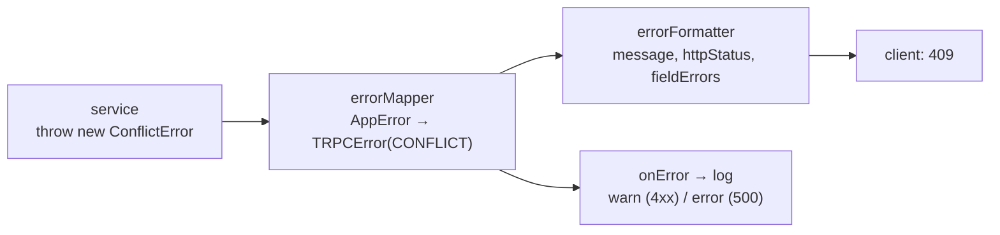

# Central error handling: business error → HTTP status

History: see [CHANGELOG.md](../CHANGELOG.md) or run `pnpm docs:history`

Area: API · Status: ✅ built · Step doc: [02 errors](../../02-errors.md)

## 1. In one line

Services throw plain **business errors** (`NotFoundError`, `ConflictError`…); one middleware maps
them to HTTP-style codes, one formatter decides what the client sees, and crashes are logged in full
but answered with "Something went wrong".

## 2. Real-life comparison

A call centre: the specialist writes "customer not found" on an internal form; the front-line agent
translates it into a polite, standard answer; serious internal problems go into the incident log,
and the caller only hears "we're having a problem, please try again".

## 3. Picture it



## 4. Where in our code

- Anchor: `apps/api/src/errors.ts` · `AppError`, `NotFoundError`, `ConflictError`, `ForbiddenError`, `UnauthorizedError`: no tRPC or Fastify imports.
- Anchor: `apps/api/src/trpc/init.ts` · `errorFormatter`, `errorMapper`: the shape sent to clients, and the mapping.
- Anchor: `apps/api/src/app.ts` · `setErrorHandler`, `onError`: plain-route errors and logging.

Step by step:

1. A service throws, e.g. `throw new UnauthorizedError("Invalid email or password")`.
2. `errorMapper` sees `result.error.cause instanceof AppError` and throws
   `new TRPCError({ code: codeByKind[kind], message, cause })`.
3. Not ours (a `ZodError` or a crash)? It passes through unchanged.
4. `errorFormatter` builds the response:
   - `ZodError` → message "Invalid input" + `fieldErrors` from `z.flattenError`;
   - `INTERNAL_SERVER_ERROR` → message "Something went wrong" (never the real one);
   - `stack` always removed.
5. `onError` (tRPC option in `app.ts`) logs: `error` level with the cause and stack for 500,
   `warn` with only the code for the rest.
6. Plain Fastify routes (`/health`, `/ready`) use `setErrorHandler`: same idea, 500 → generic.
7. Queries translate driver errors into `AppError`s (`23505` → `ConflictError` in
   `queries/users.ts`), so services never see Postgres codes.

## 5. See it yourself

Recorded against a local api instance:

```bash
curl -s -X POST localhost:4000/trpc/auth.signup -H 'content-type: application/json' \
  -d '{"email":"YOU@example.com","password":"correct-horse-battery","confirmPassword":"correct-horse-battery"}'
# second time, same email in any case:
# {"error":{"message":"Email already registered","code":-32009,
#   "data":{"code":"CONFLICT","httpStatus":409,"path":"auth.signup","fieldErrors":null}}}
```

A crash looks like this to the client (Redis stopped, local test instance):
`{"error":{"message":"Something went wrong",…,"httpStatus":500,…}}`, while the log line has
`"msg":"procedure crashed"` with the real message and stack.

The unit test `apps/api/src/trpc/init.test.ts` checks the mapping without HTTP.

**Break it on purpose:** in `errorFormatter`, return `shape` unchanged. A 500 now sends the raw
message to the client, and in development a stack trace with file paths.

## 6. How it connects

- **Uses ←** [trpc-middleware](trpc-middleware.md), [structured-logging](structured-logging.md).
- **Gives →** a stable error contract for [ui-error-handling](ui-error-handling.md); status codes
  in [http-status-codes](http-status-codes.md).

## 7. Our settings and WHY

| Rule | Why |
| ---- | --- |
| `errors.ts` imports nothing from tRPC/Fastify | Services must not know about HTTP. |
| One map, `codeByKind` | One place to change a status. |
| 500 → generic message; stack dropped | Internals (SQL, paths, secrets in messages) never leak. |
| Log 500 at `error` with cause, 4xx at `warn` | Crashes stand out; caller mistakes don't spam alerts. |

## 8. Trade-offs

- **Pros:** consistent client contract; safe by default; services stay clean.
- **Cons:** another indirection to learn; an unexpected error with a useful message still becomes
  generic (by design).

## 9. Alternatives and when to choose them

- **Throw `TRPCError` directly in services:** less code, couples services to tRPC.
- **Result types** (`{ ok, error }` returned, never thrown): explicit, more verbose.
- **RFC 9457 Problem Details:** standard JSON error format for REST APIs.

## 10. What breaks, and how we'd notice

- A new `AppErrorKind` without a `codeByKind` entry: TypeScript fails (`Record<AppErrorKind, …>`).
- A service throwing a plain `Error` for a user mistake: user sees "Something went wrong", logs
  show a crash. Logs at `error` level make it visible.

## 13. Interview answers at 3 levels

- **Simple:** The server turns its problems into clear, safe messages, and hides technical details.
- **Senior:** Services throw `AppError` subclasses with no HTTP knowledge. `errorMapper` maps kind →
  tRPC code; `errorFormatter` adds Zod field errors, replaces 500 messages with a generic one and
  strips stacks; `onError` logs crashes with the cause. Queries translate driver errors like
  `23505` into `ConflictError`.
- **Lead:** Separate "what went wrong" (domain), "how to say it" (transport) and "what to record"
  (logs). That keeps the contract stable, avoids leaks, and lets us alert on 5xx only. Next: error
  codes clients can rely on beyond HTTP status, and correlation ids in every error log.

## 14. Follow-up questions interviewers ask

- *Why not send the real message for 500s?* It can contain SQL, paths or secrets.
- *Where are validation errors handled?* tRPC's `.input()` throws a `ZodError`; the formatter turns
  it into 400 + `fieldErrors`.

## 15. Say it in 30 seconds

"Services throw small business errors like ConflictError, with no HTTP knowledge. One tRPC middleware
maps them to codes like CONFLICT, and one formatter decides what the client sees: field errors for
bad input, a generic message for any crash, never a stack. Crashes are logged in full on the server."

## 16. Status

✅ built.
