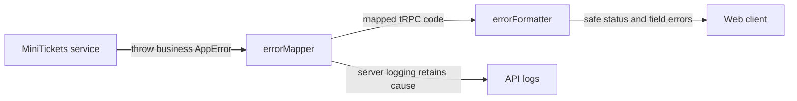

# Central error handling: business error → HTTP status

History: see [CHANGELOG.md](../CHANGELOG.md) or run `pnpm docs:history`

Area: API · Status: ✅ built · Step doc: [02 errors](../../02-errors.md)
<!-- interview-card: v2 -->

## 1. What is it?

Central error handling turns internal failures into a consistent, safe API response. Business code describes the problem, while the request boundary chooses what clients see.

## 2. Why do we need it?

Duplicate signup should show a useful conflict message, but a database crash must not expose SQL or a stack trace. MiniTickets needs both clear feedback and detailed private diagnosis.

## 3. How does it work?



1. Translate storage-specific failures at the data boundary.
2. Map known business failures into a stable transport code.
3. Format safe output and log unexpected failures for diagnosis.

## 4. How do we use it in MiniTickets?

Services throw AppError subclasses without HTTP imports. Middleware maps them; the formatter attaches field errors, hides internal messages and removes stacks. Plain Fastify routes have their own error handler with the same safe-output goal.

## 5. Interview-ready answer

“MiniTickets separates the meaning of a failure from its HTTP representation. Queries translate driver errors, services throw business errors, and one middleware maps them for clients. Unexpected crashes return a generic message while logs retain diagnostic context. That avoids leaking internals and gives the UI a consistent machine-readable contract.”

## 6. Important follow-up questions

- **What if a business mistake is thrown as plain Error?** It looks like an unexpected server failure and loses its useful client classification.
- **Why hide stack traces?** They can expose paths, implementation details or sensitive information.
- **Does a generic client response mean poor observability?** No. Keep detailed causes and correlation in controlled server logs.
- **Why not throw transport errors in every service?** It would couple business code to tRPC and make another transport harder to support.

## 7. Advanced details

<details>
<summary>Technical reference</summary>

### Current reading notes

Current AppError kinds also cover TOO_MANY_REQUESTS and SERVICE_UNAVAILABLE. RateLimitedError carries retryAfterSeconds; the middleware sets Retry-After and the formatter includes retry metadata. Unexpected errors remain generic with no client stack. Existing historical local curl/crash observations below were not rerun, and log redaction still applies to private diagnostic data.

### Implementation reference

- Anchor: `apps/api/src/errors.ts` · `AppError`, `NotFoundError`, `ConflictError`, `ForbiddenError`, `UnauthorizedError`: no tRPC or Fastify imports.
- Anchor: `apps/api/src/trpc/init.ts` · `errorFormatter`, `errorMapper`: the shape sent to clients, and the mapping.
- Anchor: `apps/api/src/app.ts` · `setErrorHandler`, `onError`: plain-route errors and logging.

Step by step:

1. A service throws, e.g. `throw new UnauthorizedError("Invalid email or password")`.
2. `errorMapper` sees `result.error.cause instanceof AppError` and throws
   `new TRPCError({ code: codeByKind[kind], message, cause })`.
3. Not ours (a `ZodError` or a crash)? It passes through unchanged.
4. `errorFormatter` builds the response:
   - `ZodError` → message "Invalid input" + `fieldErrors` from `z.flattenError`;
   - `INTERNAL_SERVER_ERROR` → message "Something went wrong" (never the real one);
   - `stack` always removed.
5. `onError` (tRPC option in `app.ts`) logs: `error` level with the cause and stack for 500,
   `warn` with only the code for the rest.
6. Plain Fastify routes (`/health`, `/ready`) use `setErrorHandler`: same idea, 500 → generic.
7. Queries translate driver errors into `AppError`s (`23505` → `ConflictError` in
   `queries/users.ts`), so services never see Postgres codes.

### Inspection and historical evidence

Recorded against a local api instance:

```bash
curl -s -X POST localhost:4000/trpc/auth.signup -H 'content-type: application/json' \
  -d '{"email":"YOU@example.com","password":"correct-horse-battery","confirmPassword":"correct-horse-battery"}'
# second time, same email in any case:
# {"error":{"message":"Email already registered","code":-32009,
#   "data":{"code":"CONFLICT","httpStatus":409,"path":"auth.signup","fieldErrors":null}}}
```

A crash looks like this to the client (Redis stopped, local test instance):
`{"error":{"message":"Something went wrong",…,"httpStatus":500,…}}`, while the log line has
`"msg":"procedure crashed"` with the real message and stack.

The unit test `apps/api/src/trpc/init.test.ts` checks the mapping without HTTP.

**Break it on purpose:** in `errorFormatter`, return `shape` unchanged. A 500 now sends the raw
message to the client, and in development a stack trace with file paths.

### Settings and reasoning

| Rule | Why |
| ---- | --- |
| `errors.ts` imports nothing from tRPC/Fastify | Services must not know about HTTP. |
| One map, `codeByKind` | One place to change a status. |
| 500 → generic message; stack dropped | Internals (SQL, paths, secrets in messages) never leak. |
| Log 500 at `error` with cause, 4xx at `warn` | Crashes stand out; caller mistakes don't spam alerts. |

### Trade-offs

- **Pros:** consistent client contract; safe by default; services stay clean.
- **Cons:** another indirection to learn; an unexpected error with a useful message still becomes
  generic (by design).

### Alternatives and scaling

- **Throw `TRPCError` directly in services:** less code, couples services to tRPC.
- **Result types** (`{ ok, error }` returned, never thrown): explicit, more verbose.
- **RFC 9457 Problem Details:** standard JSON error format for REST APIs.

### Failure diagnosis

- A new `AppErrorKind` without a `codeByKind` entry: TypeScript fails (`Record<AppErrorKind, …>`).
- A service throwing a plain `Error` for a user mistake: user sees "Something went wrong", logs
  show a crash. Logs at `error` level make it visible.

### Further questions

- *Why not send the real message for 500s?* It can contain SQL, paths or secrets.
- *Where are validation errors handled?* tRPC's `.input()` throws a `ZodError`; the formatter turns
  it into 400 + `fieldErrors`.

### Related reading

- [trpc-middleware](trpc-middleware.md)
- [structured-logging](structured-logging.md)
- [ui-error-handling](ui-error-handling.md)
- [http-status-codes](http-status-codes.md)

[Open this piece in the city explorer](../guides/infra-explorer.html?concept=error-handling#chapter=0&piece=laptop-api).

## Where it appears in the story

- [App story: 6. Middleware: errorMapper and protectedProcedure](../app-story.md#6-middleware-errormapper-and-protectedprocedure)
- [App story: 11. The error path back to the UI](../app-story.md#11-the-error-path-back-to-the-ui)

</details>
