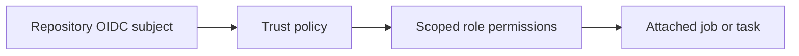

# Execution role vs task role

History: see [CHANGELOG.md](../CHANGELOG.md) or run `pnpm docs:history`

Area: AWS Compute · Status: ✅ built in repository; live acceptance is separate

## 1. In one line

ECS execution role starts tasks: image pull, startup secrets and log configuration. The application task role authorizes runtime SNS/Dynamo/S3 calls and ECS Exec. Web execution now reads the one revalidation secret; it still has no application task role. Lambda uses one execution/runtime role.

## 2. Real-life comparison

A sealed package is built once, then checked at a gate before the manager installs that exact version.

## 3. Picture it

## 4. Where in our code

- Anchor: `infra/src/compute/iam.ts` · `createIamRoles`: the api execution role and task role.
- Anchor: `infra/src/compute/web-iam.ts` · `createWebIamRole`: the web execution role (no task role).
- Anchor: `infra/src/compute/task.ts` · `executionRoleArn`, `taskRoleArn`: where the api roles are attached.

`infra/src/cicd.ts` restricts OIDC subjects and PassRole. `infra/src/publish-policy.ts` includes ECR read/write actions needed by publish; `compute/iam.ts` separates API execution/application roles. Read the D1 Every IAM badge tour and runbook §3.11. Live deploy acceptance remains owner work.

## 5. See it yourself

`infra/src/cicd.ts` restricts OIDC subjects and PassRole. `infra/src/publish-policy.ts` includes ECR read/write actions needed by publish; `compute/iam.ts` separates API execution/application roles. Read the D1 Every IAM badge tour and runbook §3.11. Live deploy acceptance remains owner work.

Failure thought experiment: Why did worker publish need BatchGetImage? Publishing tooling reads image manifests as well as uploading layers.

## 6. How it connects

Uses the [current system](../00-big-picture.md); gives a concrete decision to the [scenario](../guides/interview-scenarios.md#iam-oidc) and [explorer tour](../guides/infra-explorer.html?tour=iam-badges).

## 7. Our settings and WHY

ECS execution role starts tasks: image pull, startup secrets and log configuration. The application task role authorizes runtime SNS/Dynamo/S3 calls and ECS Exec. Web execution now reads the one revalidation secret; it still has no application task role. Lambda uses one execution/runtime role. A reachable AWS endpoint is not permission to invoke it.

## 8. Trade-offs

Resource wildcards needed for APIs without resource scoping require conditions where supported. Broad deploy capability is dangerous; do not let old infrastructure runs apply.

## 9. Alternatives and when to choose them

10x: environment protection/expiry and policy review. 100x: separate accounts, policy-as-code and change approvals tied to exact SHA.

## 10. What breaks and how we notice

Why did worker publish need BatchGetImage? Publishing tooling reads image manifests as well as uploading layers.

## 13. Interview answers at 3 levels

- **Simple:** ECS execution role starts tasks: image pull, startup secrets and log configuration. The application task role authorizes runtime SNS/Dynamo/S3 calls and ECS Exec. Web execution now reads the one revalidation secret; it still has no application task role. Lambda uses one execution/runtime role.
- **Senior:** A trust policy says who can assume a role; a permission policy says which actions/resources it can access; attachment says which runtime uses it. GitHub OIDC exchanges an approved repository/environment identity for short-lived AWS credentials. Task execution retrieves images/secrets; application roles authorize runtime AWS calls.
- **Lead:** 10x: environment protection/expiry and policy review. 100x: separate accounts, policy-as-code and change approvals tied to exact SHA.

## 14. Follow-up questions with answers

Why did worker publish need BatchGetImage? Publishing tooling reads image manifests as well as uploading layers.

## 15. Say it in 30 seconds

A trust policy says who can assume a role; a permission policy says which actions/resources it can access; attachment says which runtime uses it. GitHub OIDC exchanges an approved repository/environment identity for short-lived AWS credentials. Task execution retrieves images/secrets; application roles authorize runtime AWS calls.

## 16. Status and production work

Repository implementation and local evidence are described above. Live AWS/CI execution remains owner acceptance. 10x: environment protection/expiry and policy review. 100x: separate accounts, policy-as-code and change approvals tied to exact SHA.

## Where it appears in the story

- [Infra story: 5. IAM roles](../infra-story.md#5-iam-roles)
- [Big picture: 4. Components](../00-big-picture.md#4-components)
