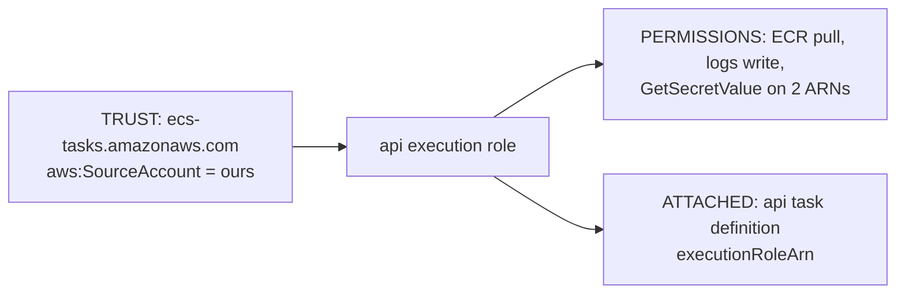
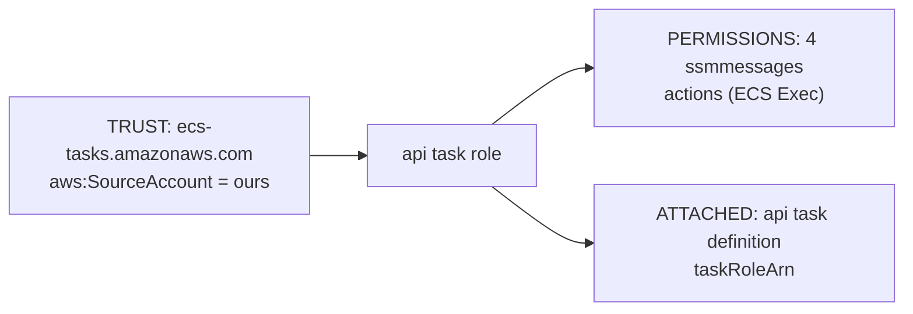
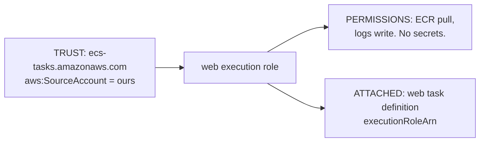
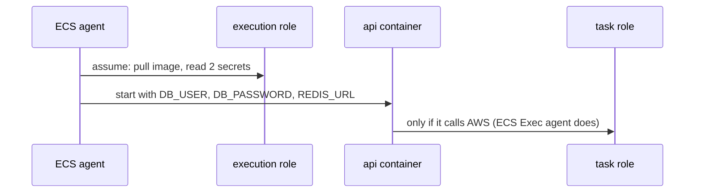

# Execution role vs task role

History: see [CHANGELOG.md](../CHANGELOG.md) or run `pnpm docs:history`

Area: AWS Compute · Status: ✅ built · Deep dive: [aws-foundations, chapter 5](../aws-foundations.md#5-roles-sts-and-the-confused-deputy) · Step docs: [17](../../17-infra-ecs-api.md) (section 3.4), [18](../../18-infra-alb-web.md) (section 3.9)

## 1. In one line

The **execution role** is worn by ECS to **start** a task (pull the image, read secrets, write
logs); the **task role** is worn by **our running code**.

## 2. Real-life comparison

The removal company and the tenant. The removal company (ECS) has a key to the storage unit to bring
in your furniture (secrets, image) on moving day. You, the tenant, get a different key that opens
only your own flat. You never hold the storage unit key.

## 3. Picture it

Each role in three parts: who may wear it (trust), what it may do (permissions), where it is
attached.







When each is worn:



## 4. Where in our code

- Anchor: `infra/src/compute/iam.ts` · `createIamRoles`: the api execution role and task role.
- Anchor: `infra/src/compute/web-iam.ts` · `createWebIamRole`: the web execution role (no task role).
- Anchor: `infra/src/compute/task.ts` · `executionRoleArn`, `taskRoleArn`: where the api roles are attached.

Step by step (`iam.ts`):

1. `ecsTasksTrustPolicy`: principal `ecs-tasks.amazonaws.com`, `sts:AssumeRole`, condition
   `aws:SourceAccount` = our account (stops the confused deputy).
2. `executionRole` + `executionManaged` (`AmazonECSTaskExecutionRolePolicy`) + `executionSecrets`
   (`read-secrets`: `GetSecretValue` on exactly two ARNs).
3. `taskRole` + `taskExec` (`ecs-exec`: four `ssmmessages` actions, `Resource: "*"`).
4. Returns each ARN only after its policies exist (`pulumi.all`), so the first task never starts
   with a role that cannot yet read secrets.

`web-iam.ts`: one execution role with only the managed policy. `web-task.ts` sets no `taskRoleArn`.

## 5. See it yourself

```bash
for R in minitickets-dev-api-execution-role minitickets-dev-api-task-role minitickets-dev-web-execution-role; do
  echo "== $R"
  aws iam list-attached-role-policies --profile ticketlite --role-name $R --query "AttachedPolicies[].PolicyName"
  aws iam list-role-policies --profile ticketlite --role-name $R --query PolicyNames
done
```

**Break it on purpose (scratch branch, undo after):** move `executionSecrets` onto the task role.
The task cannot start (`ResourceInitializationError: unable to pull secrets`), which proves that
ECS, not our code, reads the secrets.

## 6. How it connects

- **Uses ←** IAM policies and STS ([aws-foundations](../aws-foundations.md)); secret ARNs from
  [secrets-manager](secrets-manager.md) and [rds-managed-password](rds-managed-password.md).
- **Gives →** the permissions behind [ECR](ecr.md) pulls, [CloudWatch Logs](cloudwatch-logs.md),
  secret injection, and [ECS Exec](ecs-exec.md); the main example of [least privilege](least-privilege.md).

## 7. Our settings and WHY

| Choice | Why |
| ------ | --- |
| Split execution and task roles | The code that runs all day has no IAM permission to read secrets. |
| Web has its own execution role | Web needs no secrets, so its role cannot read any. |
| No web task role | Web code calls no AWS API and has no ECS Exec. |
| `aws:SourceAccount` | Confused deputy protection. |

## 8. Trade-offs

- **Pros:** small blast radius; a compromised app process holds no secret-reading power.
- **Cons:** the injected values still sit in the container's environment; three roles to review.

## 9. Alternatives and when to choose them

- **One role for both:** only for throwaway demos.
- **Task role reads secrets at runtime** (SDK + cache): survives password rotation; the task role
  then needs `GetSecretValue` on that one secret.

## 10. What breaks, and how we'd notice

- Execution role lacks a secret → `ResourceInitializationError: unable to pull secrets`.
- Execution role lacks ECR or logs → `CannotPullContainerError` or no logs.
- Task role lacks `ssmmessages` → `execute-command` fails; the ECS Exec agent is not running.

## 11. Reach / Allowed / Password

These roles are **Allowed**. Their STS credentials sign the calls to ECR, Secrets Manager, Logs and
SSM; **Reach** to those endpoints is the task's public IP.

## 12. Cost

Free.

## 13. Interview answers at 3 levels

- **Simple:** One role lets ECS start the container; the other is what the running code may do.
- **Senior:** Our api execution role has the managed execution policy plus `GetSecretValue` on
  exactly the RDS master secret and the redis-url secret; ECS injects them as env vars at start. The
  task role only has the ECS Exec `ssmmessages` actions. Web has an execution role without secrets
  and no task role. All trust policies require `aws:SourceAccount`.
- **Lead:** The split means an RCE in the app cannot call Secrets Manager. I'd standardise per-service
  roles, review trust and permission policies in code review, and move to runtime secret reads where
  rotation matters.

## 14. Follow-up questions interviewers ask

- *Which role pulls the image?* The execution role.
- *Which role would an AWS SDK call from our code use?* The task role.
- *Why does the ECS Exec permission sit on the task role?* The agent runs inside our task.

## 15. Say it in 30 seconds

"The execution role is ECS's: pull the image, read exactly two secrets, write logs, before our code
starts. The task role is our code's: only ECS Exec. Web gets an execution role without secrets and no
task role. All of them can only be assumed by ECS for our account."

## 16. Status

✅ built.
