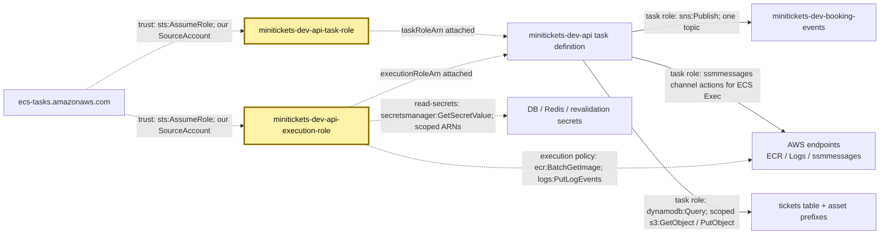
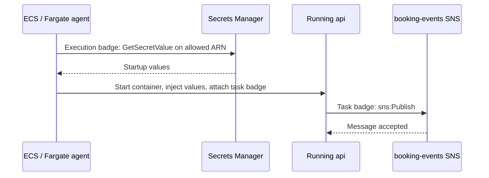

# IAM roles: staff badges for starting and working

History: see [CHANGELOG.md](../CHANGELOG.md) or run `pnpm docs:history`

Area: AWS Compute · Status: ✅ built in repository; live acceptance is separate
<!-- interview-card: v1 -->

## 1. In one line

MiniTickets gives ECS one [IAM role](../glossary.md#iam-role), a temporary permission badge, to start api, and gives running api code another badge to do its work.

## 2. Where it sits

[Open this piece in the city explorer](../guides/infra-explorer.html?concept=execution-vs-task-role#chapter=24&piece=iam).

## 3. How it works

## 4. What happens in MiniTickets

1. Trust policy says **who** may wear each badge: ECS tasks acting for our account.
2. `minitickets-dev-api-execution-role` permits image pulls, log writes and specified startup secrets.
3. The task definition attaches it as `executionRoleArn`; the agent uses it.
4. `minitickets-dev-api-task-role` attaches as `taskRoleArn`: SNS publish, ticket reads, constrained posters and ECS Exec channels.
5. Web has its own execution role, one revalidation secret, and no task role.

## 5. Reach / Allowed / Password

**Reach:** HTTPS paths to AWS endpoints must exist.

**Allowed:** trust permits wearing the badge; its policies permit named actions on named resources.

**Password:** temporary role credentials sign AWS calls; Postgres passwords are a separate startup value.

## 6. In our code

`infra/src/compute/iam.ts` → `createIamRoles`.

`infra/src/compute/web-iam.ts` → `createWebIamRole`.

`infra/src/compute/task.ts` → `createApiTask` attaches both roles.

## 7. In the AWS console

IAM → Roles → `minitickets-dev-api-execution-role` or `minitickets-dev-api-task-role` → Trust relationships / Permissions. ECS → Task definitions → `minitickets-dev-api` → revision shows both attached roles. Compare the ARN, its AWS resource address. [AWS distinction](https://docs.aws.amazon.com/AmazonECS/latest/developerguide/task-iam-roles.html). Live policies were not checked.

## 8. Good / Bad

**Good:** startup powers stay out of app credentials; web cannot fetch DB secrets.

**Bad:** correct permissions on an unattached role do nothing; policy growth needs review.

## 9. Other choices

- Pick one task role per app responsibility when permissions differ.
- Pick Lambda's execution role for Lambda: it covers that function's runtime too.

## 10. Connected to

| Neighbor | Direction | What allows it | Console check |
| --- | --- | --- | --- |
| [Secrets](secrets-manager.md) | Agent → safe | Execution role, `GetSecretValue` | Role → Permissions |
| [ECR](ecr.md) | Agent → images | Managed execution policy | Role → Permissions |
| [Logs](cloudwatch-logs.md) | Agent → diary | Execution role, log-stream writes | Role → Permissions |
| [SNS](sns.md) | api → topic | Task role, `sns:Publish` | `send-jobs` policy |
| [S3](presigned-urls.md) | api → objects | Task role, scoped Get/Put | `ticket-reads-and-posters` policy |
| [DynamoDB](dynamodb.md) | api → tickets | Task role, `dynamodb:Query` | Same assets policy |
| [ECS Exec](ecs-exec.md) | In-task agent → channels | Task role, four `ssmmessages` actions | `ecs-exec` policy |

## 11. When it breaks

- Startup secret denied → execution role and ARN → repair the attached scoped grant.
- Runtime publish denied → task role `send-jobs` → check topic ARN and action.

## 12. Say it in 30 seconds

“ECS wears the execution badge to pull our image, fetch allowed startup secrets and configure logs. Running api code wears the task badge for SNS, ticket data and posters. Trust answers who; permissions answer what; the task definition answers where the badge is attached.”

## 13. Likely follow-ups

- **Does api inherit execution credentials?** No; it receives secret values, but not that badge.
- **Does network reach imply permission?** No. AWS can answer `AccessDenied` over a working connection.

## 14. Remember it

One badge starts the worker; another lets the worker do its job.

## 15. More detail

Reference notes, source anchors and earlier useful detail

- Anchor: `infra/src/compute/iam.ts` · `createIamRoles`: the api execution role and task role.
- Anchor: `infra/src/compute/web-iam.ts` · `createWebIamRole`: the web execution role (no task role).
- Anchor: `infra/src/compute/task.ts` · `executionRoleArn`, `taskRoleArn`: where the api roles are attached.

### Exact API task permissions

`ecs-exec` permits `ssmmessages:CreateControlChannel`, `CreateDataChannel`, `OpenControlChannel`, `OpenDataChannel` on `*`, because these channel actions cannot be resource-scoped. The managed agent inside the task uses them. The human caller separately needs permission to request ECS Exec. These are not general SSM administration powers.

`send-jobs` grants `sns:Publish` only on the booking-events topic. SNS-to-SQS delivery uses the queues' resource policies; the API task has no SQS consume grant.

`ticket-reads-and-posters` permits `dynamodb:Query` on the tickets table; `s3:GetObject` on `tickets/*`, `posters/*` and `poster-uploads/*`; and `s3:PutObject` on the two poster prefixes only with `s3:x-amz-server-side-encryption = AES256`. No ticket write, DynamoDB Scan, bucket listing or signing-secret read is granted here. Policies on other resources or explicit denies still affect authorization.

Both ECS role trust policies use `ecs-tasks.amazonaws.com`, `sts:AssumeRole` and `aws:SourceAccount` for our account. The SourceAccount condition narrows which ECS acting account may assume the roles; it is not a substitute for reviewing deployer's `iam:PassRole` permission. The trust policy does not itself grant S3/SNS access.

`AmazonECSTaskExecutionRolePolicy` supplies ECR pull and CloudWatch Logs writes. The API `read-secrets` policy names the RDS and Redis secret ARNs, plus revalidation when entry is on. The web role `minitickets-dev-web-execution-role` reads only revalidation. Current default AWS-managed Secrets Manager keys require no separately configured customer-key decrypt grant here. A future customer key requires checking its policy and IAM decrypt permission.

`pulumi.all` delays returning role ARNs until their policies exist, preventing first-start permission races. [AWS execution-role guide](https://docs.aws.amazon.com/AmazonECS/latest/developerguide/task_execution_IAM_role.html) explains why agent credentials are not directly exposed to containers. Secret values injected into the process can still be leaked by compromised application code.

GitHub publish/deploy badges are separate: `infra/src/cicd.ts` restricts OIDC identity subjects and PassRole; `publish-policy.ts` includes manifest reads such as `ecr:BatchGetImage` because image publishing tools also read manifests. Trusting GitHub for one job does not authorize an ECS task. Lambda uses one execution/runtime role, not ECS's split.

At larger scale, review wildcard necessity, environment protection/expiry and policies; separate accounts and policies checked as code can limit blast radius. Stale infrastructure runs must not apply. Runbook §3.11 and the Every IAM badge explorer tour cover all badges. Live deploy acceptance remains owner work.

## Where it appears in the story

- [Infra story: 5. IAM roles](../infra-story.md#5-iam-roles)
- [Big picture: 4. Components](../00-big-picture.md#4-components)
