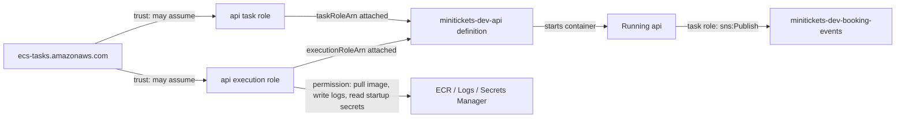

# IAM roles: staff badges for starting and working

History: see [CHANGELOG.md](../CHANGELOG.md) or run `pnpm docs:history`

Area: AWS Compute · Status: ✅ built in repository; live acceptance is separate
<!-- interview-card: v2 -->

## 1. What is it?

An [IAM role](../glossary.md#iam-role) gives temporary permission to call AWS services. ECS uses an execution role to start a container; running application code uses a separate task role.

## 2. Why do we need it?

Starting MiniTickets api requires its image and database password. Publishing a booking event requires different permission. Separate roles keep startup access out of the application's AWS credentials.

## 3. How does it work?

1. Trust decides who may assume each role.
2. Permission policies decide which AWS operations it allows.
3. The task definition attaches the roles to the right job.

## 4. How do we use it in MiniTickets?

API's execution role supplies startup access. Its task role permits booking events, ticket reads and constrained poster access. Web has its own execution role and no task role.

## 5. Interview-ready answer

“In MiniTickets, ECS uses the execution role for image pulls, logs and allowed startup secrets. The running API uses its task role for business operations such as publishing booking events. I review three things: who can assume the role, what it permits, and where it is attached.”

## 6. Important follow-up questions

- **Does api receive execution-role credentials?** No. It receives injected secret values, which compromised code could still leak.
- **Startup secret access denied?** Check the attached execution role and secret reference.
- **Runtime publish access denied?** Check the task role and destination, even if networking works.
- **Why avoid one broad role?** A compromised application would inherit unnecessary startup powers.

## 7. Advanced details

Technical reference

### Roles, attachment and diagnosis

`infra/src/compute/iam.ts` → `createIamRoles` creates `minitickets-dev-api-execution-role` and `minitickets-dev-api-task-role`. `infra/src/compute/web-iam.ts` → `createWebIamRole` creates the web role. `infra/src/compute/task.ts` → `createApiTask` attaches `executionRoleArn` / `taskRoleArn`.

IAM → Roles → named role → Trust relationships / Permissions shows who and what. ECS → Task definitions → `minitickets-dev-api` → revision shows attachment. A correctly permitted role has no effect if the definition attaches another ARN. Live policies were not checked; HTTPS reach to AWS endpoints remains necessary. Temporary credentials sign AWS calls; database passwords are separate values.

The execution policy supports ECR, log delivery and scoped secret reads. API task policies cover SNS, DynamoDB, scoped S3 access and ECS Exec; ECS's service-linked role, rather than the app role, manages target registration. Use a separate task role when application responsibilities differ.

- Anchor: `infra/src/compute/iam.ts` · `createIamRoles`: the api execution role and task role.
- Anchor: `infra/src/compute/web-iam.ts` · `createWebIamRole`: the web execution role (no task role).
- Anchor: `infra/src/compute/task.ts` · `executionRoleArn`, `taskRoleArn`: where the api roles are attached.

### Exact API task permissions

`ecs-exec` permits `ssmmessages:CreateControlChannel`, `CreateDataChannel`, `OpenControlChannel`, `OpenDataChannel` on `*`, because these channel actions cannot be resource-scoped. The managed agent inside the task uses them. The human caller separately needs permission to request ECS Exec. These are not general SSM administration powers.

`send-jobs` grants `sns:Publish` only on the booking-events topic. SNS-to-SQS delivery uses the queues' resource policies; the API task has no SQS consume grant.

`ticket-reads-and-posters` permits `dynamodb:Query` on the tickets table; `s3:GetObject` on `tickets/*`, `posters/*` and `poster-uploads/*`; and `s3:PutObject` on the two poster prefixes only with `s3:x-amz-server-side-encryption = AES256`. No ticket write, DynamoDB Scan, bucket listing or signing-secret read is granted here. Policies on other resources or explicit denies still affect authorization.

Both ECS role trust policies use `ecs-tasks.amazonaws.com`, `sts:AssumeRole` and `aws:SourceAccount` for our account. The SourceAccount condition narrows which ECS acting account may assume the roles; it is not a substitute for reviewing deployer's `iam:PassRole` permission. The trust policy does not itself grant S3/SNS access.

`AmazonECSTaskExecutionRolePolicy` supplies ECR pull and CloudWatch Logs writes. The API `read-secrets` policy names the RDS and Redis secret ARNs, plus revalidation when entry is on. The web role `minitickets-dev-web-execution-role` reads only revalidation. Current default AWS-managed Secrets Manager keys require no separately configured customer-key decrypt grant here. A future customer key requires checking its policy and IAM decrypt permission.

`pulumi.all` delays returning role ARNs until their policies exist, preventing first-start permission races. [AWS execution-role guide](https://docs.aws.amazon.com/AmazonECS/latest/developerguide/task_execution_IAM_role.html) explains why agent credentials are not directly exposed to containers. Secret values injected into the process can still be leaked by compromised application code.

GitHub publish/deploy badges are separate: `infra/src/cicd.ts` restricts OIDC identity subjects and PassRole; `publish-policy.ts` includes manifest reads such as `ecr:BatchGetImage` because image publishing tools also read manifests. Trusting GitHub for one job does not authorize an ECS task. Lambda uses one execution/runtime role, not ECS's split.

At larger scale, review wildcard necessity, environment protection/expiry and policies; separate accounts and policies checked as code can limit blast radius. Stale infrastructure runs must not apply. Runbook §3.11 and the Every IAM badge explorer tour cover all badges. Live deploy acceptance remains owner work.

### Related reading

- [AWS distinction](https://docs.aws.amazon.com/AmazonECS/latest/developerguide/task-iam-roles.html)
- [Secrets](secrets-manager.md)
- [ECR](ecr.md)
- [Logs](cloudwatch-logs.md)
- [SNS](sns.md)
- [S3](presigned-urls.md)
- [DynamoDB](dynamodb.md)
- [ECS Exec](ecs-exec.md)

[Open this piece in the city explorer](../guides/infra-explorer.html?concept=execution-vs-task-role#chapter=24&piece=iam).

## Where it appears in the story

- [Infra story: 5. IAM roles](../infra-story.md#5-iam-roles)
- [Big picture: 4. Components](../00-big-picture.md#4-components)

