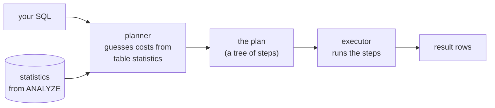
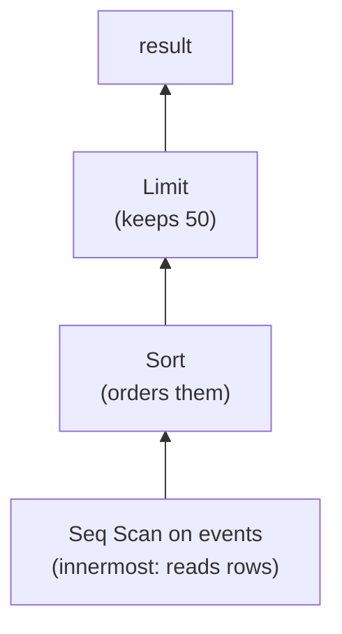
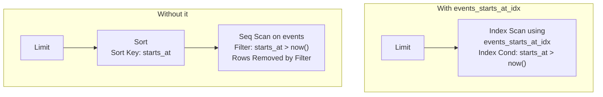

# EXPLAIN and EXPLAIN ANALYZE

History: see [CHANGELOG.md](../CHANGELOG.md) or run `pnpm docs:history`

Area: Data · Status: 📖 explain-only (a tool you run by hand in `psql`; nothing in our code calls it) · Step doc: [23 events index](../../23-events-index.md)

## 1. In one line

`EXPLAIN` shows the **plan** Postgres chose for a query (which scans, which sorts, in what order);
`EXPLAIN ANALYZE` also **runs** the query and adds what really happened (rows, time, pages read).

## 2. Real-life comparison

A taxi satnav. `EXPLAIN` is the route it shows before you leave: "highway, then exit 4, about 20
minutes" (an estimate). `EXPLAIN ANALYZE` is the same route plus the trip log after you drove it:
"the highway took 6 minutes, the exit was closed".

## 3. Picture it

How a query becomes a plan, and why the estimate can be wrong:



A plan is a **tree**. Read it from the **innermost, most-indented line outwards**: the deepest nodes
run first and hand rows to the node above them.



## 4. Where in our code

Not in our app yet: no code runs `EXPLAIN`. It is a manual tool, used in `psql` while writing a
query or reviewing a slow one. What we would build: `log_min_duration_statement` and
`pg_stat_statements` on RDS to find slow queries, and `auto_explain` to log their plans
([metrics](metrics.md)). The query we practise on is `listUpcoming` in
`apps/api/src/queries/events.ts`, served by `events_starts_at_idx` ([indexing](indexing.md)).

## 5. See it yourself

> **Numbers: run it to see yours.** This handbook records no timings for this step, because they
> depend on your machine, your Postgres cache and the day's `now()`. The commands below are the
> experiment; the shapes to look for are described in the sections after them.

The container is `minitickets-postgres-1`, user, database `minitickets` (the same as in
[indexing](indexing.md)). Open a SQL prompt once, then paste the SQL blocks:

```bash
pnpm db:up
pnpm --filter @minitickets/api db:migrate     # creates events_starts_at_idx (migration 0002)
docker exec -it minitickets-postgres-1 psql -U minitickets -d minitickets
```

**Step 1. Make the table big.** 200 000 fake events, spread from about 69 days in the past to about
69 days in the future (so about half are upcoming), all titled `Load test event N` so we can delete
exactly those later. The 12 seed events stay.

```sql
insert into events (title, venue, starts_at, total_seats, seats_left)
select 'Load test event ' || g,
       'Venue ' || (g % 50),
       now() + ((g - 100000) || ' minutes')::interval,
       100, 100
from generate_series(1, 200000) g;

analyze events;          -- refresh the planner's statistics after a bulk load
select count(*) from events;   -- 200012
```

**Step 2. EXPLAIN ANALYZE with the index.** This is the exact SQL `listUpcoming` produces (from
drizzle's `.toSQL()`), with `$1` written as `now()` and `$2` as `50`:

```sql
explain (analyze, buffers)
select "id", "title", "venue", "starts_at", "total_seats", "seats_left", "created_at"
from "events"
where "events"."starts_at" > now()
order by "events"."starts_at" asc
limit 50;
```

Write down: the node names, `Execution Time`, and `Buffers: shared hit=…`.

**Step 3. Drop the index and run the same query again.**

```sql
drop index events_starts_at_idx;

explain (analyze, buffers)
select "id", "title", "venue", "starts_at", "total_seats", "seats_left", "created_at"
from "events"
where "events"."starts_at" > now()
order by "events"."starts_at" asc
limit 50;
```

Compare with step 2: which nodes appeared, how many rows were read, how many buffers.

**Step 4. Put the index back** (so the database matches the migration history). In `psql` each
statement runs by itself (no surrounding transaction), so `CONCURRENTLY` is allowed here:

```sql
create index concurrently events_starts_at_idx on events using btree (starts_at);
select indexrelid::regclass, indisvalid from pg_index where indexrelid = 'events_starts_at_idx'::regclass;  -- indisvalid = t
```

**Step 5. Reset the data.** This deletes only the generated rows:

```sql
delete from events where title like 'Load test event %';
analyze events;
select count(*) from events;   -- 12
```

Then `\q` to leave. (Do the reset before running the e2e tests or opening `/events`, or the page will
show your fake events.) If you would rather not touch your dev data at all, run the same steps in a
throwaway database: `create database scratch;`, connect to it, apply the SQL files from
`apps/api/drizzle/` in order, and `drop database scratch;` afterwards.

**Also try:** `explain select …` (no `analyze`): the plan only, nothing runs. And with the 12 seed
rows only (before step 1) to see Postgres choose a Seq Scan even with the index present.

**Break it on purpose:** in step 2, change `starts_at > now()` to `date(starts_at) > current_date`.
The index can no longer be used, because the column is wrapped in a function.

## 6. How it connects

- **Uses ←** [indexing](indexing.md) (the thing you are checking), [drizzle-schema](drizzle-schema.md) (the queries it builds), [seed-data](seed-data.md) (the 12 rows you add to).
- **Gives →** the evidence for any "add an index" decision; the baseline-then-measure habit from [step 21](../../21-events-list.md); later, the way to check a slow ticket query.

## 7. Our settings and WHY

We use the options `ANALYZE` and `BUFFERS`: `(analyze, buffers)`. WHY: `analyze` gives real times
and row counts; `buffers` shows how many 8 kB pages were touched, which is a steadier measure than
milliseconds (time varies run to run; pages for one plan do not). We use `now()` instead of `$1`
because `psql` has no parameters; the app sends a bound `$1`, which can give a slightly different
plan on repeated runs. (From Postgres 16, `explain (generic_plan)` shows the plan for `$1`.)

## 8. Trade-offs

- **Pros:** shows exactly why a query is slow; free; built in.
- **Cons:**
  - `EXPLAIN ANALYZE` **really runs the query**. For `insert`/`update`/`delete`, wrap it:
    `begin; explain analyze …; rollback;`.
  - The first run may read from disk, later runs from memory (cache). Run it twice and compare
    `shared hit` (memory) with `shared read` (disk).
  - Timing each node adds a small overhead.
  - A laptop with 200 000 rows is not production. Plans change with table size and statistics.

## 9. Alternatives and when to choose them

- **`explain` alone:** when the query is dangerous or very slow and you only need the plan shape.
- **`pg_stat_statements`:** to find *which* queries are slow in the first place (total time, calls).
- **`auto_explain`:** logs the plan of slow queries automatically in production.
- **A visualiser** (pasting plan text into a plan-viewer website): easier on big plans. Do not paste
  production data or secrets into third-party sites.

## 10. What breaks, and how we'd notice

Reading it wrong is the failure here. Common traps: believing `cost` is milliseconds (it is not; it
is a unit used only to compare plans); trusting estimates when `rows=` and `actual rows=` differ by a
lot (run `ANALYZE`); judging from a tiny table; running `EXPLAIN ANALYZE` on a write without a
rollback.

## 13. Interview answers at 3 levels

- **Simple:** `EXPLAIN` shows how the database will run a query; `EXPLAIN ANALYZE` runs it and shows
  the real timing.
- **Senior:** I read the plan from the innermost node outwards. I look at the scan type (`Seq Scan`
  vs `Index Scan`), whether a `Sort` is there, `rows=` (estimate) against `actual rows=`, `Rows Removed
  by Filter` (work thrown away), `loops`, and `Buffers` (`shared hit` from memory, `read` from
  disk). `Execution Time` includes the executor, `Planning Time` is separate. For `listUpcoming`, the
  good plan is `Limit → Index Scan using events_starts_at_idx`; the bad one is `Limit → Sort → Seq
  Scan`.
- **Lead:** Plans are how I make performance decisions evidence-based: baseline first, change one
  thing, compare plan and buffers, not only milliseconds. In production I would find candidates with
  `pg_stat_statements`, capture plans with `auto_explain`, test on production-sized data (plans
  change with size and statistics), and make "attach the EXPLAIN output" part of review for any new
  index or query on a big table.

## 14. Follow-up questions interviewers ask

- *What is the difference between `EXPLAIN` and `EXPLAIN ANALYZE`?* The first only plans; the second also runs the query and reports real numbers.
- *Is it safe on an `UPDATE`?* It really runs the update. Wrap it in a transaction and roll back.
- *What does `cost=0.42..2.47` mean?* Estimated startup cost to the first row, then total cost, in planner units, not milliseconds. (Example format only; run it to see yours.)
- *The estimate says 10 rows, the actual is 100 000. What now?* Statistics are stale or skewed: run `ANALYZE`, check the column's statistics, or use extended statistics.
- *Why do `shared hit` and `shared read` matter?* They show memory versus disk. A cold run reads more.

## 15. Say it in 30 seconds

"`EXPLAIN` shows the plan; `EXPLAIN ANALYZE` runs the query and shows real rows, time and buffers.
I read it from the innermost node outwards and compare estimated rows with actual rows. For our
events list I check that the plan is a Limit over an Index Scan on `events_starts_at_idx`, not a Sort
over a Seq Scan, and I wrap writes in a rolled-back transaction."

## 16. Status

📖 explain-only. **If we built it:** `pg_stat_statements` and `auto_explain` on RDS, slow-query
logging, and plan checks in review for queries on large tables.

## How to read the output, line by line

A plan has this *shape*. The `<…>` are placeholders: **run it to see your numbers**.

```text
Limit  (cost=<startup>..<total> rows=<est> width=<bytes>) (actual time=<first>..<last> rows=<n> loops=<n>)
  Buffers: shared hit=<n> read=<n>
  ->  Index Scan using events_starts_at_idx on events  (cost=… rows=…) (actual time=… rows=<n> loops=1)
        Index Cond: (starts_at > now())
        Buffers: shared hit=<n>
Planning Time: <ms>
Execution Time: <ms>
```

| Line or word | What it means, in simple words |
| --- | --- |
| `Limit` | Stop after N rows. The top node here. If the node below can hand rows over in order, the rest of the work never happens. |
| `Seq Scan on events` | Sequential scan: read **every row** of the table, one after another. Fine for tiny tables, slow for big ones. |
| `Parallel Seq Scan` / `Gather Merge` | Postgres split a big scan across helper workers and merged the sorted results. Seen on larger tables without the index. |
| `Index Scan using events_starts_at_idx` | Walk the index to the matching spot, then read those table rows. |
| `Index Only Scan` | The index alone has every column the query needs, so the table is not visited. (We select all columns, so this does not apply.) |
| `Bitmap Heap Scan` | A middle way for medium result sizes: collect matching row locations from the index first, then read the table in order. |
| `Index Cond` | The condition used **inside the index** to find rows. This is what you want to see. |
| `Filter` | The condition checked **after** reading each row. A filter means the row was read first and may be thrown away. |
| `Rows Removed by Filter` | How many rows were read and then discarded. Large = wasted work. |
| `Sort` / `Sort Key` | Postgres had to order rows itself. If you see this where an index could have given the order, an index may help. |
| `Sort Method: top-N heapsort` | A sort that only keeps the best N rows (because of `LIMIT`), in little memory. `quicksort` means it sorted everything in memory; `external merge Disk: …kB` means it spilled to disk. |
| `cost=A..B` | The planner's **estimate** in made-up units (not milliseconds). A = before the first row, B = all rows. Only compare costs of plans for the same query. |
| `rows=` (in the first brackets) | The **estimated** number of rows this node returns. |
| `width=` | Estimated average row size in bytes. |
| `actual time=A..B` | Real milliseconds (only with `ANALYZE`): A = until the first row, B = until the last row. Per loop. |
| `rows=` (in the second brackets) | The **actual** number of rows. Compare with the estimate: a big gap means stale statistics. |
| `loops=` | How many times this node ran. Multiply the `actual time` by `loops` for the true total. |
| `Buffers: shared hit=` | 8 kB pages found in Postgres's memory cache. |
| `Buffers: shared read=` | 8 kB pages that had to be read from disk (or the OS cache). |
| `Planning Time` | Time to decide the plan. |
| `Execution Time` | Time to run it. This is the number to compare before and after. |

The two plans to compare for `listUpcoming` (node names only; the numbers are yours to find):



What to notice: in the good plan, `actual rows` at the Index Scan is about 50, not the size of the
table (the `Limit` stopped it), and `Buffers` is small. In the bad plan, the Seq Scan reads the whole
table, so its `actual rows` and `Buffers` grow with the table. When the planner uses parallel
workers, the bad plan also shows `Gather Merge` and `Parallel Seq Scan`.

## Why a small table may still show a Seq Scan

With the 12 seed rows the whole table fits in one 8 kB page. Reading one page sequentially is
cheaper than going through the index first, so the planner chooses a Seq Scan even though the index
exists. That is correct. This is also why you must test on realistic data: an index that "does
nothing" in development may matter a lot in production, and an index that looks great in development
may be pointless there.

## Where it appears in the story

- [App story: 10b. Reading events](../app-story.md#10b-reading-events)
