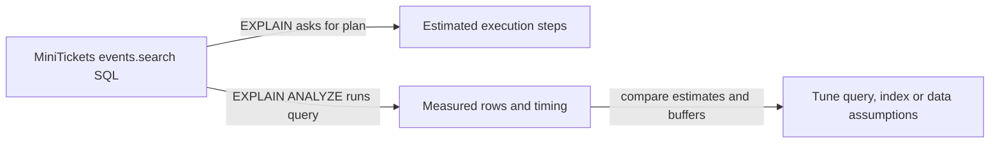

# EXPLAIN and EXPLAIN ANALYZE

History: see [CHANGELOG.md](../CHANGELOG.md) or run `pnpm docs:history`

Area: Data · Status: ✅ built in repository; live acceptance is separate
<!-- interview-card: v2 -->

## 1. What is it?

EXPLAIN shows how Postgres plans to run a query. EXPLAIN ANALYZE actually runs it and reports what happened, including timing and row counts.

## 2. Why do we need it?

MiniTickets may have an index yet still search slowly. We need evidence of scans, sorting and estimation errors before adding more indexes or another cache.

## 3. How does it work?

1. Inspect the estimated plan for a representative query.
2. Run a controlled read with ANALYZE when execution is appropriate.
3. Compare estimated rows, actual work and buffer activity.

## 4. How do we use it in MiniTickets?

The isolated search demo exercises a 10k-event dataset and checks selective trigram-index use. Broad or short search terms can sensibly choose a scan. Production cache sizing and live query performance were not benchmarked for this rewrite.

## 5. Interview-ready answer

“I use EXPLAIN to understand a proposed plan and ANALYZE to compare it with real execution. In MiniTickets that checks whether search benefits from the intended index and how many rows each step handles. I also inspect buffers and representative inputs; a warm run or one selective term does not describe every production request.”

## 6. Important follow-up questions

- **Does ANALYZE execute writes too?** Yes. Never treat it as a harmless description of an UPDATE or DELETE.
- **Why compare estimated and actual rows?** Large gaps can reveal stale statistics or assumptions that lead to poor plans.
- **Does a buffer read prove physical disk access?** No. The operating system may satisfy it from its own cache.
- **What if a sequential scan is chosen?** Check selectivity and table size before assuming the planner is wrong.

## 7. Advanced details

Technical reference

### Current implementation

EXPLAIN is descriptive; EXPLAIN ANALYZE executes the statement. Add BUFFERS to distinguish database buffer hits/reads, remembering OS caching. `pnpm demo:search` is an isolated demo with representative data; its earlier measured evidence is not a production benchmark. Deep offsets, GIN write cost and stable-but-not-snapshot keyset traversal remain relevant query-plan context.

### Technical limits and diagnosis

EXPLAIN describes the estimated plan. EXPLAIN ANALYZE executes the statement, including mutations: never treat it as a harmless description of an UPDATE or DELETE. BUFFERS distinguishes shared hits/reads, but an OS page-cache hit can satisfy a reported database read. Warm and controlled cold runs answer different questions.

The current literal contains query and tuple cursor use the indexes from migration 0008. Historical demo:search executes EXPLAIN ANALYZE against 10k isolated rows and checks selective trigram-index use plus timestamp-tie traversal. It is not a production benchmark or a fresh measurement in this rewrite.

Inspect representative estimated/actual selectivity, rows, sort work and buffers. Broad/short terms can favour scanning; GIN has write/storage cost. Deep OFFSET discards growing prefixes. Keyset cannot jump arbitrarily and does not supply snapshot semantics. Later partitioning, retention or search relevance changes need product and traffic evidence.

### Related reading

- [current system](../00-big-picture.md)
- [scenario](../guides/interview-scenarios.md#indexes-pagination)
- [explorer tour](../guides/infra-explorer.html?tour=search)
- [App story: 10b. Reading events](../app-story.md#10b-reading-events)

[Open this piece in the city explorer](../guides/infra-explorer.html?concept=explain-analyze#chapter=24&piece=code-query).

## Where it appears in the story

- [App story: 10b. Reading events](../app-story.md#10b-reading-events)

