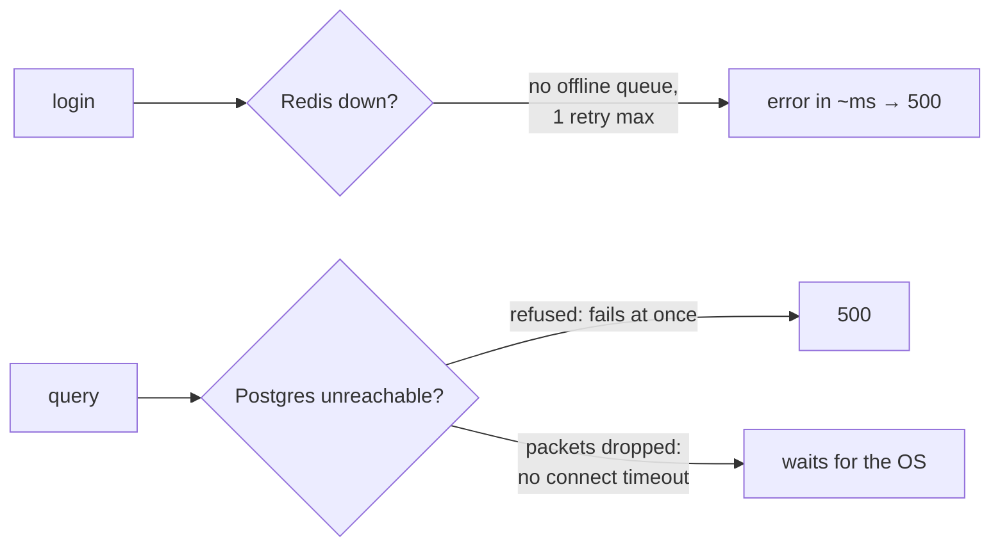

# Fail fast and timeouts when a dependency is down

History: see [CHANGELOG.md](../CHANGELOG.md) or run `pnpm docs:history`

Area: Reliability · Status: 🟡 partial (Redis fails fast; Postgres has no connection timeout) · Step doc: [05 database](../../05-database.md), [07 login](../../07-login-session.md)

## 1. In one line

When a dependency is down, answer with a quick error instead of letting requests hang; our Redis
client does this, and both clients survive connection errors without crashing the process.

## 2. Real-life comparison

A shop assistant who says "the card machine is down, cash only" at once, instead of making the queue
wait twenty minutes hoping it comes back.

## 3. Picture it



## 4. Where in our code

- Anchor: `apps/api/src/redis/client.ts` · `maxRetriesPerRequest: 1`, `enableOfflineQueue: false`, `redis.on("error")`.
- Anchor: `apps/api/src/db/client.ts` · `pool.on("error")`.

Step by step:

1. Redis: with `enableOfflineQueue: false`, a command while disconnected errors immediately instead
   of waiting in a queue; `maxRetriesPerRequest: 1` caps retries of a command.
2. Both clients emit `"error"` when a connection breaks. Node crashes on an unhandled `"error"` event,
   so we log it; the clients reconnect by themselves when the store returns.
3. The service's error becomes a generic 500 ([error-handling](error-handling.md)); `/ready` says
   503 ([health-checks](health-checks.md)); `/health` stays 200, so ECS doesn't restart tasks.
4. **Gap (Postgres):** we set no `connectionTimeoutMillis`; `pg-pool`'s default is "no timeout"
   (verified in the installed `pg-pool` source: the timeout is only armed when the option is set).
   If Postgres refuses connections, the error is immediate; if the network silently drops packets,
   a new connection waits until the operating system gives up. No `statement_timeout` either.

**Measured** with a local api instance whose `REDIS_URL` pointed at a port with nothing listening:
login answered **500 in 0.019 s**; the log said
`"Stream isn't writeable and enableOfflineQueue options is false"`; `/health` 200; `/ready` 503.

## 5. See it yourself

```bash
cd apps/api && PORT=4401 REDIS_URL=redis://localhost:6399 ./node_modules/.bin/tsx --env-file=.env src/server.ts &
PID=$!; sleep 3
curl -s -o /dev/null -w '%{http_code} in %{time_total}s\n' -X POST localhost:4401/trpc/auth.login \
  -H 'content-type: application/json' -d '{"email":"a@example.com","password":"x"}'
kill $PID      # stop only the instance you started
```

**Break it on purpose:** delete both options so ioredis's defaults apply (verified in the installed
ioredis 6.0.0 `RedisOptions.js`: `enableOfflineQueue: true`, `maxRetriesPerRequest: 20`) and
repeat: the login request is queued and waits through up to 20 reconnection attempts before it
fails. (Not measured; the reconnect delays come from ioredis's default `retryStrategy`.)

## 6. How it connects

- **Uses ←** [config-validation](config-validation.md) (fail fast at **startup**; this card is
  fail fast at **request time**), [connection-pooling](connection-pooling.md).
- **Gives →** stable api under dependency outages; the reason we have no app-level
  [circuit-breaker](circuit-breaker.md).

## 7. Our settings and WHY

| Setting | Value | Why |
| ------- | ----- | --- |
| `enableOfflineQueue` | false | No hidden waiting while Redis is gone. |
| `maxRetriesPerRequest` | 1 | Bounded time per command. |
| `"error"` listeners | both clients | One broken connection must not kill the process. |
| pg `connectionTimeoutMillis` | not set | Gap; see section 16. |

## 8. Trade-offs

- **Pros:** quick, honest errors; threads of work don't pile up; the api recovers by itself.
- **Cons:** a one-second Redis blip fails some requests instead of delaying them; Postgres can still
  hang on a network partition.

## 9. Alternatives and when to choose them

- **Circuit breaker** (e.g. `opossum`): stop calling a dependency that keeps failing; worth it when
  calls are slow, not just failing.
- **Timeouts everywhere:** connection, statement, and per-request deadlines.
- **Bulkheads:** separate pools so one slow dependency can't use up all capacity (explain-only card
  `backpressure`).

## 10. What breaks, and how we'd notice

- Postgres unreachable without refusing: requests hang; ALB timeouts and 5xx; nothing alarms yet.
- Removing the `"error"` listener: the first Redis restart crashes the api; ECS restarts it.

## 13. Interview answers at 3 levels

- **Simple:** If a database is down, the api says so right away instead of freezing.
- **Senior:** The Redis client has no offline queue and at most one retry per command, so commands
  fail in milliseconds when Redis is down (I measured a 500 in about 19 ms); both clients log
  `"error"` events instead of crashing and reconnect on their own. The gap is Postgres: no connection
  or statement timeout.
- **Lead:** Every network call needs a deadline. I'd set `connectionTimeoutMillis` and a
  `statement_timeout`, add per-request deadlines, and only then consider circuit breakers for slow
  dependencies.

## 14. Follow-up questions interviewers ask

- *Fail fast vs retry?* Retry briefly for transient errors at the edge (the browser does); inside
  the api, fail quickly and let the caller decide.
- *Why log instead of crash on `"error"`?* The clients reconnect; a crash would turn a blip into an
  outage.

## 15. Say it in 30 seconds

"Redis is configured to fail fast: no offline queue, one retry, so a login with Redis down returns a
500 in about 20 ms instead of hanging. Both clients log errors instead of crashing and reconnect by
themselves. The gap is Postgres, which has no connection or statement timeout yet."

## 16. Status

🟡 partial. **To make it production-grade:** pg `connectionTimeoutMillis` and a `statement_timeout`,
per-request deadlines, alarms on 5xx.

## Where it appears in the story

- [App story: 5. The tRPC context](../app-story.md#5-the-trpc-context)
- [App story: 10. Postgres and Redis](../app-story.md#10-postgres-and-redis)
