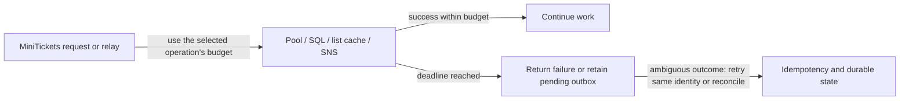

# Fail fast and timeouts when a dependency is down

History: see [CHANGELOG.md](../CHANGELOG.md) or run `pnpm docs:history`

Area: Reliability · Status: ✅ built in repository; live AWS acceptance is separate

<!-- interview-card: v2 -->

## 1. What is it?

Fail-fast behavior stops waiting when work cannot complete within a useful budget. Timeouts protect scarce connections and let callers receive a bounded failure.

## 2. Why do we need it?

If a queue endpoint silently accepts a connection but never replies, a MiniTickets relay should not occupy a database connection forever. It needs a deadline and durable work to retry later.

## 3. How does it work?

1. Set a budget for acquiring resources and for performing the operation.
2. Stop waiting when the relevant deadline expires.
3. Handle uncertain outcomes with stable identity and recovery rather than assuming nothing happened.

## 4. How do we use it in MiniTickets?

MiniTickets gives database work, list-cache calls and background publishing separate budgets. Other Redis calls have retry settings but no hard command deadline. Outbox failure leaves durable work pending. A request-path circuit breaker and overall request deadline remain future work.

## 5. Interview-ready answer

“MiniTickets sets separate budgets for database work, list-cache operations and background publishing. These do not create one overall request deadline, and some Redis calls can still stall. A timeout also cannot prove an operation never committed. Booking retries keep their original identity, and background work remains durable for recovery. A repeated-failure circuit breaker would be a separate design.”

## 6. Important follow-up questions

- **Does SQL timeout bound pool wait?** No. Acquiring a connection has its own timeout.
- **Does a network timeout prove rollback?** No. The remote operation may have completed before the reply was lost.
- **Why not retry indefinitely in the request?** It consumes resources and may exceed a useful user-facing deadline.
- **When might a breaker help?** Repeated slow failures can justify pausing calls and probing recovery, while durable work stays pending.

## 7. Advanced details

Technical reference

### Budgets and implementation

`apps/api/src/db/client.ts` sets **2-second connection/acquisition** and **5-second statement** budgets; statement time includes lock wait but not pool acquisition. The SQL timeout is server-side, not an end-to-end HTTP or network-reply deadline. `apps/api/src/queries/events-cache.ts` wraps public-list cache operations with **100 ms** limits. The shared Redis client disables the offline queue and limits retries, but has no `commandTimeout`; direct session, inventory and rate-limit calls can stall on a connected server that stops replying. Retry limits do not establish a hard command deadline. `apps/api/src/queues/jobs.ts` bounds SDK connect/hard request time. The outbox publisher leaves failed notes pending.

`pnpm demo:outbox` includes a silent queue timeout exercise; no new run/live acceptance is claimed here. An application breaker around `apps/api/src/services/outbox.ts` would need closed/open/half-open state and recovery probes; this is proposed, distinct from the built ECS deployment breaker.

### Design limits and growth

Independent timeouts can exceed the useful request budget when added together; define overall deadlines and leave recovery time. Timeout cannot establish commit outcome. Retrying durable work requires idempotency/reconciliation, not blindly assuming failure. Poorly tuned breakers can suppress useful recovery calls. Future options include pool occupancy/queue telemetry, per-dependency capacity isolation, adaptive limits and end-to-end deadlines.

### Code anchors

- Anchor: `apps/api/src/db/client.ts` — `db`; follow the numbered comments at this boundary.
- Anchor: `apps/api/src/queries/events-cache.ts` — `CACHE_TIMEOUT_MS`; follow the numbered comments at this boundary.
- Anchor: `apps/api/src/redis/client.ts` — `module configuration`; follow the numbered comments at this boundary.

### Related reading

[current system](../00-big-picture.md) · [scenario](../guides/interview-scenarios.md#timeouts-pools) · [explorer tour](../guides/infra-explorer.html?tour=sale-day)

[Open this concept in the city explorer](../guides/infra-explorer.html?concept=fail-fast#chapter=8&piece=api-task).

## Where it appears in the story

- [app-story: 9b. A booking reaches its transaction](../app-story.md#9b-a-booking-reaches-its-transaction)

